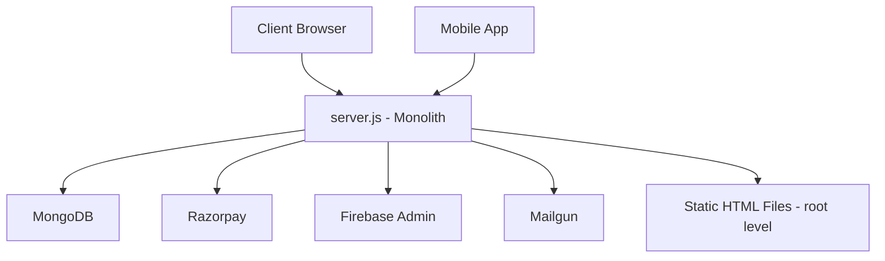
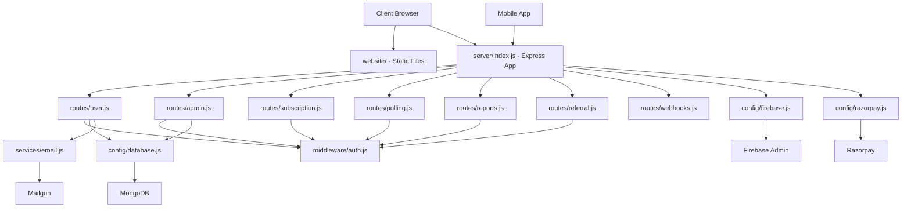
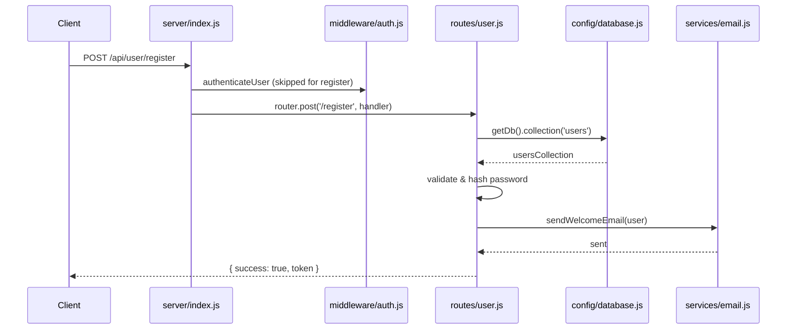
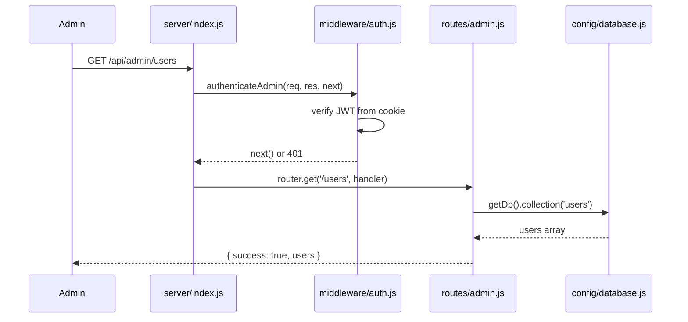

# Design Document: Codebase Restructure

## Overview

The ChoosePure project currently consists of a monolithic `server.js` (~4800 lines) that handles all Express routes, database connections, third-party integrations (Razorpay, Firebase, Mailgun), email sending, PDF generation, and static file serving. HTML pages, email templates, documentation, and the mobile app all live at the root level with no clear separation of concerns.

This restructure splits the codebase into three distinct workspaces — `website/` (static frontend), `server/` (Node.js/Express API), and `mobile-app/` (React Native/Expo) — while preserving all existing API endpoints and functionality. The refactor introduces Express Router for modular route files, extracts shared middleware, centralizes third-party client initialization into config modules, and moves utility functions into dedicated service/helper files.

This is a pure structural refactor with zero functional changes. All API contracts, database schemas, and client-facing behavior remain identical.

## Architecture

### Current Architecture (Monolithic)



### Target Architecture (Modular)



## Sequence Diagrams

### Request Flow Through Modular Architecture



### Admin Route with Authentication



## Components and Interfaces

### Component 1: config/database.js

**Purpose**: Manages MongoDB connection lifecycle and exposes collection accessors.

**Interface**:
```javascript
// config/database.js
module.exports = {
  connectToDatabase(),        // async — connects and initializes indexes
  getDb(),                    // returns the db instance
  getCollection(name),        // returns a specific collection
  isConnected(),              // returns boolean connection status
};
```

**Responsibilities**:
- Establish MongoDB connection with retry logic
- Create all collection indexes on startup
- Expose collection references to route handlers
- Handle reconnection on failure

### Component 2: config/firebase.js

**Purpose**: Initializes Firebase Admin SDK and exports the admin instance.

**Interface**:
```javascript
// config/firebase.js
module.exports = {
  admin,                      // firebase-admin instance (or null if not configured)
  isFirebaseAvailable(),      // returns boolean
};
```

**Responsibilities**:
- Parse FIREBASE_SERVICE_ACCOUNT from environment
- Initialize Firebase Admin with service account credentials
- Gracefully handle missing configuration

### Component 3: config/razorpay.js

**Purpose**: Initializes and exports the Razorpay client instance.

**Interface**:
```javascript
// config/razorpay.js
module.exports = {
  razorpay,                   // Razorpay instance
};
```

**Responsibilities**:
- Create Razorpay client with key_id and key_secret from env
- Log configuration status on startup

### Component 4: middleware/auth.js

**Purpose**: Shared authentication middleware for user and admin routes.

**Interface**:
```javascript
// middleware/auth.js
module.exports = {
  authenticateUser,           // Express middleware — verifies user JWT
  authenticateAdmin,          // Express middleware — verifies admin JWT from cookie
  authenticateSubscribedUser, // Express middleware — verifies user has active subscription
};
```

**Responsibilities**:
- Extract JWT from Authorization header (Bearer token) or cookies
- Verify token signature against JWT_SECRET
- Attach `req.user` with user data from database
- Return 401/403 for invalid/expired tokens
- Check subscription status for premium endpoints

### Component 5: services/email.js

**Purpose**: Handles all email sending via Mailgun.

**Interface**:
```javascript
// services/email.js
module.exports = {
  sendUserWelcomeEmail(email, name, whatsappLink),
  sendAdminNotificationEmail(userData),
  sendPasswordResetEmail(email, resetLink),
  sendBulkEmail(recipients, subject, message, messageType),
  sendInvoiceEmail(email, invoiceData),
  sendNewReportNotification(subscribers, reportData),
};
```

**Responsibilities**:
- Initialize Mailgun client
- Load and populate email templates from `website/email-templates/`
- Send transactional emails (welcome, password reset, invoices)
- Send bulk marketing emails with rate limiting
- Handle email delivery errors gracefully

### Component 6: services/pdf.js

**Purpose**: Generates PDF reports using PDFKit.

**Interface**:
```javascript
// services/pdf.js
module.exports = {
  generateReportPdf(reportData),  // returns Buffer
};
```

**Responsibilities**:
- Create formatted PDF from test report data
- Include headers, tables, scores, and branding
- Return PDF as a Buffer for streaming to client

### Component 7: Route Files

**Purpose**: Each route file encapsulates a domain's API endpoints using Express Router.

| Route File | Prefix | Endpoints |
|---|---|---|
| `routes/user.js` | `/api/user` | register, login, logout, firebase-auth, google-auth, me, profile, change-password, forgot-password, reset-password, fcm-token, feedback, referral-stats |
| `routes/admin.js` | `/api/admin` | login, logout, forgot-password, reset-password, users, waitlist, bulk-email, polls/*, suggestions/*, reports/*, feedback/*, referral-overview, referrals, parse-report/* |
| `routes/subscription.js` | `/api/subscription` | create-order, verify-payment, cancel |
| `routes/polling.js` | `/api/polls` | products (public), vote, verify-payment, free-vote-status, free-vote, suggestions/* |
| `routes/reports.js` | `/api/reports` | list (public), get by id, download pdf |
| `routes/referral.js` | `/api/referral` | (referral-specific endpoints if any beyond user/referral-stats) |
| `routes/webhooks.js` | `/api/razorpay` | webhook |

**Additional routes in index.js**:
- `GET /api/health` — health check
- `GET /api/config/google-client-id` — public config
- `POST /api/waitlist` — waitlist submission
- `POST /api/feedback` — public feedback
- `GET /api/off/*` — Open Food Facts proxy endpoints
- Static page serving routes (`/`, `/dashboard`, `/admin`, etc.)

## Data Models

### Database Collections (unchanged)

```javascript
// Collections managed by config/database.js
const collections = {
  waitlist:                    // { name, email, phone, pincode, createdAt }
  users:                       // { email, password_hash, name, phone, pincode, role, subscriptionStatus, referral_code, ... }
  products:                    // { name, imageUrl, description, status, totalVotes, ... }
  vote_transactions:           // { productId, userId, votes, amount, paymentId, createdAt }
  product_suggestions:         // { productName, category, userName, status, upvotes, upvotedBy[], ... }
  test_reports:                // { productName, brandName, category, purityScore, testParameters[], published, ... }
  subscription_transactions:   // { userId, planType, amount, paymentId, createdAt }
  referrals:                   // { referrer_user_id, referee_user_id, status, ... }
  rewards:                     // { user_id, type, amount, ... }
  feedback:                    // { name, email, message, createdAt }
};
```

**Validation Rules**:
- `users.email`: unique index, required
- `users.referral_code`: unique sparse index
- `test_reports.labReportNumber`: unique sparse index
- `test_reports.barcode`: 13 digits exactly (when provided)
- `test_reports.purityScore`: number between 0 and 100

## Key Functions with Formal Specifications

### Function 1: connectToDatabase()

```javascript
// config/database.js
async function connectToDatabase() {
  const client = new MongoClient(process.env.MONGO_URL, {
    serverSelectionTimeoutMS: 10000,
    connectTimeoutMS: 10000,
  });
  await client.connect();
  db = client.db(process.env.DB_NAME || 'choosepure_db');
  // Initialize all collections and indexes...
  isDbConnected = true;
}
```

**Preconditions:**
- `process.env.MONGO_URL` is a valid MongoDB connection string
- `process.env.DB_NAME` is set (or defaults to 'choosepure_db')
- Network access to MongoDB cluster is available

**Postconditions:**
- `db` is a valid Db instance
- All collection references are initialized
- All required indexes are created
- `isDbConnected` is `true`
- On failure: retries after 5 seconds, `isDbConnected` remains `false`

**Loop Invariants:** N/A (single connection attempt with retry on failure)

### Function 2: authenticateUser(req, res, next)

```javascript
// middleware/auth.js
async function authenticateUser(req, res, next) {
  const token = req.headers.authorization?.replace('Bearer ', '') 
    || req.cookies?.user_token;
  if (!token) return res.status(401).json({ success: false, message: 'No token' });
  
  const decoded = jwt.verify(token, JWT_SECRET);
  const user = await getCollection('users').findOne({ _id: new ObjectId(decoded.id) });
  if (!user) return res.status(401).json({ success: false, message: 'User not found' });
  
  req.user = user;
  next();
}
```

**Preconditions:**
- `req.headers.authorization` contains "Bearer <token>" OR `req.cookies.user_token` exists
- JWT_SECRET environment variable is configured
- Database connection is active

**Postconditions:**
- If valid: `req.user` is populated with full user document, `next()` is called
- If invalid/expired token: responds with 401, `next()` is NOT called
- If user not found in DB: responds with 401, `next()` is NOT called

**Loop Invariants:** N/A

### Function 3: authenticateSubscribedUser(req, res, next)

```javascript
// middleware/auth.js
async function authenticateSubscribedUser(req, res, next) {
  // First authenticate as regular user
  await authenticateUser(req, res, () => {
    // Then check subscription status
    if (req.user.subscriptionStatus !== 'subscribed') {
      return res.status(403).json({ success: false, message: 'Subscription required' });
    }
    next();
  });
}
```

**Preconditions:**
- Same as authenticateUser, plus user must have `subscriptionStatus === 'subscribed'`

**Postconditions:**
- If valid and subscribed: `req.user` populated, `next()` called
- If not subscribed: responds with 403
- If not authenticated: responds with 401

## Algorithmic Pseudocode

### Route File Structure Pattern

```javascript
// Pattern for every route file (e.g., routes/user.js)
const express = require('express');
const router = express.Router();
const { getCollection, isConnected } = require('../config/database');
const { authenticateUser } = require('../middleware/auth');

// Each handler follows this pattern:
router.post('/register', async (req, res) => {
  try {
    if (!isConnected()) {
      return res.status(500).json({ success: false, message: 'Database not connected' });
    }
    const collection = getCollection('users');
    // ... business logic ...
    res.json({ success: true, /* data */ });
  } catch (error) {
    console.error('Error:', error);
    res.status(500).json({ success: false, message: 'Operation failed' });
  }
});

module.exports = router;
```

### server/index.js — Entry Point Assembly

```javascript
// server/index.js — assembles all pieces
const express = require('express');
const cors = require('cors');
const path = require('path');
const cookieParser = require('cookie-parser');
require('dotenv').config();

const { connectToDatabase } = require('./config/database');

// Import route modules
const userRoutes = require('./routes/user');
const adminRoutes = require('./routes/admin');
const subscriptionRoutes = require('./routes/subscription');
const pollingRoutes = require('./routes/polling');
const reportsRoutes = require('./routes/reports');
const referralRoutes = require('./routes/referral');
const webhookRoutes = require('./routes/webhooks');

const app = express();
const PORT = process.env.PORT || 3000;

// Global middleware
app.use(cors({
  origin: ['https://choosepure.in', 'https://www.choosepure.in', 'http://localhost:3000'],
  credentials: true
}));
app.use(express.json());
app.use(express.urlencoded({ extended: true }));
app.use(cookieParser());

// Serve static website files
app.use(express.static(path.join(__dirname, '..', 'website')));
app.use(express.static(path.join(__dirname, '..', 'website', 'public')));

// Mount route modules
app.use('/api/user', userRoutes);
app.use('/api/admin', adminRoutes);
app.use('/api/subscription', subscriptionRoutes);
app.use('/api/polls', pollingRoutes);
app.use('/api/reports', reportsRoutes);
app.use('/api/referral', referralRoutes);
app.use('/api/razorpay', webhookRoutes);

// Health check & config (remain in index.js)
app.get('/api/health', (req, res) => { /* ... */ });
app.get('/api/config/google-client-id', (req, res) => { /* ... */ });

// Static page routes
app.get('/', (req, res) => res.sendFile(path.join(__dirname, '..', 'website', 'index.html')));
// ... other page routes ...

// Connect to database and start server
connectToDatabase().then(() => {
  app.listen(PORT, () => console.log(`Server running on port ${PORT}`));
});
```

### config/database.js — Full Implementation Pattern

```javascript
// config/database.js
const { MongoClient } = require('mongodb');

let db = null;
let client = null;
let isDbConnected = false;

async function connectToDatabase() {
  try {
    if (!process.env.MONGO_URL) {
      throw new Error('MONGO_URL environment variable is not set');
    }

    client = new MongoClient(process.env.MONGO_URL, {
      serverSelectionTimeoutMS: 10000,
      connectTimeoutMS: 10000,
    });

    await client.connect();
    await client.db().admin().ping();

    db = client.db(process.env.DB_NAME || 'choosepure_db');

    // Create all indexes
    await db.collection('waitlist').createIndex({ email: 1 }, { unique: true });
    await db.collection('users').createIndex({ email: 1 }, { unique: true });
    await db.collection('users').createIndex({ role: 1 });
    await db.collection('users').createIndex({ referral_code: 1 }, { unique: true, sparse: true });
    await db.collection('products').createIndex({ status: 1, totalVotes: -1 });
    await db.collection('vote_transactions').createIndex({ productId: 1 });
    await db.collection('vote_transactions').createIndex({ createdAt: -1 });
    await db.collection('product_suggestions').createIndex({ status: 1, upvotes: -1 });
    await db.collection('product_suggestions').createIndex({ createdAt: -1 });
    await db.collection('test_reports').createIndex({ published: 1, createdAt: -1 });
    await db.collection('test_reports').createIndex({ category: 1 });
    await db.collection('test_reports').createIndex({ barcode: 1 }, { sparse: true });
    await db.collection('test_reports').createIndex({ brandName: 1 });
    await db.collection('test_reports').createIndex({ labReportNumber: 1 }, { unique: true, sparse: true });
    await db.collection('subscription_transactions').createIndex({ userId: 1 });
    await db.collection('subscription_transactions').createIndex({ createdAt: -1 });
    await db.collection('referrals').createIndex({ referrer_user_id: 1 });
    await db.collection('referrals').createIndex({ referee_user_id: 1 });
    await db.collection('referrals').createIndex({ referrer_user_id: 1, referee_user_id: 1 }, { unique: true });
    await db.collection('rewards').createIndex({ user_id: 1 });
    await db.collection('feedback').createIndex({ createdAt: -1 });

    isDbConnected = true;
    console.log('✅ Connected to MongoDB');
  } catch (error) {
    console.error('❌ MongoDB connection error:', error.message);
    isDbConnected = false;
    setTimeout(connectToDatabase, 5000);
  }
}

function getDb() {
  return db;
}

function getCollection(name) {
  if (!db) throw new Error('Database not connected');
  return db.collection(name);
}

function isConnected() {
  return isDbConnected;
}

module.exports = { connectToDatabase, getDb, getCollection, isConnected };
```

### middleware/auth.js — Full Implementation Pattern

```javascript
// middleware/auth.js
const jwt = require('jsonwebtoken');
const { ObjectId } = require('mongodb');
const { getCollection, isConnected } = require('../config/database');

const JWT_SECRET = process.env.SECRET_KEY || 'your-secret-key-change-this';

function authenticateAdmin(req, res, next) {
  const token = req.cookies.admin_token;
  if (!token) {
    return res.status(401).json({ success: false, message: 'Admin authentication required' });
  }
  try {
    const decoded = jwt.verify(token, JWT_SECRET);
    if (decoded.role !== 'admin') {
      return res.status(403).json({ success: false, message: 'Admin access required' });
    }
    req.admin = decoded;
    next();
  } catch (error) {
    return res.status(401).json({ success: false, message: 'Invalid or expired token' });
  }
}

async function authenticateUser(req, res, next) {
  const token = req.headers.authorization?.replace('Bearer ', '')
    || req.cookies?.user_token;

  if (!token) {
    return res.status(401).json({ success: false, message: 'Authentication required' });
  }

  try {
    const decoded = jwt.verify(token, JWT_SECRET);
    if (!isConnected()) {
      return res.status(500).json({ success: false, message: 'Database not connected' });
    }
    const usersCollection = getCollection('users');
    const user = await usersCollection.findOne({ _id: new ObjectId(decoded.id) });

    if (!user) {
      return res.status(401).json({ success: false, message: 'User not found' });
    }

    req.user = {
      id: user._id,
      email: user.email,
      name: user.name,
      role: user.role,
      subscriptionStatus: user.subscriptionStatus,
      subscriptionExpiry: user.subscriptionExpiry,
      referral_code: user.referral_code,
    };
    next();
  } catch (error) {
    return res.status(401).json({ success: false, message: 'Invalid or expired token' });
  }
}

async function authenticateSubscribedUser(req, res, next) {
  await authenticateUser(req, res, () => {
    if (!req.user) return; // authenticateUser already sent response
    const status = req.user.subscriptionStatus;
    if (status !== 'subscribed') {
      return res.status(403).json({ success: false, message: 'Active subscription required' });
    }
    next();
  });
}

module.exports = { authenticateAdmin, authenticateUser, authenticateSubscribedUser, JWT_SECRET };
```

## Example Usage

### Route File Example: routes/user.js (partial)

```javascript
const express = require('express');
const router = express.Router();
const bcrypt = require('bcrypt');
const jwt = require('jsonwebtoken');
const { getCollection, isConnected } = require('../config/database');
const { authenticateUser, JWT_SECRET } = require('../middleware/auth');
const { admin, isFirebaseAvailable } = require('../config/firebase');
const { sendUserWelcomeEmail } = require('../services/email');

// POST /api/user/register
router.post('/register', async (req, res) => {
  try {
    if (!isConnected()) {
      return res.status(500).json({ success: false, message: 'Database not connected' });
    }
    const { name, email, password, phone, pincode } = req.body;
    const usersCollection = getCollection('users');

    // Check if user already exists
    const existing = await usersCollection.findOne({ email: email.toLowerCase() });
    if (existing) {
      return res.status(409).json({ success: false, message: 'Email already registered' });
    }

    // Hash password and create user
    const hashedPassword = await bcrypt.hash(password, 10);
    const user = { name, email: email.toLowerCase(), password: hashedPassword, phone, pincode, role: 'user', createdAt: new Date() };
    const result = await usersCollection.insertOne(user);

    // Generate JWT
    const token = jwt.sign({ id: result.insertedId, email: user.email }, JWT_SECRET, { expiresIn: '7d' });

    // Send welcome email (fire-and-forget)
    sendUserWelcomeEmail(email, name, process.env.WHATSAPP_GROUP_LINK).catch(console.error);

    res.json({ success: true, token, user: { id: result.insertedId, name, email: user.email } });
  } catch (error) {
    console.error('Registration error:', error);
    res.status(500).json({ success: false, message: 'Registration failed' });
  }
});

// GET /api/user/me
router.get('/me', authenticateUser, (req, res) => {
  res.json({ success: true, user: req.user });
});

module.exports = router;
```

### Route File Example: routes/webhooks.js

```javascript
const express = require('express');
const router = express.Router();
const crypto = require('crypto');
const { ObjectId } = require('mongodb');
const { getCollection, isConnected } = require('../config/database');

// POST /api/razorpay/webhook
router.post('/webhook', async (req, res) => {
  try {
    const webhookSecret = process.env.RAZORPAY_WEBHOOK_SECRET;
    if (!webhookSecret) {
      console.error('RAZORPAY_WEBHOOK_SECRET not configured');
      return res.status(500).json({ success: false });
    }

    const signature = req.headers['x-razorpay-signature'];
    const expectedSignature = crypto
      .createHmac('sha256', webhookSecret)
      .update(JSON.stringify(req.body))
      .digest('hex');

    if (expectedSignature !== signature) {
      return res.status(400).json({ success: false });
    }

    const event = req.body.event;
    const payload = req.body.payload;
    // ... handle subscription.activated, subscription.cancelled, etc.

    res.status(200).json({ success: true });
  } catch (error) {
    console.error('Webhook error:', error);
    res.status(200).json({ success: true }); // Always 200 to prevent retries
  }
});

module.exports = router;
```

## Correctness Properties

### Property 1: Endpoint Preservation

For every route `app.METHOD(path, ...)` in the original `server.js`, the restructured codebase must respond identically to the same HTTP method + path combination. No endpoints are added, removed, or have their paths changed.

### Property 2: Middleware Order Preservation

Authentication middleware must execute in the same order relative to route handlers. Routes that required `authenticateUser` or `authenticateAdmin` in the monolith must still require the same middleware in the modular version.

### Property 3: Static File Serving Equivalence

All HTML pages previously served from the root directory must remain accessible at the same URL paths after moving to `website/`. A request to `GET /` still returns `index.html`, `GET /admin` still returns `admin.html`, etc.

### Property 4: Database Connection Singleton

Only one MongoDB connection is established regardless of how many route files import `config/database.js`. Node.js module caching ensures the module is executed once and all importers share the same `db` instance.

### Property 5: Environment Variable Compatibility

The restructured server must use the exact same environment variable names — no renames, no new required variables. Deployment works with the existing `.env` file unchanged.

### Property 6: Response Shape Invariance

Every API endpoint must return the same JSON response shape (field names, types, status codes) as the original monolith. Clients (mobile app, website JS) require no changes.

### Property 7: Error Handling Consistency

Error responses must maintain the same `{ success: false, message: string }` pattern with identical HTTP status codes for all error conditions.

## Error Handling

### Error Scenario 1: Database Not Connected

**Condition**: Route handler called before MongoDB connection is established or after connection drops
**Response**: `{ success: false, message: 'Database not connected' }` with HTTP 500
**Recovery**: Background retry every 5 seconds via `connectToDatabase()` retry logic

### Error Scenario 2: Invalid/Expired JWT

**Condition**: Request with missing, malformed, or expired authentication token
**Response**: `{ success: false, message: 'Authentication required' }` with HTTP 401
**Recovery**: Client must re-authenticate (login again)

### Error Scenario 3: Module Import Failure

**Condition**: Circular dependency or missing module during restructure
**Response**: Server fails to start with clear error message
**Recovery**: Fix import paths; use dependency injection pattern if circular deps arise

### Error Scenario 4: Static File Not Found

**Condition**: HTML file moved but route still points to old path
**Response**: Express returns 404
**Recovery**: Update `path.join()` references to use `../website/` prefix

## Testing Strategy

### Unit Testing Approach

- Test each route file in isolation by mocking `config/database.js` and `services/email.js`
- Test middleware functions with mock `req`, `res`, `next` objects
- Verify that each route handler returns expected status codes and response shapes

### Integration Testing Approach

- Start the restructured server and hit every endpoint with the same requests used against the monolith
- Compare response bodies and status codes between old and new
- Verify static file serving returns correct HTML content

### Smoke Test Checklist (Manual)

1. `GET /` → returns index.html
2. `GET /api/health` → returns `{ status: 'ok' }`
3. `POST /api/user/register` → creates user
4. `POST /api/user/login` → returns JWT
5. `GET /api/user/me` (with token) → returns user profile
6. `POST /api/admin/login` → returns admin token
7. `GET /api/admin/users` (with admin cookie) → returns user list
8. `GET /api/reports` → returns published reports
9. `GET /api/polls/products` → returns active products
10. `POST /api/razorpay/webhook` (with valid signature) → returns 200

## Performance Considerations

- **No performance regression**: The restructure adds no new middleware layers or database calls. Express Router has negligible overhead.
- **Module caching**: Node.js `require()` caches modules, so `config/database.js` is only executed once regardless of how many route files import it.
- **Static file serving**: `express.static()` pointing to `../website/` has identical performance to serving from root.
- **Memory**: Splitting into multiple files has no meaningful memory impact — all code is loaded at startup regardless.

## Security Considerations

- **No security changes**: All authentication, authorization, CORS, and input validation logic is preserved exactly as-is.
- **Secret handling**: Environment variables remain the same. No secrets are moved or exposed.
- **CORS configuration**: Identical allowed origins list maintained in `server/index.js`.
- **Cookie settings**: `httpOnly`, `secure`, `sameSite` cookie attributes preserved in auth middleware.

## Migration Plan

### Step-by-Step File Movement

#### Phase 1: Create Directory Structure

```
mkdir -p server/config server/middleware server/routes server/services server/utils
mkdir -p website/public website/email-templates
mkdir -p docs
```

#### Phase 2: Move Static Website Files

| Source (root) | Destination |
|---|---|
| `index.html` | `website/index.html` |
| `purity-wall.html` | `website/purity-wall.html` |
| `akshayakalpa-report.html` | `website/akshayakalpa-report.html` |
| `farmmade-eggs-report.html` | `website/farmmade-eggs-report.html` |
| `heritage-report.html` | `website/heritage-report.html` |
| `deep-dive.html` | `website/deep-dive.html` |
| `contact-us.html` | `website/contact-us.html` |
| `admin.html` | `website/admin.html` |
| `admin-login.html` | `website/admin-login.html` |
| `admin-forgot-password.html` | `website/admin-forgot-password.html` |
| `admin-reset-password.html` | `website/admin-reset-password.html` |
| `user-reset-password.html` | `website/user-reset-password.html` |
| `product-lookup.html` | `website/product-lookup.html` |
| `namdhari-report.html` | `website/namdhari-report.html` |
| `polling.html` | `website/polling.html` |
| `public/*` | `website/public/*` |
| `email-templates/*` | `website/email-templates/*` |

#### Phase 3: Move Documentation

| Source (root) | Destination |
|---|---|
| `DEPLOYMENT.md` | `docs/DEPLOYMENT.md` |
| `ANALYTICS_SETUP.md` | `docs/ANALYTICS_SETUP.md` |
| `META_PIXEL_SETUP.md` | `docs/META_PIXEL_SETUP.md` |

#### Phase 4: Rename Mobile App Folder

```
mv "mobile app" mobile-app
```

#### Phase 5: Create Server Module Files

1. **`server/package.json`** — Copy from root, update `main` to `index.js`, update `start` script to `node index.js`
2. **`server/config/database.js`** — Extract MongoDB connection logic (lines 65–195 of server.js)
3. **`server/config/firebase.js`** — Extract Firebase init (lines 17–33 of server.js)
4. **`server/config/razorpay.js`** — Extract Razorpay init (lines 52–65 of server.js)
5. **`server/middleware/auth.js`** — Extract `authenticateAdmin`, `authenticateUser`, `authenticateSubscribedUser` (lines 361–485)
6. **`server/services/email.js`** — Extract Mailgun init + `sendUserEmail`, `sendAdminEmail`, and all email functions
7. **`server/services/pdf.js`** — Extract PDF generation logic from the `/api/reports/:id/pdf` handler
8. **`server/utils/helpers.js`** — Extract `generateReferralCode`, `extendSubscriptionExpiry`, `addToWhatsAppCommunity`, `isValidBarcode`, `normaliseProduct`, `normaliseSearchResults`, OFF cache functions
9. **`server/routes/user.js`** — All `/api/user/*` routes
10. **`server/routes/admin.js`** — All `/api/admin/*` routes
11. **`server/routes/subscription.js`** — All `/api/subscription/*` routes
12. **`server/routes/polling.js`** — All `/api/polls/*` routes + `/api/suggestions/*` routes
13. **`server/routes/reports.js`** — All `/api/reports/*` routes + `/api/off/*` proxy routes
14. **`server/routes/referral.js`** — Referral-specific routes (user referral stats are in user.js)
15. **`server/routes/webhooks.js`** — `/api/razorpay/webhook`
16. **`server/index.js`** — Entry point that assembles everything

#### Phase 6: Update Root Files

1. **Root `package.json`** — Remove server dependencies, keep only workspace-level scripts or remove entirely
2. **`.gitignore`** — Add `server/node_modules/`, `mobile-app/node_modules/`
3. **`README.md`** — Update with new project structure documentation

#### Phase 7: Update Render Deployment

Update Render service configuration:
- **Root Directory**: `server`
- **Build Command**: `npm install`
- **Start Command**: `npm start`

The `server/package.json` will have:
```json
{
  "name": "choosepure-server",
  "version": "1.0.0",
  "main": "index.js",
  "scripts": {
    "start": "node index.js",
    "dev": "nodemon index.js"
  }
}
```

## Route-to-File Mapping (Detailed)

### routes/user.js — All endpoints under `/api/user`

| Method | Path | Auth | Line in server.js |
|---|---|---|---|
| POST | /register | none | 488 |
| POST | /firebase-auth | none | 648 |
| POST | /fcm-token | authenticateUser | 799 |
| DELETE | /fcm-token | authenticateUser | 836 |
| POST | /login | none | 856 |
| POST | /logout | none | 956 |
| POST | /google-auth | none | 978 |
| GET | /me | authenticateUser | 1177 |
| PUT | /profile | authenticateUser | 1197 |
| POST | /change-password | authenticateUser | 1290 |
| POST | /forgot-password | none | 1345 |
| POST | /reset-password | none | 1470 |
| POST | /feedback | authenticateUser | 3130 |
| GET | /referral-stats | authenticateUser | 3197 |

### routes/admin.js — All endpoints under `/api/admin`

| Method | Path | Auth | Line in server.js |
|---|---|---|---|
| POST | /login | none | 1930 |
| POST | /logout | none | 2034 |
| POST | /forgot-password | none | 2040 |
| POST | /reset-password | none | 2161 |
| GET | /users | authenticateAdmin | 2269 |
| GET | /waitlist | authenticateAdmin | 2298 |
| POST | /waitlist | authenticateAdmin | 2329 |
| DELETE | /waitlist/:id | authenticateAdmin | 2382 |
| POST | /bulk-email | authenticateAdmin | 2418 |
| POST | /polls/products | authenticateAdmin | 2549 |
| GET | /polls/products | authenticateAdmin | 2612 |
| PUT | /polls/products/:id/status | authenticateAdmin | 2640 |
| DELETE | /polls/products/:id | authenticateAdmin | 2686 |
| GET | /polls/transactions | authenticateAdmin | 2723 |
| POST | /polls/manual-vote | authenticateAdmin | 2781 |
| GET | /suggestions | authenticateAdmin | 3513 |
| PUT | /suggestions/:id/status | authenticateAdmin | 3532 |
| DELETE | /suggestions/:id | authenticateAdmin | 3563 |
| POST | /suggestions/:id/convert | authenticateAdmin | 3584 |
| POST | /reports | authenticateAdmin | 3645 |
| GET | /reports | authenticateAdmin | 3786 |
| PUT | /reports/:id | authenticateAdmin | 3816 |
| DELETE | /reports/:id | authenticateAdmin | 3896 |
| GET | /feedback | authenticateAdmin | 3163 |
| DELETE | /feedback/:id | authenticateAdmin | 3178 |
| GET | /referral-overview | authenticateAdmin | 3230 |
| GET | /referrals | authenticateAdmin | 3257 |
| GET | /parse-report/:filename | authenticateAdmin | ~4800 |

### routes/subscription.js — All endpoints under `/api/subscription`

| Method | Path | Auth | Line in server.js |
|---|---|---|---|
| POST | /create-order | authenticateUser | 4201 |
| POST | /verify-payment | authenticateUser | 4247 |
| POST | /cancel | authenticateUser | 4374 |

### routes/polling.js — All endpoints under `/api/polls` + `/api/suggestions`

| Method | Path | Auth | Line in server.js |
|---|---|---|---|
| GET | /products | none | 2893 |
| POST | /vote | authenticateUser | 2922 |
| POST | /verify-payment | authenticateUser | 2996 |
| GET | /free-vote-status | authenticateUser | 3300 |
| POST | /free-vote | authenticateUser | 3331 |

Note: `/api/suggestions` routes are mounted separately in index.js:
| POST | /api/suggestions | authenticateUser | 3412 |
| GET | /api/suggestions | none | 3454 |
| POST | /api/suggestions/:id/upvote | authenticateUser | 3473 |

### routes/reports.js — All endpoints under `/api/reports` + `/api/off`

| Method | Path | Auth | Line in server.js |
|---|---|---|---|
| GET | / | none (optional auth) | 3922 |
| GET | /:id | none (checks subscription internally) | 4006 |
| GET | /:id/pdf | authenticateSubscribedUser | 4084 |

Open Food Facts proxy (also in this file or a separate `routes/openfoodfacts.js`):
| GET | /api/off/product/:barcode | none | ~4600 |
| GET | /api/off/nutriscore | none | ~4680 |
| GET | /api/off/search | none | ~4790 |

### routes/webhooks.js — Razorpay webhook

| Method | Path | Auth | Line in server.js |
|---|---|---|---|
| POST | /webhook | signature verification | 4404 |

### Remaining in server/index.js

| Method | Path | Purpose |
|---|---|---|
| GET | /api/health | Health check |
| GET | /api/config/google-client-id | Public config |
| POST | /api/waitlist | Waitlist submission |
| POST | /api/feedback | Public feedback (unauthenticated) |
| GET | / | Serve index.html |
| GET | /dashboard, /purity-wall | Serve purity-wall.html |
| GET | /deep-dive | Serve deep-dive.html |
| GET | /contact | Serve contact-us.html |
| GET | /product-lookup | Serve product-lookup.html |
| GET | /namdhari-report | Serve namdhari-report.html |
| GET | /polling | Serve polling.html |
| GET | /admin | Serve admin.html (with cookie check) |
| GET | /admin/login | Serve admin-login.html |
| GET | /admin/forgot-password | Serve admin-forgot-password.html |
| GET | /admin/reset-password | Serve admin-reset-password.html |
| GET | /user/reset-password | Serve user-reset-password.html |

## Deployment Configuration Update

### Render Service Changes

**Before** (current):
```
Root Directory: . (or empty)
Build Command: npm install
Start Command: npm start
```

**After** (restructured):
```
Root Directory: server
Build Command: npm install
Start Command: npm start
```

### Static File Serving Path Update

The key change in `server/index.js`:

```javascript
// Before (in monolithic server.js):
app.use(express.static(__dirname));
app.use(express.static(path.join(__dirname, 'public')));

// After (in server/index.js):
app.use(express.static(path.join(__dirname, '..', 'website')));
app.use(express.static(path.join(__dirname, '..', 'website', 'public')));
```

Page-serving routes update:
```javascript
// Before:
app.get('/', (req, res) => res.sendFile(path.join(__dirname, 'index.html')));

// After:
const websitePath = path.join(__dirname, '..', 'website');
app.get('/', (req, res) => res.sendFile(path.join(websitePath, 'index.html')));
```

### Email Template Path Update

```javascript
// In services/email.js:
const templateDir = path.join(__dirname, '..', '..', 'website', 'email-templates');
```

## Dependencies

All dependencies remain the same — no new packages are introduced:

**Server dependencies** (from current package.json):
- express, cors, cookie-parser, dotenv
- mongodb, bcrypt, jsonwebtoken
- firebase-admin, google-auth-library
- razorpay, form-data, mailgun.js
- pdfkit, crypto (built-in)

**Dev dependencies**:
- nodemon

**Mobile app**: Unchanged (separate package.json in `mobile-app/`)

## Final Directory Structure

```
choosepure/
├── README.md
├── .gitignore
├── .env                         # Stays at root (referenced by server/index.js via dotenv path)
├── website/
│   ├── index.html
│   ├── purity-wall.html
│   ├── akshayakalpa-report.html
│   ├── farmmade-eggs-report.html
│   ├── heritage-report.html
│   ├── namdhari-report.html
│   ├── deep-dive.html
│   ├── contact-us.html
│   ├── polling.html
│   ├── product-lookup.html
│   ├── admin.html
│   ├── admin-login.html
│   ├── admin-forgot-password.html
│   ├── admin-reset-password.html
│   ├── user-reset-password.html
│   ├── public/
│   │   └── (images, favicon, CSS, JS assets)
│   └── email-templates/
│       ├── new-report-farmmade-eggs.html
│       ├── new-report-kriti.html
│       ├── new-report-notification.html
│       └── voting-reminder.html
├── server/
│   ├── package.json
│   ├── index.js
│   ├── config/
│   │   ├── database.js
│   │   ├── firebase.js
│   │   └── razorpay.js
│   ├── middleware/
│   │   ├── auth.js
│   │   └── validation.js
│   ├── routes/
│   │   ├── user.js
│   │   ├── admin.js
│   │   ├── subscription.js
│   │   ├── polling.js
│   │   ├── reports.js
│   │   ├── referral.js
│   │   ├── suggestions.js
│   │   ├── openfoodfacts.js
│   │   └── webhooks.js
│   ├── services/
│   │   ├── email.js
│   │   └── pdf.js
│   └── utils/
│       └── helpers.js
├── mobile-app/
│   ├── package.json
│   ├── App.js
│   └── (existing Expo/RN structure)
└── docs/
    ├── DEPLOYMENT.md
    ├── ANALYTICS_SETUP.md
    └── META_PIXEL_SETUP.md
```
