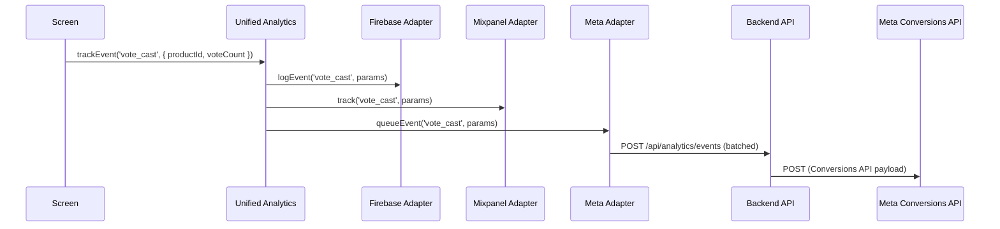
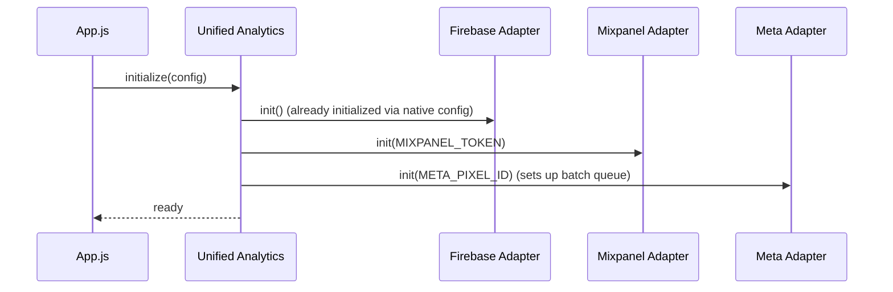
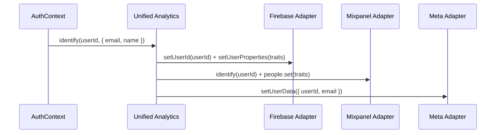

# Design Document: Comprehensive Analytics Integration

## Overview

This design describes a unified analytics layer for the ChoosePure mobile app (React Native + Expo SDK 52) that fans out every tracked event to three providers simultaneously: Firebase Analytics (already integrated), Mixpanel (new), and Meta/Facebook (new, via server-side Conversions API).

The app currently has ~26 screens across 5 tabs (Home, Scan, Vote, History, Profile). Firebase Analytics already tracks screen views and a handful of events. This design introduces a single `analytics` service that all screens and hooks call, which internally dispatches to provider-specific adapters. This ensures consistent event naming, eliminates provider lock-in, and makes adding/removing providers trivial.

The Meta integration uses a server-side approach (Conversions API via the existing backend) to avoid native SDK complexity in Expo's managed workflow. Mixpanel uses the official `mixpanel-react-native` package directly on-device.

## Architecture

```mermaid
graph TD
    subgraph Mobile App
        A[Screens & Components] -->|trackEvent / trackScreen| B[Unified Analytics Service]
        B --> C[Firebase Adapter]
        B --> D[Mixpanel Adapter]
        B --> E[Meta Adapter]
    end

    C -->|@react-native-firebase/analytics| F[Firebase Analytics]
    D -->|mixpanel-react-native SDK| G[Mixpanel]
    E -->|POST /api/analytics/events| H[Backend API]
    H -->|Conversions API| I[Meta/Facebook]
```


## Sequence Diagrams

### Event Tracking Flow



### Initialization Flow



### User Identification Flow




## Components and Interfaces

### Component 1: Unified Analytics Service (`src/services/analytics/index.js`)

**Purpose**: Single entry point for all analytics calls. Fans out events to all registered provider adapters.

**Interface**:
```javascript
// src/services/analytics/index.js

/**
 * Initialize all analytics providers. Call once in App.js on mount.
 * @param {AnalyticsConfig} config
 * @returns {Promise<void>}
 */
export async function initAnalytics(config) {}

/**
 * Track a named event with optional properties.
 * @param {string} eventName - Snake_case event name
 * @param {Record<string, any>} [properties] - Event properties
 * @returns {Promise<void>}
 */
export async function trackEvent(eventName, properties = {}) {}

/**
 * Track a screen view.
 * @param {string} screenName - Name of the screen
 * @param {Record<string, any>} [properties] - Additional properties
 * @returns {Promise<void>}
 */
export async function trackScreen(screenName, properties = {}) {}

/**
 * Identify a user across all providers.
 * @param {string} userId - Unique user ID
 * @param {Record<string, any>} [traits] - User traits (email, name, etc.)
 * @returns {Promise<void>}
 */
export async function identify(userId, traits = {}) {}

/**
 * Reset/logout across all providers.
 * @returns {Promise<void>}
 */
export async function reset() {}
```

**Responsibilities**:
- Maintain a registry of provider adapters
- Call each adapter's corresponding method in parallel (Promise.allSettled)
- Swallow individual adapter failures — analytics must never crash the app
- Provide debug logging in __DEV__ mode


### Component 2: Firebase Adapter (`src/services/analytics/firebase.js`)

**Purpose**: Wraps `@react-native-firebase/analytics`. Extends the existing `src/services/firebase/analytics.js` into adapter form.

**Interface**:
```javascript
// src/services/analytics/firebase.js

export const firebaseAdapter = {
  name: 'firebase',

  async init() {},
  // Firebase is auto-initialized via native config — this is a no-op

  async trackEvent(eventName, properties) {},
  // Calls analytics().logEvent(eventName, properties)

  async trackScreen(screenName, properties) {},
  // Calls analytics().logScreenView({ screen_name, screen_class })

  async identify(userId, traits) {},
  // Calls analytics().setUserId(userId) + setUserProperties(traits)

  async reset() {},
  // Calls analytics().setUserId(null) + resetAnalyticsData()
};
```

### Component 3: Mixpanel Adapter (`src/services/analytics/mixpanel.js`)

**Purpose**: Wraps `mixpanel-react-native` SDK for direct on-device tracking.

**Interface**:
```javascript
// src/services/analytics/mixpanel.js

export const mixpanelAdapter = {
  name: 'mixpanel',

  async init(config) {},
  // new Mixpanel(config.mixpanelToken, trackAutomaticEvents)
  // mixpanel.init()

  async trackEvent(eventName, properties) {},
  // mixpanel.track(eventName, properties)

  async trackScreen(screenName, properties) {},
  // mixpanel.track('screen_view', { screen_name: screenName, ...properties })

  async identify(userId, traits) {},
  // mixpanel.identify(userId)
  // mixpanel.getPeople().set(traits)

  async reset() {},
  // mixpanel.reset()
};
```

### Component 4: Meta Adapter (`src/services/analytics/meta.js`)

**Purpose**: Sends events to the backend which forwards them to Meta's Conversions API. Uses a batching strategy to minimize network calls.

**Interface**:
```javascript
// src/services/analytics/meta.js

export const metaAdapter = {
  name: 'meta',

  async init(config) {},
  // Stores pixelId and sets up batch queue with flush interval

  async trackEvent(eventName, properties) {},
  // Adds event to queue; flushes if queue >= BATCH_SIZE

  async trackScreen(screenName, properties) {},
  // Adds PageView-equivalent event to queue

  async identify(userId, traits) {},
  // Stores user data for inclusion in subsequent events

  async reset() {},
  // Clears stored user data, flushes remaining queue

  async flush() {},
  // POST /api/analytics/events with batched events to backend
};
```


## Data Models

### AnalyticsConfig

```javascript
/**
 * @typedef {Object} AnalyticsConfig
 * @property {string} mixpanelToken - Mixpanel project token
 * @property {string} metaPixelId - Meta/Facebook Pixel ID
 * @property {number} [metaBatchSize=10] - Events before auto-flush to backend
 * @property {number} [metaFlushInterval=30000] - Max ms between flushes (30s default)
 * @property {boolean} [debug=false] - Enable verbose logging
 */
```

### AnalyticsEvent (internal queue item for Meta batching)

```javascript
/**
 * @typedef {Object} QueuedEvent
 * @property {string} eventName - Snake_case event name
 * @property {Record<string, any>} properties - Event properties
 * @property {number} timestamp - Unix timestamp (ms)
 * @property {string|null} userId - User ID if identified
 * @property {Record<string, any>} userData - Hashed user traits for Meta
 */
```

### Backend Analytics Payload (POST /api/analytics/events)

```javascript
/**
 * @typedef {Object} AnalyticsBatchPayload
 * @property {string} pixelId - Meta Pixel ID
 * @property {QueuedEvent[]} events - Array of queued events
 * @property {string} platform - 'ios' | 'android'
 * @property {string} appVersion - Current app version
 */
```

### Event Catalog

| Category | Event Name | Properties | Screens |
|----------|-----------|------------|---------|
| Screen | `screen_view` | screen_name, screen_class | All (auto via navigation) |
| Auth | `sign_up` | method (email/google/phone) | RegisterScreen, OTPScreen |
| Auth | `login` | method (email/google/phone) | LoginScreen, OTPScreen |
| Auth | `logout` | — | ProfileScreen |
| Onboarding | `onboarding_started` | — | OnboardingScreen |
| Onboarding | `onboarding_completed` | slide_count | OnboardingScreen |
| Onboarding | `onboarding_skipped` | slide_index | OnboardingScreen |
| Reports | `report_viewed` | report_id, product_name | ReportDetailScreen |
| Reports | `report_pdf_downloaded` | report_id, product_name | ReportDetailScreen |
| Subscription | `subscribe_tapped` | screen, plan | SubscriptionScreen, DashboardScreen |
| Subscription | `subscription_started` | plan, amount | SubscriptionScreen |
| Subscription | `subscription_cancelled` | plan | SubscriptionScreen |
| Voting | `vote_cast` | product_id, vote_count | PollingScreen |
| Voting | `vote_payment_completed` | product_id, amount | PollingScreen |
| Scanning | `product_scanned` | barcode | ScannerScreen |
| Scanning | `manual_barcode_entered` | barcode | ScannerScreen |
| Referral | `referral_shared` | method (whatsapp/copy/other) | ReferralScreen |
| Referral | `referral_code_copied` | — | ReferralScreen |
| CTA | `cta_tapped` | cta_name, screen | Multiple screens |
| Profile | `profile_edited` | fields_changed | EditProfileScreen |
| Profile | `rate_app_tapped` | — | ProfileScreen |


## Algorithmic Pseudocode

### Unified trackEvent Algorithm

```javascript
/**
 * ALGORITHM: trackEvent
 * INPUT: eventName (string), properties (object)
 * OUTPUT: void (fire-and-forget)
 */
async function trackEvent(eventName, properties = {}) {
  // PRECONDITION: eventName is non-empty string
  // PRECONDITION: adapters have been initialized via initAnalytics()

  if (!eventName || typeof eventName !== 'string') {
    console.warn('[Analytics] Invalid event name:', eventName);
    return;
  }

  const enrichedProps = {
    ...properties,
    timestamp: Date.now(),
    app_version: APP_VERSION,
    platform: Platform.OS,
  };

  // Fan out to all adapters in parallel; never throw
  const results = await Promise.allSettled(
    adapters.map(adapter => adapter.trackEvent(eventName, enrichedProps))
  );

  // Log failures in dev mode
  if (__DEV__) {
    results.forEach((result, i) => {
      if (result.status === 'rejected') {
        console.warn(`[Analytics][${adapters[i].name}] Failed:`, result.reason);
      }
    });
  }

  // POSTCONDITION: Event dispatched to all available adapters
  // POSTCONDITION: No exceptions propagated to caller
}
```

### Meta Batching Algorithm

```javascript
/**
 * ALGORITHM: Meta Event Batching
 * Queues events locally, flushes to backend in batches.
 */
const META_BATCH_SIZE = 10;
const META_FLUSH_INTERVAL = 30000; // 30 seconds

let eventQueue = [];
let flushTimer = null;
let userData = null;

function queueEvent(eventName, properties) {
  // PRECONDITION: init() has been called

  eventQueue.push({
    eventName,
    properties,
    timestamp: Date.now(),
    userId: userData?.userId || null,
    userData: userData?.traits || {},
  });

  // Flush immediately if batch is full
  if (eventQueue.length >= META_BATCH_SIZE) {
    flush();
  }

  // LOOP INVARIANT: eventQueue.length < META_BATCH_SIZE after flush
}

async function flush() {
  if (eventQueue.length === 0) return;

  const batch = [...eventQueue];
  eventQueue = [];

  try {
    await apiClient.post('/api/analytics/events', {
      pixelId: META_PIXEL_ID,
      events: batch,
      platform: Platform.OS,
      appVersion: APP_VERSION,
    });
  } catch (error) {
    // Re-queue failed events (max retry once)
    if (!batch[0]._retried) {
      batch.forEach(e => { e._retried = true; });
      eventQueue.unshift(...batch);
    }
    console.warn('[Analytics][Meta] Flush failed:', error.message);
  }

  // POSTCONDITION: batch sent to backend OR re-queued for one retry
}

function startFlushTimer() {
  flushTimer = setInterval(flush, META_FLUSH_INTERVAL);
}

function stopFlushTimer() {
  if (flushTimer) clearInterval(flushTimer);
}
```


### Initialization Algorithm

```javascript
/**
 * ALGORITHM: initAnalytics
 * INPUT: config (AnalyticsConfig)
 * OUTPUT: void
 *
 * PRECONDITION: Called exactly once in App.js useEffect on mount
 * POSTCONDITION: All adapters initialized, ready to receive events
 */
async function initAnalytics(config) {
  const adapterModules = [firebaseAdapter, mixpanelAdapter, metaAdapter];

  const results = await Promise.allSettled(
    adapterModules.map(adapter => adapter.init(config))
  );

  // Only register successfully initialized adapters
  adapters = adapterModules.filter((_, i) => results[i].status === 'fulfilled');

  if (__DEV__) {
    console.log('[Analytics] Initialized adapters:', adapters.map(a => a.name));
    results.forEach((r, i) => {
      if (r.status === 'rejected') {
        console.warn(`[Analytics] ${adapterModules[i].name} init failed:`, r.reason);
      }
    });
  }
}
```

### Screen Tracking Integration

```javascript
/**
 * ALGORITHM: Navigation State Change Handler
 * Called by NavigationContainer.onStateChange in App.js
 *
 * PRECONDITION: navigationRef.current is valid
 * POSTCONDITION: screen_view event sent to all providers
 */
function onNavigationStateChange() {
  const currentRouteName = navigationRef.current?.getCurrentRoute()?.name;
  const previousRouteName = routeNameRef.current;

  if (currentRouteName && currentRouteName !== previousRouteName) {
    trackScreen(currentRouteName, { previous_screen: previousRouteName });
  }

  routeNameRef.current = currentRouteName;
}
```


## Key Functions with Formal Specifications

### Function: trackEvent()

```javascript
async function trackEvent(eventName, properties = {})
```

**Preconditions:**
- `eventName` is a non-empty string matching `/^[a-z][a-z0-9_]{0,39}$/`
- `properties` values are serializable (string, number, boolean)
- `initAnalytics()` has completed successfully

**Postconditions:**
- Event dispatched to all initialized adapters
- No exceptions propagated to caller (all failures caught)
- In `__DEV__`, failures logged to console

**Loop Invariants:** N/A

---

### Function: identify()

```javascript
async function identify(userId, traits = {})
```

**Preconditions:**
- `userId` is a non-empty string
- `traits` is a flat object with string values
- At least one adapter is initialized

**Postconditions:**
- User identity set in all providers (Firebase UID, Mixpanel distinct_id, Meta external_id)
- Subsequent events include user context
- Provider-specific PII hashing applied (Meta requires SHA-256 for email/phone)

**Loop Invariants:** N/A

---

### Function: reset()

```javascript
async function reset()
```

**Preconditions:**
- Analytics has been initialized

**Postconditions:**
- Firebase: userId set to null, analytics data reset
- Mixpanel: distinct_id reset to anonymous
- Meta: userData cleared, remaining events flushed with anonymous context

---

### Function: metaAdapter.flush()

```javascript
async function flush()
```

**Preconditions:**
- `eventQueue` is an array (may be empty)
- `apiClient` is configured with valid base URL and auth headers

**Postconditions:**
- If queue was empty: no-op
- If queue had events: POST to backend, queue cleared
- On network failure: events re-queued with `_retried = true` (max 1 retry)
- On second failure: events dropped silently

**Loop Invariants:**
- Queue length never exceeds `2 * META_BATCH_SIZE` (batch + re-queued batch)


## Example Usage

### Initialization in App.js

```javascript
import { initAnalytics, trackScreen } from './src/services/analytics';
import { MIXPANEL_TOKEN, META_PIXEL_ID } from './src/config/analytics';

useEffect(() => {
  initAnalytics({
    mixpanelToken: MIXPANEL_TOKEN,
    metaPixelId: META_PIXEL_ID,
    metaBatchSize: 10,
    metaFlushInterval: 30000,
    debug: __DEV__,
  });
}, []);

// In NavigationContainer onStateChange:
const onNavigationStateChange = () => {
  const currentRoute = navigationRef.current?.getCurrentRoute()?.name;
  if (currentRoute && currentRoute !== routeNameRef.current) {
    trackScreen(currentRoute, { previous_screen: routeNameRef.current });
  }
  routeNameRef.current = currentRoute;
};
```

### Auth Events

```javascript
import { trackEvent, identify, reset } from '../services/analytics';

// On sign up
async function handleSignUp(method) {
  await registerUser(credentials);
  trackEvent('sign_up', { method }); // 'email' | 'google' | 'phone'
  identify(user.uid, { email: user.email, name: user.displayName });
}

// On login
async function handleLogin(method) {
  await loginUser(credentials);
  trackEvent('login', { method });
  identify(user.uid, { email: user.email });
}

// On logout
async function handleLogout() {
  trackEvent('logout');
  reset();
  await signOut();
}
```

### Scanning Events

```javascript
import { trackEvent } from '../services/analytics';

// In ScannerScreen after successful scan
function onBarcodeScanned(barcode) {
  trackEvent('product_scanned', { barcode });
  navigateToResult(barcode);
}

// Manual entry
function onManualSubmit(barcode) {
  trackEvent('manual_barcode_entered', { barcode });
  navigateToResult(barcode);
}
```

### Voting Events

```javascript
import { trackEvent } from '../services/analytics';

// In PollingScreen
function onVoteCast(productId, newCount) {
  trackEvent('vote_cast', { product_id: productId, vote_count: newCount });
}

function onPaymentComplete(productId, amount) {
  trackEvent('vote_payment_completed', { product_id: productId, amount });
}
```

### CTA Tracking (generic, reusable)

```javascript
import { trackEvent } from '../services/analytics';

// Wrap any CTA button
function onCtaPress(ctaName, screenName) {
  trackEvent('cta_tapped', { cta_name: ctaName, screen: screenName });
}

// Usage: <Button onPress={() => onCtaPress('subscribe_banner', 'Dashboard')} />
```


## Correctness Properties

*A property is a characteristic or behavior that should hold true across all valid executions of a system—essentially, a formal statement about what the system should do. Properties serve as the bridge between human-readable specifications and machine-verifiable correctness guarantees.*

### Property 1: Fan-out completeness

*For any* analytics operation (trackEvent, trackScreen, identify, reset) and *for any* set of adapters in the Adapter_Registry, each adapter SHALL receive exactly one invocation with the same arguments (enriched where applicable).

**Validates: Requirements 2.1, 4.3, 5.1, 6.1**

### Property 2: Event enrichment

*For any* input properties object passed to trackEvent, the properties received by each adapter SHALL be a superset of the original properties and SHALL additionally contain `timestamp` (number), `platform` (string), and `app_version` (string).

**Validates: Requirements 2.2**

### Property 3: Fault isolation

*For any* set of adapters where one or more adapters throw during a dispatch call, the remaining adapters SHALL still receive and process the event, and no exception SHALL propagate to the caller.

**Validates: Requirements 2.3, 11.1, 11.2, 11.3**

### Property 4: Initialization filtering

*For any* set of provider adapters where each adapter either resolves or rejects during initialization, the Adapter_Registry SHALL contain exactly those adapters whose init method resolved successfully.

**Validates: Requirements 1.2, 1.3**

### Property 5: Event name validation

*For any* string input as an event name, the Unified_Analytics_Service SHALL dispatch the event to adapters if and only if the name matches the pattern `/^[a-z][a-z0-9_]{0,39}$/`. Invalid names SHALL be discarded.

**Validates: Requirements 2.4, 3.1, 3.2**

### Property 6: Screen tracking de-duplication

*For any* sequence of navigation state changes, consecutive state changes to the same route name SHALL NOT produce duplicate screen_view events. Only transitions to a different route SHALL trigger trackScreen.

**Validates: Requirements 4.1, 4.2**

### Property 7: Meta queue size invariant

*For any* sequence of trackEvent calls and flush outcomes (success or failure) on the Meta_Adapter, the Event_Queue length SHALL never exceed `2 * metaBatchSize`.

**Validates: Requirements 9.8, 9.7**

### Property 8: Meta batch trigger

*For any* sequence of events queued to the Meta_Adapter, a Batch_Flush SHALL be triggered immediately when the Event_Queue length reaches the configured metaBatchSize.

**Validates: Requirements 9.3**

### Property 9: Meta retry-then-drop

*For any* batch of events that fails to flush, the Meta_Adapter SHALL re-queue those events with a retry flag. If those re-queued events fail a second time, they SHALL be discarded (not re-queued again).

**Validates: Requirements 9.6, 9.7**

### Property 10: Identity persistence in Meta events

*For any* event queued to the Meta_Adapter after an identify(userId, traits) call, the queued event SHALL include the userId and userData fields until reset() is called.

**Validates: Requirements 5.4, 6.4**

### Property 11: Pre-initialization safety

*For any* analytics call (trackEvent, trackScreen, identify, reset) made before initAnalytics has completed, the call SHALL be a no-op producing no errors and no adapter invocations.

**Validates: Requirements 2.5**

### Property 12: Debug logging conditionality

*For any* analytics dispatch, debug logging (event names, properties, adapter failures) SHALL be active if and only if the app is running in development mode. In production mode, no analytics debug output SHALL be produced.

**Validates: Requirements 13.1, 13.2, 13.3**

### Property 13: Backend payload validation

*For any* POST request to the Backend_Endpoint with a body missing the pixelId field or the events array, the endpoint SHALL return a 400 status code with a descriptive error.

**Validates: Requirements 10.3**

### Property 14: Adapter SDK pass-through

*For any* event name and properties, each adapter SHALL call its underlying SDK with the correct method and parameters: Firebase calls logEvent/logScreenView, Mixpanel calls track, and Meta queues with all required fields (eventName, properties, timestamp, userId, userData).

**Validates: Requirements 7.2, 7.3, 8.2, 8.3, 9.2**

## Error Handling

### Scenario 1: Mixpanel SDK Init Failure

**Condition**: `mixpanel-react-native` throws during `init()` (e.g., invalid token, no network)
**Response**: Mixpanel adapter excluded from active adapters list. Firebase and Meta continue normally.
**Recovery**: On next app cold start, initialization retried automatically.

### Scenario 2: Meta Backend Unreachable

**Condition**: POST to `/api/analytics/events` returns network error or 5xx
**Response**: Events re-queued with `_retried` flag. Timer continues attempting flushes.
**Recovery**: Events are retried once on next flush cycle. After second failure, events are dropped to prevent unbounded queue growth.

### Scenario 3: Firebase Not Initialized

**Condition**: `isFirebaseInitialized()` returns false (e.g., missing GoogleService-Info.plist in dev)
**Response**: Firebase adapter's `init()` resolves but adapter is effectively a no-op. All methods check initialization state.
**Recovery**: Automatic on next launch with proper config.

### Scenario 4: Invalid Event Name

**Condition**: Caller passes empty string, null, or name exceeding 40 chars
**Response**: Warning logged in dev. Event silently dropped (not forwarded to adapters).
**Recovery**: Developer fixes at call site. No data corruption.

### Scenario 5: App Backgrounded with Queued Meta Events

**Condition**: User backgrounds app while Meta queue has unsent events
**Response**: AppState listener triggers immediate `flush()` on background transition.
**Recovery**: Events sent before OS suspends the process. If flush fails, events lost (acceptable tradeoff).


## Testing Strategy

### Unit Testing Approach

Test each adapter in isolation with mocked SDKs:

- **Firebase adapter**: Mock `@react-native-firebase/analytics` — verify `logEvent`, `logScreenView`, `setUserId` called with correct params
- **Mixpanel adapter**: Mock `mixpanel-react-native` Mixpanel class — verify `track`, `identify`, `reset` called correctly
- **Meta adapter**: Mock `apiClient.post` — verify batch payload structure, queue behavior, retry logic
- **Unified service**: Mock all adapters — verify fan-out, error isolation, enrichment

### Property-Based Testing Approach

**Property Test Library**: fast-check (already in devDependencies)

Properties to test with fast-check:

1. **Fan-out property**: For any arbitrary event name and properties object, `trackEvent` calls all adapter `trackEvent` methods exactly once.
2. **Enrichment property**: For any input properties, the properties passed to adapters always contain `timestamp` (number), `platform` (string), `app_version` (string) in addition to original props.
3. **Batch size property**: For any sequence of N events queued to the Meta adapter, the queue length never exceeds `2 * META_BATCH_SIZE`.
4. **Event name validation property**: For any string input, `trackEvent` only forwards to adapters if the name matches the valid pattern.

### Integration Testing Approach

- Verify end-to-end flow: `trackEvent` → all three adapters fire (using dev/staging provider accounts)
- Verify Meta batching: queue 15 events → verify 1 flush of 10 + queue of 5 remaining
- Verify identity: `identify` → subsequent events include userId in all adapters
- Verify AppState flush: simulate background → verify pending Meta events flushed

## Performance Considerations

- **Non-blocking**: All `trackEvent` calls are fire-and-forget (no await at call site). Screens never wait for analytics.
- **Batching**: Meta events are batched (default 10 events per POST) to minimize network overhead.
- **Timer-based flush**: Maximum 30s delay for Meta events ensures timely delivery without excessive network usage.
- **Memory bounds**: Meta queue capped at `2 * BATCH_SIZE` to prevent memory growth on prolonged offline periods.
- **Parallel dispatch**: `Promise.allSettled` ensures adapters run concurrently, not sequentially.
- **Lazy SDK init**: Mixpanel instance created once and reused; no per-event allocation.

## Security Considerations

- **PII hashing**: Meta Conversions API requires SHA-256 hashing of email and phone before transmission. The backend handles hashing before forwarding to Meta.
- **Token storage**: `MIXPANEL_TOKEN` and `META_PIXEL_ID` stored in environment config (not hardcoded). These are client-side tokens (not secrets) but kept in config for easy rotation.
- **No sensitive data in events**: Event properties must never include passwords, full credit card numbers, or other PII beyond userId/email.
- **Backend auth**: POST to `/api/analytics/events` uses the existing authenticated API client (JWT in headers).
- **Data minimization**: Only necessary properties sent per event. No device identifiers beyond what SDKs collect automatically.

## Dependencies

| Package | Purpose | Version | Notes |
|---------|---------|---------|-------|
| `@react-native-firebase/analytics` | Firebase Analytics | ^24.0.0 | Already installed |
| `mixpanel-react-native` | Mixpanel SDK | ^3.0.0 | New dependency |
| `axios` | HTTP client (for Meta batching) | ^1.7.0 | Already installed (via apiClient) |
| `fast-check` | Property-based testing | ^3.22.0 | Already in devDependencies |

**Not adding**: `react-native-fbsdk-next` — avoided due to Expo managed workflow complexity. Server-side Conversions API approach used instead.

### File Structure

```
src/services/analytics/
├── index.js          # Unified analytics service (public API)
├── firebase.js       # Firebase Analytics adapter
├── mixpanel.js       # Mixpanel adapter
├── meta.js           # Meta/Facebook adapter (server-side batching)
└── constants.js      # Event name constants and validation

src/config/
└── analytics.js      # MIXPANEL_TOKEN, META_PIXEL_ID, batch config
```
