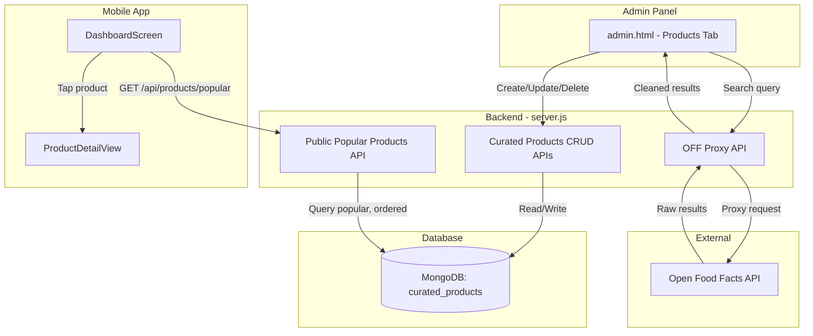
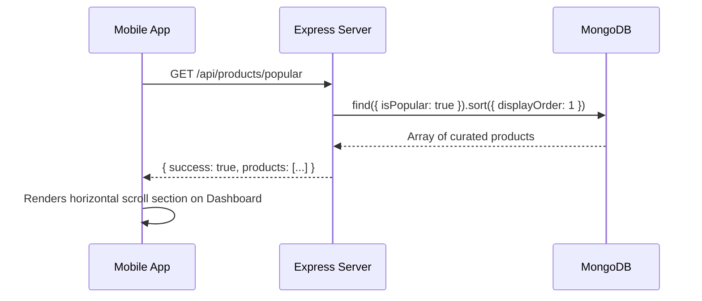

# Design Document: Curated Products

## Overview

The Curated Products feature allows the ChoosePure admin to search Open Food Facts (OFF), select products, clean up their data (name, images, descriptions), and save polished versions to a dedicated MongoDB collection. These curated products are then surfaced as a "Popular Products" section on the mobile app's Dashboard. This decouples the curated experience from the real-time OFF barcode lookup — the admin owns the final content quality.

The system has three layers: an admin-facing search + edit UI in `admin.html`, a set of backend CRUD APIs protected by the existing `authenticateAdmin` middleware, and a public mobile endpoint that serves curated products ordered by `displayOrder`.

## Architecture



## Sequence Diagrams

### Admin: Search & Curate a Product

```mermaid
sequenceDiagram
    participant Admin as Admin Panel
    participant Server as Express Server
    participant OFF as Open Food Facts
    participant DB as MongoDB

    Admin->>Server: GET /api/admin/off-search?q=amul+butter
    Server->>OFF: GET https://world.openfoodfacts.org/cgi/search.pl?search_terms=amul+butter&json=1
    OFF-->>Server: Raw product results (JSON)
    Server-->>Admin: Cleaned results (name, brand, image, barcode, nutriscore)

    Admin->>Admin: Clicks "Add" → Opens edit form pre-filled with OFF data
    Admin->>Admin: Edits fields (name, image, description, etc.)
    Admin->>Server: POST /api/admin/curated-products {productName, brand, imageUrl, ...}
    Server->>DB: insertOne into curated_products
    DB-->>Server: Inserted document with _id
    Server-->>Admin: { success: true, product: {...} }
```

### Mobile: Fetch Popular Products



## Components and Interfaces

### Component 1: Admin Products Tab (Frontend)

**Purpose**: Provides the UI for searching OFF, previewing results, editing product data, and managing the curated products list.

**Interface**:
```javascript
// Tab activation
function switchTab('products') → void

// OFF Search
async function searchOFF(query: string) → OFFSearchResult[]

// CRUD operations
async function saveCuratedProduct(productData: CuratedProductInput) → CuratedProduct
async function updateCuratedProduct(id: string, productData: CuratedProductInput) → CuratedProduct
async function deleteCuratedProduct(id: string) → void
async function loadCuratedProducts() → CuratedProduct[]
```

**Responsibilities**:
- Render search box and trigger OFF proxy search
- Display OFF results as cards with "Add" button
- Open modal edit form pre-filled with OFF data
- Allow image URL override or custom image upload (base64 or URL)
- Submit create/update/delete requests to backend
- Render list of all curated products with edit/delete actions

### Component 2: Backend API Routes (server.js)

**Purpose**: Handles OFF proxy search, CRUD for curated products, and the public popular products endpoint.

**Interface**:
```javascript
// Admin routes (protected by authenticateAdmin)
app.get('/api/admin/off-search', authenticateAdmin, offSearchHandler)
app.get('/api/admin/curated-products', authenticateAdmin, listCuratedProducts)
app.post('/api/admin/curated-products', authenticateAdmin, createCuratedProduct)
app.put('/api/admin/curated-products/:id', authenticateAdmin, updateCuratedProduct)
app.delete('/api/admin/curated-products/:id', authenticateAdmin, deleteCuratedProduct)

// Public route (no auth required)
app.get('/api/products/popular', getPopularProducts)
```

**Responsibilities**:
- Proxy OFF search and normalize results for admin consumption
- Validate and persist curated product documents
- Enforce unique barcode constraint (sparse — barcode is optional)
- Return popular products sorted by displayOrder for mobile

### Component 3: Mobile Popular Products Section (DashboardScreen)

**Purpose**: Fetches and displays curated popular products as a horizontal scrollable section.

**Interface**:
```javascript
// Data fetching hook
function usePopularProducts() → { products: CuratedProduct[], loading: boolean, error: string | null }

// UI component
function PopularProductsSection({ products, onProductPress }) → JSX.Element
```

**Responsibilities**:
- Fetch popular products on mount and on pull-to-refresh
- Render horizontal FlatList with product cards
- Navigate to product detail on tap

## Data Models

### Model 1: CuratedProduct (MongoDB Document)

```javascript
/**
 * MongoDB Collection: curated_products
 */
const CuratedProductSchema = {
  _id: ObjectId,                          // Auto-generated
  productName: String,                    // Required — display name
  brand: String,                          // Brand name
  imageUrl: String,                       // Cleaned/custom image URL
  barcode: String,                        // Unique sparse index (nullable)
  category: String,                       // Product category
  description: String,                    // Admin-written description
  nutriscoreGrade: String,               // One of: 'A', 'B', 'C', 'D', 'E'
  ingredients: String,                    // Ingredients text
  tags: [String],                         // Array of tags for filtering
  source: String,                         // 'open_food_facts' | 'manual'
  offProductId: String,                   // Original OFF product code (if sourced from OFF)
  isPopular: Boolean,                     // Default: true
  displayOrder: Number,                   // Sort order for mobile display
  createdAt: Date,                        // Auto-set on insert
  updatedAt: Date                         // Auto-set on insert and update
}
```

**Validation Rules**:
- `productName` is required and must be non-empty string
- `nutriscoreGrade` must be one of `['A', 'B', 'C', 'D', 'E']` or null
- `source` must be one of `['open_food_facts', 'manual']`
- `barcode` if provided must be a string of digits (no format enforcement beyond string)
- `displayOrder` defaults to 0 if not provided
- `isPopular` defaults to true

**Indexes**:
- `{ barcode: 1 }` — unique, sparse
- `{ isPopular: 1, displayOrder: 1 }` — for mobile popular query
- `{ createdAt: -1 }` — for admin list sorting

### Model 2: OFFSearchResult (API Response Shape)

```javascript
/**
 * Shape returned by GET /api/admin/off-search
 */
const OFFSearchResult = {
  name: String,           // product_name from OFF
  brand: String,          // brands field
  barcode: String,        // OFF product code
  imageUrl: String,       // image_front_url or image_url
  nutriscoreGrade: String, // nutriscore_grade
  categories: String,     // categories field from OFF
  ingredients: String     // ingredients_text
}
```

### Model 3: CuratedProductInput (Create/Update Request Body)

```javascript
/**
 * Request body for POST/PUT /api/admin/curated-products
 */
const CuratedProductInput = {
  productName: String,       // Required
  brand: String,             // Optional
  imageUrl: String,          // Optional
  barcode: String,           // Optional
  category: String,          // Optional
  description: String,       // Optional
  nutriscoreGrade: String,   // Optional, validated enum
  ingredients: String,       // Optional
  tags: [String],            // Optional, defaults to []
  source: String,            // Required: 'open_food_facts' | 'manual'
  offProductId: String,      // Optional, set when source is OFF
  isPopular: Boolean,        // Optional, defaults to true
  displayOrder: Number       // Optional, defaults to 0
}
```

## Algorithmic Pseudocode

### OFF Proxy Search Algorithm

```javascript
/**
 * GET /api/admin/off-search?q=<query>
 * Proxies search to Open Food Facts and normalizes results
 */
async function offSearchHandler(req, res) {
  // PRECONDITION: req.query.q is a non-empty string
  // POSTCONDITION: Returns array of normalized OFF products (max 20)
  
  const query = req.query.q?.trim()
  if (!query) {
    return res.status(400).json({ success: false, message: 'Search query required' })
  }

  // Check in-memory cache first
  const cacheKey = `off-search:${query.toLowerCase()}`
  const cached = offCacheGet(cacheKey)
  if (cached) {
    return res.json({ success: true, products: cached })
  }

  // Fetch from Open Food Facts search API
  const url = `https://world.openfoodfacts.org/cgi/search.pl?search_terms=${encodeURIComponent(query)}&json=1&page_size=20&fields=product_name,brands,code,image_url,image_front_url,nutriscore_grade,categories,ingredients_text`
  
  const response = await fetch(url)
  const data = await response.json()
  
  // Normalize results
  const products = (data.products || []).map(p => ({
    name: p.product_name || '',
    brand: p.brands || '',
    barcode: p.code || '',
    imageUrl: p.image_front_url || p.image_url || null,
    nutriscoreGrade: p.nutriscore_grade || null,
    categories: p.categories || '',
    ingredients: p.ingredients_text || ''
  })).filter(p => p.name) // Only include products with a name

  // Cache results
  offCacheSet(cacheKey, products)

  return res.json({ success: true, products })
}
```

**Preconditions:**
- Admin is authenticated (enforced by `authenticateAdmin` middleware)
- `req.query.q` is provided and non-empty after trimming

**Postconditions:**
- Returns `{ success: true, products: OFFSearchResult[] }` with at most 20 items
- Each product has at least a non-empty `name`
- Results are cached for 24 hours to avoid repeated OFF queries
- No mutation to database

### Create Curated Product Algorithm

```javascript
/**
 * POST /api/admin/curated-products
 * Validates input and inserts a new curated product document
 */
async function createCuratedProduct(req, res) {
  // PRECONDITION: req.body contains at least { productName, source }
  // POSTCONDITION: New document inserted into curated_products collection
  
  const { productName, brand, imageUrl, barcode, category, description,
          nutriscoreGrade, ingredients, tags, source, offProductId,
          isPopular, displayOrder } = req.body

  // Validate required fields
  if (!productName || !productName.trim()) {
    return res.status(400).json({ success: false, message: 'Product name is required' })
  }
  if (!source || !['open_food_facts', 'manual'].includes(source)) {
    return res.status(400).json({ success: false, message: 'Source must be open_food_facts or manual' })
  }

  // Validate nutriscore if provided
  if (nutriscoreGrade && !['A', 'B', 'C', 'D', 'E'].includes(nutriscoreGrade.toUpperCase())) {
    return res.status(400).json({ success: false, message: 'Invalid nutriscore grade' })
  }

  // Check barcode uniqueness (if provided)
  if (barcode) {
    const existing = await curatedProductsCollection.findOne({ barcode })
    if (existing) {
      return res.status(409).json({ success: false, message: 'A product with this barcode already exists' })
    }
  }

  const now = new Date()
  const document = {
    productName: productName.trim(),
    brand: brand || '',
    imageUrl: imageUrl || '',
    barcode: barcode || null,
    category: category || '',
    description: description || '',
    nutriscoreGrade: nutriscoreGrade ? nutriscoreGrade.toUpperCase() : null,
    ingredients: ingredients || '',
    tags: Array.isArray(tags) ? tags : [],
    source,
    offProductId: offProductId || null,
    isPopular: isPopular !== false,  // defaults to true
    displayOrder: typeof displayOrder === 'number' ? displayOrder : 0,
    createdAt: now,
    updatedAt: now
  }

  const result = await curatedProductsCollection.insertOne(document)
  document._id = result.insertedId

  return res.status(201).json({ success: true, product: document })
}
```

**Preconditions:**
- Admin is authenticated
- `req.body.productName` is a non-empty string
- `req.body.source` is one of `['open_food_facts', 'manual']`
- If `barcode` is provided, no existing document has the same barcode

**Postconditions:**
- A new document is inserted into `curated_products`
- `createdAt` and `updatedAt` are set to current timestamp
- Returns the inserted document with its `_id`
- If barcode conflicts, returns 409 without mutation

**Loop Invariants:** N/A (no loops)

### Update Curated Product Algorithm

```javascript
/**
 * PUT /api/admin/curated-products/:id
 * Updates an existing curated product
 */
async function updateCuratedProduct(req, res) {
  // PRECONDITION: req.params.id is a valid ObjectId string
  // POSTCONDITION: Document is updated with new fields, updatedAt is refreshed

  const { id } = req.params
  if (!ObjectId.isValid(id)) {
    return res.status(400).json({ success: false, message: 'Invalid product ID' })
  }

  const updates = req.body
  
  // Validate nutriscore if provided
  if (updates.nutriscoreGrade && !['A', 'B', 'C', 'D', 'E'].includes(updates.nutriscoreGrade.toUpperCase())) {
    return res.status(400).json({ success: false, message: 'Invalid nutriscore grade' })
  }

  // Check barcode uniqueness if barcode is being changed
  if (updates.barcode) {
    const existing = await curatedProductsCollection.findOne({
      barcode: updates.barcode,
      _id: { $ne: new ObjectId(id) }
    })
    if (existing) {
      return res.status(409).json({ success: false, message: 'A product with this barcode already exists' })
    }
  }

  // Normalize nutriscore
  if (updates.nutriscoreGrade) {
    updates.nutriscoreGrade = updates.nutriscoreGrade.toUpperCase()
  }

  updates.updatedAt = new Date()

  const result = await curatedProductsCollection.findOneAndUpdate(
    { _id: new ObjectId(id) },
    { $set: updates },
    { returnDocument: 'after' }
  )

  if (!result.value) {
    return res.status(404).json({ success: false, message: 'Product not found' })
  }

  return res.json({ success: true, product: result.value })
}
```

**Preconditions:**
- `id` is a valid MongoDB ObjectId
- If `nutriscoreGrade` is in body, it's a valid grade
- If `barcode` is in body, it doesn't conflict with another document

**Postconditions:**
- Document is updated in-place with provided fields
- `updatedAt` is always refreshed to current time
- Returns updated document
- Returns 404 if document doesn't exist

### Get Popular Products Algorithm (Public)

```javascript
/**
 * GET /api/products/popular
 * Returns curated products marked as popular, sorted by displayOrder
 */
async function getPopularProducts(req, res) {
  // PRECONDITION: None (public endpoint)
  // POSTCONDITION: Returns array of popular curated products sorted by displayOrder ASC

  const products = await curatedProductsCollection
    .find({ isPopular: true })
    .sort({ displayOrder: 1, createdAt: -1 })
    .project({
      productName: 1,
      brand: 1,
      imageUrl: 1,
      barcode: 1,
      category: 1,
      description: 1,
      nutriscoreGrade: 1,
      tags: 1
    })
    .toArray()

  return res.json({ success: true, products })
}
```

**Preconditions:**
- Database connection is available
- No authentication required

**Postconditions:**
- Returns only documents where `isPopular === true`
- Results are sorted by `displayOrder` ascending, then `createdAt` descending
- Sensitive fields (source, offProductId, displayOrder) are excluded from public response
- Returns empty array if no popular products exist

## Key Functions with Formal Specifications

### Function: normalizeOFFForAdmin()

```javascript
function normalizeOFFForAdmin(rawProduct) {
  return {
    name: rawProduct.product_name || rawProduct.product_name_en || '',
    brand: rawProduct.brands || '',
    barcode: rawProduct.code || '',
    imageUrl: rawProduct.image_front_url || rawProduct.image_url || null,
    nutriscoreGrade: rawProduct.nutriscore_grade || null,
    categories: rawProduct.categories || '',
    ingredients: rawProduct.ingredients_text || rawProduct.ingredients_text_en || ''
  }
}
```

**Preconditions:**
- `rawProduct` is a non-null object from OFF API response

**Postconditions:**
- Returns object with all string fields (no undefined values)
- `imageUrl` and `nutriscoreGrade` may be null
- All other fields default to empty string if missing

### Function: validateCuratedProductInput()

```javascript
function validateCuratedProductInput(body) {
  const errors = []

  if (!body.productName || !body.productName.trim()) {
    errors.push('Product name is required')
  }
  if (!body.source || !['open_food_facts', 'manual'].includes(body.source)) {
    errors.push('Source must be open_food_facts or manual')
  }
  if (body.nutriscoreGrade && !['A', 'B', 'C', 'D', 'E'].includes(body.nutriscoreGrade.toUpperCase())) {
    errors.push('Nutriscore grade must be A, B, C, D, or E')
  }
  if (body.tags && !Array.isArray(body.tags)) {
    errors.push('Tags must be an array')
  }
  if (body.displayOrder !== undefined && typeof body.displayOrder !== 'number') {
    errors.push('Display order must be a number')
  }

  return { valid: errors.length === 0, errors }
}
```

**Preconditions:**
- `body` is a non-null object

**Postconditions:**
- Returns `{ valid: true, errors: [] }` if all validations pass
- Returns `{ valid: false, errors: string[] }` with descriptive messages if any fail
- No side effects

## Example Usage

```javascript
// Example 1: Admin searches OFF from the admin panel
const response = await fetch('/api/admin/off-search?q=amul+butter', {
  credentials: 'include' // sends admin_token cookie
})
const { products } = await response.json()
// products = [{ name: "Amul Butter", brand: "Amul", barcode: "8901030...", ... }]

// Example 2: Admin saves a curated product
const saveResponse = await fetch('/api/admin/curated-products', {
  method: 'POST',
  headers: { 'Content-Type': 'application/json' },
  credentials: 'include',
  body: JSON.stringify({
    productName: 'Amul Butter',
    brand: 'Amul',
    imageUrl: 'https://choosepure.in/uploads/amul-butter-clean.jpg',
    barcode: '8901030794582',
    category: 'Dairy',
    description: 'Pasteurized butter made from fresh cream',
    nutriscoreGrade: 'D',
    ingredients: 'Milk fat, common salt, permitted natural colour (Annatto)',
    tags: ['dairy', 'butter', 'popular'],
    source: 'open_food_facts',
    offProductId: '8901030794582',
    isPopular: true,
    displayOrder: 1
  })
})

// Example 3: Mobile app fetches popular products
// In DashboardScreen.js:
const res = await apiClient.get('/api/products/popular')
const popularProducts = res.data.products
// Render in horizontal FlatList
```

## Correctness Properties

*A property is a characteristic or behavior that should hold true across all valid executions of a system — essentially, a formal statement about what the system should do. Properties serve as the bridge between human-readable specifications and machine-verifiable correctness guarantees.*

### Property 1: OFF Normalization Completeness

*For any* raw product object returned by the Open Food Facts API, the normalization function SHALL produce an object with all expected keys (name, brand, barcode, imageUrl, nutriscoreGrade, categories, ingredients) with no undefined values, and SHALL exclude products that have no product_name.

**Validates: Requirements 1.3, 1.4**

### Property 2: Product Name Required

*For any* input to the curated product creation or update endpoint where productName is missing, empty, or whitespace-only, the Validator SHALL reject the request with a 400 status.

**Validates: Requirements 2.2, 11.1**

### Property 3: Valid Source Enum

*For any* input to the curated product creation endpoint where source is not exactly "open_food_facts" or "manual", the Validator SHALL reject the request with a 400 status.

**Validates: Requirements 2.3, 11.2**

### Property 4: Valid Nutriscore Grade

*For any* input to the curated product creation or update endpoint where nutriscoreGrade is provided but is not one of A, B, C, D, or E (case-insensitive), the Validator SHALL reject the request with a 400 status.

**Validates: Requirements 2.4, 3.5, 11.3**

### Property 5: Barcode Uniqueness

*For any* two curated product documents with non-null barcodes and different IDs, their barcodes SHALL be different. Attempting to create or update a product with a barcode that already exists on another document SHALL return a 409 status with no mutation.

**Validates: Requirements 2.5, 3.4, 11.4**

### Property 6: Popular Filter Correctness

*For any* set of documents in the curated_products collection, the popular products endpoint SHALL return only those documents where isPopular is true — never exposing non-popular products.

**Validates: Requirements 6.1**

### Property 7: Display Order Sorting

*For any* set of popular products returned by the popular products endpoint, the results SHALL be sorted by displayOrder ascending, then createdAt descending.

**Validates: Requirements 6.2**

### Property 8: Admin Auth Enforcement

*For any* request to an admin curated products endpoint or OFF search endpoint that lacks a valid admin token, the system SHALL return a 401 status and perform no data mutation.

**Validates: Requirements 7.1, 7.2**

### Property 9: Default Values Applied

*For any* valid curated product creation request where isPopular is not explicitly provided, the stored document SHALL have isPopular set to true. Where displayOrder is not provided, the stored document SHALL have displayOrder set to 0.

**Validates: Requirements 2.6, 2.7**

### Property 10: Search Result Cap

*For any* OFF search response regardless of how many products the OFF API returns, the OFF_Proxy SHALL return at most 20 products.

**Validates: Requirements 1.5**

## Error Handling

### Error Scenario 1: OFF API Unavailable

**Condition**: Open Food Facts API times out or returns 5xx during admin search
**Response**: Return `{ success: false, message: 'Unable to search Open Food Facts. Please try again.' }` with status 503
**Recovery**: Admin can retry; cached results are still served if available for same query

### Error Scenario 2: Duplicate Barcode on Create/Update

**Condition**: Admin tries to save a product with a barcode that already exists
**Response**: Return `{ success: false, message: 'A product with this barcode already exists' }` with status 409
**Recovery**: Admin edits the barcode or chooses a different product; no data is mutated

### Error Scenario 3: Product Not Found on Update/Delete

**Condition**: The product ID in the URL doesn't match any document
**Response**: Return `{ success: false, message: 'Product not found' }` with status 404
**Recovery**: Admin refreshes the list to get current state

### Error Scenario 4: Invalid Input on Create/Update

**Condition**: Required fields are missing or fields have invalid values
**Response**: Return `{ success: false, message: '<specific validation error>' }` with status 400
**Recovery**: Admin fixes the form and resubmits

### Error Scenario 5: Database Connection Lost

**Condition**: MongoDB connection drops during a request
**Response**: Return `{ success: false, message: 'Database unavailable' }` with status 503
**Recovery**: Server's existing reconnection logic retries; subsequent requests succeed after reconnection

## Testing Strategy

### Unit Testing Approach

- Test `validateCuratedProductInput()` with valid inputs, missing required fields, invalid enum values
- Test `normalizeOFFForAdmin()` with complete OFF data, partial data, and empty objects
- Test barcode uniqueness check logic in isolation

### Property-Based Testing Approach

**Property Test Library**: fast-check

- **Property 1**: For any valid CuratedProductInput, `validateCuratedProductInput(input).valid === true`
- **Property 2**: For any OFF raw product object, `normalizeOFFForAdmin(product)` always returns an object with all expected keys (no undefined values)
- **Property 3**: The popular products endpoint always returns results sorted by displayOrder (for any set of inserted documents)

### Integration Testing Approach

- Test full CRUD cycle: create → read → update → delete
- Test OFF search proxy with mocked OFF responses
- Test barcode uniqueness enforcement across create and update
- Test public popular endpoint returns only isPopular=true documents in correct order
- Test auth middleware rejects unauthenticated requests

## Performance Considerations

- **OFF Search Caching**: Reuse the existing `offCache` in-memory Map with 24h TTL to avoid repeated OFF API calls for the same query
- **MongoDB Indexes**: Compound index on `{ isPopular: 1, displayOrder: 1 }` ensures the popular products query is efficient even with many curated products
- **Sparse barcode index**: Only indexes documents with a barcode value, keeping the index small
- **Projection on public endpoint**: Only return fields needed by the mobile app to reduce payload size
- **Horizontal scroll limit**: The mobile section shows a reasonable number of products (curated by admin), so pagination isn't needed for the popular endpoint initially

## Security Considerations

- All admin endpoints are protected by the existing `authenticateAdmin` middleware (JWT cookie-based)
- The public `/api/products/popular` endpoint is read-only and exposes no sensitive admin data
- Image URLs should be validated to prevent XSS via malicious URLs in the admin form
- OFF search query is URL-encoded with `encodeURIComponent` to prevent injection
- The `source` and `nutriscoreGrade` fields use allowlist validation (not user-provided strings directly stored)
- MongoDB ObjectId validation prevents NoSQL injection in `:id` params

## Dependencies

- **Existing**: Express, MongoDB (MongoClient), `authenticateAdmin` middleware, `offCache` utilities, `cors`, `cookie-parser`
- **New**: None — this feature uses only existing dependencies
- **External API**: Open Food Facts search API (`world.openfoodfacts.org/cgi/search.pl`)
- **Mobile**: Existing `apiClient` (axios), React Native `FlatList`, navigation via `react-navigation`
