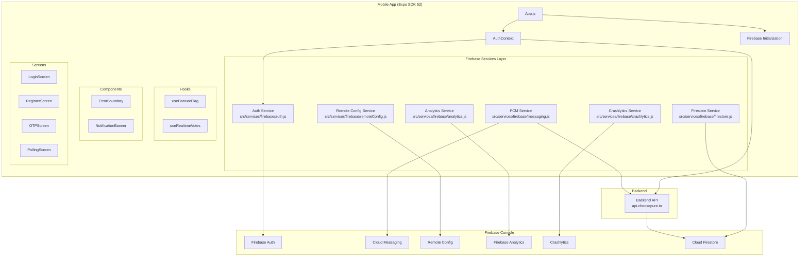
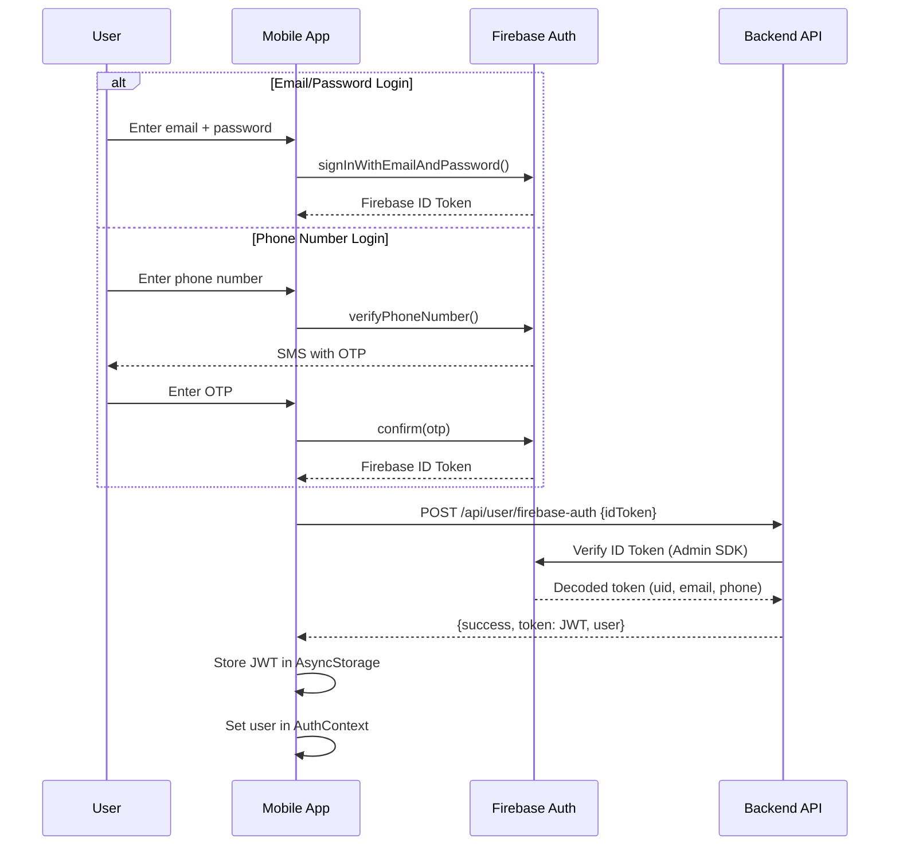
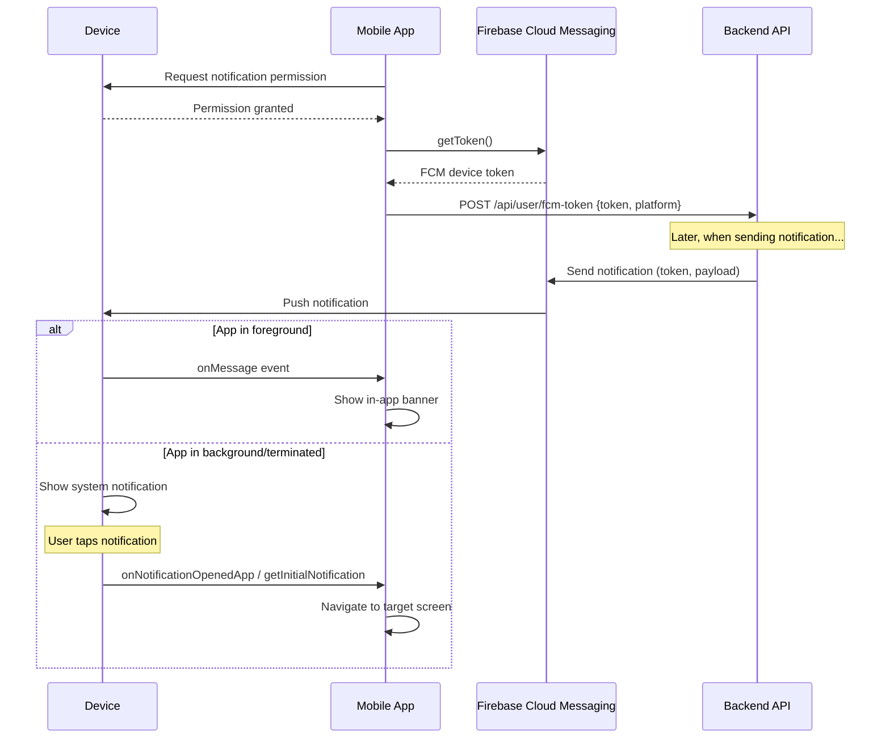

# Design Document: Firebase Integration

## Overview

This design describes the integration of six Firebase service areas into the ChoosePure React Native (Expo SDK 52) mobile application:

1. **Firebase Authentication** — Email/password and phone number sign-in, replacing direct backend credential handling with Firebase as the identity provider while preserving the existing JWT-based backend API authorization.
2. **Push Notifications (FCM)** — Firebase Cloud Messaging for delivering voting reminders, new reports, and engagement notifications.
3. **Feature Flags & A/B Testing** — Firebase Remote Config for runtime feature toggling and experiment management.
4. **App Analytics** — Firebase Analytics for screen tracking, conversion funnels, and custom event logging.
5. **Crash Reporting** — Firebase Crashlytics for automatic crash capture and non-fatal error logging.
6. **Real-time Vote Counts** — Cloud Firestore real-time listeners for live vote count updates on the Polling screen.

The integration uses the **React Native Firebase** (`@react-native-firebase/*`) native SDK suite, configured through Expo config plugins. This requires `expo-dev-client` for development builds (Expo Go is not supported). The existing backend API at `https://api.choosepure.in` remains the source of truth for user data, business logic, and authorization. Firebase serves as the identity provider and real-time data layer.

### Key Design Decisions

| Decision | Choice | Rationale |
|---|---|---|
| Firebase SDK | `@react-native-firebase/*` (native) | Required for Crashlytics, Analytics, FCM, and phone auth — none available via Firebase JS SDK |
| Auth strategy | Firebase as identity provider + backend JWT exchange | Preserves existing backend authorization; Firebase handles credential management and phone OTP |
| Notification approach | FCM via `@react-native-firebase/messaging` | Direct FCM integration gives full control over notification handling, deep linking, and foreground display |
| Real-time data | Cloud Firestore `onSnapshot` listeners | Purpose-built for real-time sync; backend writes vote counts to Firestore after each vote |
| Feature flags | Firebase Remote Config | Built-in A/B testing support, no additional infrastructure needed |
| Config plugin approach | Each `@react-native-firebase/*` module as Expo plugin in `app.json` | Standard Expo managed workflow pattern; `@react-native-firebase/app` and `@react-native-firebase/crashlytics` provide config plugins |

## Architecture

### High-Level Architecture



### Authentication Flow



### Notification Flow



## Components and Interfaces

### New File Structure

```
mobile app/src/
├── services/
│   └── firebase/
│       ├── index.js              # Firebase initialization & health check
│       ├── auth.js               # Firebase Auth wrapper functions
│       ├── messaging.js          # FCM token management & notification handling
│       ├── remoteConfig.js       # Remote Config fetch, defaults, and access
│       ├── analytics.js          # Analytics event logging functions
│       ├── crashlytics.js        # Crashlytics logging & error recording
│       └── firestore.js          # Firestore real-time listeners
├── hooks/
│   ├── useFeatureFlag.js         # Hook to read feature flag values
│   └── useRealtimeVotes.js       # Hook for real-time vote count subscription
├── components/
│   ├── ErrorBoundary.js          # React error boundary with Crashlytics
│   └── NotificationBanner.js     # In-app foreground notification banner
├── screens/
│   └── OTPScreen.js              # Phone number OTP verification screen
└── utils/
    └── notificationHandler.js    # Notification deep link routing logic
```

### 1. Firebase Initialization — `src/services/firebase/index.js`

```javascript
// Responsibilities:
// - Verify Firebase app is initialized (auto-initialized by native module)
// - Export a health check function
// - Provide graceful degradation if Firebase is unavailable

import firebase from '@react-native-firebase/app';

export function isFirebaseInitialized() { /* returns boolean */ }
export function getFirebaseApp() { /* returns firebase.app() or null */ }
```

Firebase initializes automatically via the native config plugin when the app starts. This module provides a check that other services use before accessing Firebase APIs.

### 2. Auth Service — `src/services/firebase/auth.js`

```javascript
// Wraps Firebase Auth operations, returns Firebase ID tokens
// Does NOT handle backend JWT exchange (that stays in AuthContext)

import auth from '@react-native-firebase/auth';

export async function signUpWithEmail(email, password) { /* returns { user, idToken } */ }
export async function signInWithEmail(email, password) { /* returns { user, idToken } */ }
export async function signInWithPhone(phoneNumber) { /* returns confirmation object */ }
export async function confirmOTP(confirmation, code) { /* returns { user, idToken } */ }
export async function getIdToken() { /* returns current user's ID token */ }
export async function signOut() { /* signs out from Firebase */ }
export function onAuthStateChanged(callback) { /* subscribes to auth state */ }
export function mapFirebaseAuthError(error) { /* maps error.code to user-friendly message */ }
```

### 3. Updated AuthContext — `src/context/AuthContext.js`

The existing AuthContext is modified to:
- Call Firebase Auth for sign-in/sign-up instead of directly calling the backend
- Exchange the Firebase ID token with the backend via a new endpoint (`POST /api/user/firebase-auth`)
- Support phone number authentication flow
- Sign out from both Firebase and the backend on logout

```javascript
// Key changes to AuthContext:
// - login() calls signInWithEmail() then exchanges ID token with backend
// - register() calls signUpWithEmail() then exchanges ID token with backend  
// - loginWithPhone() initiates phone auth flow
// - confirmPhoneOTP() completes phone auth and exchanges token
// - logout() calls Firebase signOut() + backend logout + clear AsyncStorage
// - New: exchangeFirebaseToken(idToken) helper for backend JWT exchange
```

### 4. FCM Service — `src/services/firebase/messaging.js`

```javascript
import messaging from '@react-native-firebase/messaging';

export async function requestNotificationPermission() { /* returns permission status */ }
export async function getFCMToken() { /* returns device token string */ }
export function onTokenRefresh(callback) { /* subscribes to token refresh */ }
export function onForegroundMessage(callback) { /* subscribes to foreground messages */ }
export function onNotificationOpened(callback) { /* handles background notification tap */ }
export async function getInitialNotification() { /* checks for launch notification */ }
export function configureIOSForegroundPresentation() { /* sets iOS display options */ }
```

### 5. Remote Config Service — `src/services/firebase/remoteConfig.js`

```javascript
import remoteConfig from '@react-native-firebase/remote-config';

// Default feature flag values
const DEFAULTS = {
  new_scanner_enabled: false,
  referral_bonus_amount: 50,
  polling_realtime_enabled: true,
  // ... additional flags
};

export async function initRemoteConfig() { /* sets defaults + fetches */ }
export function getFeatureFlag(key) { /* returns current value for key */ }
export function getAllFlags() { /* returns all flag values */ }
```

### 6. Analytics Service — `src/services/firebase/analytics.js`

```javascript
import analytics from '@react-native-firebase/analytics';

export async function logScreenView(screenName, screenClass) { /* logs screen_view */ }
export async function logSignUp(method) { /* logs sign_up event */ }
export async function logLogin(method) { /* logs login event */ }
export async function logVoteCast(productId, voteCount) { /* logs vote_cast custom event */ }
export async function logPurchase(amount, currency) { /* logs purchase event */ }
export async function logScanProduct(barcode) { /* logs scan_product custom event */ }
export async function setUserId(userId) { /* sets Firebase Analytics user ID */ }
export async function setUserProperties(properties) { /* sets user properties */ }
```

### 7. Crashlytics Service — `src/services/firebase/crashlytics.js`

```javascript
import crashlytics from '@react-native-firebase/crashlytics';

export function setCrashlyticsUserId(userId) { /* sets user ID for crash reports */ }
export function logMessage(message) { /* adds breadcrumb log */ }
export function recordError(error, context) { /* records non-fatal error */ }
export function recordAPIError(endpoint, statusCode, error) { /* records API error with attributes */ }
export function setEnabled(enabled) { /* enables/disables collection */ }
```

### 8. Firestore Service — `src/services/firebase/firestore.js`

```javascript
import firestore from '@react-native-firebase/firestore';

const VOTE_COUNTS_COLLECTION = 'voteCounts';

export function subscribeToVoteCounts(productIds, onUpdate, onError) {
  // Returns unsubscribe function
  // Listens to documents in voteCounts collection where doc ID = product ID
}

export function subscribeToSingleProduct(productId, onUpdate, onError) {
  // Returns unsubscribe function for a single product's vote count
}
```

### 9. useFeatureFlag Hook — `src/hooks/useFeatureFlag.js`

```javascript
import { useState, useEffect } from 'react';
import { getFeatureFlag } from '../services/firebase/remoteConfig';

export function useFeatureFlag(key, defaultValue) {
  // Returns the current value of the feature flag
  // Falls back to defaultValue if Remote Config is unavailable
  // Re-renders when config is activated
}
```

### 10. useRealtimeVotes Hook — `src/hooks/useRealtimeVotes.js`

```javascript
import { useState, useEffect, useRef } from 'react';
import { subscribeToVoteCounts } from '../services/firebase/firestore';

export function useRealtimeVotes(productIds) {
  // Returns { voteCounts: Map<productId, count>, isConnected: boolean }
  // Subscribes on mount, unsubscribes on unmount or when productIds change
  // Tracks connection state for offline indicator
}
```

### 11. ErrorBoundary Component — `src/components/ErrorBoundary.js`

```javascript
// React class component that catches JS errors in its subtree
// Reports errors to Crashlytics as non-fatal exceptions
// Renders a fallback UI with retry option
```

### 12. NotificationBanner Component — `src/components/NotificationBanner.js`

```javascript
// Animated banner that slides in from top when a foreground notification arrives
// Auto-dismisses after 4 seconds
// Tappable to navigate to the notification's target screen
```

### 13. OTPScreen — `src/screens/OTPScreen.js`

```javascript
// New screen for phone number OTP verification
// Receives phone number and confirmation object via navigation params
// Features:
//   - 6-digit OTP input
//   - Countdown timer (60 seconds)
//   - Resend OTP button (enabled after countdown)
//   - Loading states during verification
//   - Error display for invalid/expired codes
```

### 14. Notification Handler Utility — `src/utils/notificationHandler.js`

```javascript
// Maps notification payload data to navigation actions
// Payload format: { type: 'report' | 'poll' | 'subscription', id: string }

export function getNavigationAction(notificationData) {
  // Returns { screen: string, params: object } based on notification type
}
```

### App.js Changes

```javascript
// Updated App.js initialization order:
// 1. Load fonts
// 2. Firebase is auto-initialized by native module
// 3. Initialize Remote Config (fetch + set defaults)
// 4. Request notification permissions + register FCM token
// 5. Set up foreground notification handler
// 6. Set up notification open handlers (background + terminated)
// 7. Wrap app in ErrorBoundary
// 8. Render AuthProvider > NavigationContainer > RootNavigator
```

### app.json Plugin Configuration

```json
{
  "expo": {
    "plugins": [
      "@react-native-firebase/app",
      "@react-native-firebase/crashlytics",
      [
        "expo-build-properties",
        {
          "android": {
            "kotlinVersion": "1.9.25",
            "newArchEnabled": false
          },
          "ios": {
            "useFrameworks": "static"
          }
        }
      ]
    ]
  }
}
```

### Backend API Changes (Required)

The backend needs these new/modified endpoints:

| Endpoint | Method | Purpose |
|---|---|---|
| `/api/user/firebase-auth` | POST | Accepts Firebase ID token, verifies via Admin SDK, creates/links user, returns JWT |
| `/api/user/fcm-token` | POST | Stores FCM device token for the authenticated user |
| `/api/user/fcm-token` | DELETE | Removes FCM token on logout |

The backend must install the **Firebase Admin SDK** to verify ID tokens server-side.

## Data Models

### Firebase Auth User (Firebase-managed)

```
Firebase Auth User:
  uid: string (Firebase-generated unique ID)
  email: string | null
  phoneNumber: string | null (E.164 format, e.g., "+919876543210")
  displayName: string | null
  emailVerified: boolean
  disabled: boolean
  metadata:
    creationTime: string
    lastSignInTime: string
```

### Backend User (Extended)

The existing backend user model needs a new field:

```
User (Backend MongoDB):
  _id: ObjectId
  name: string
  email: string
  phone: string
  pincode: string
  firebaseUid: string          // NEW: Links to Firebase Auth UID
  fcmTokens: [                 // NEW: Array of FCM device tokens
    { token: string, platform: 'ios' | 'android', updatedAt: Date }
  ]
  subscriptionStatus: string
  subscriptionExpiry: Date
  referralCode: string
  createdAt: Date
  updatedAt: Date
```

### Firestore Vote Count Document

```
Collection: voteCounts
Document ID: {productId} (matches Backend_API product._id)

{
  productId: string,
  totalVotes: number,
  lastUpdatedAt: Timestamp,
  lastVoterId: string (optional, for audit)
}
```

### Remote Config Feature Flags

```
Key                          Type      Default    Description
─────────────────────────────────────────────────────────────
new_scanner_enabled          boolean   false      Enable new barcode scanner UI
referral_bonus_amount        number    50         Referral bonus amount in INR
polling_realtime_enabled     boolean   true       Enable Firestore real-time vote updates
show_subscription_banner     boolean   true       Show subscription upsell banner
maintenance_mode             boolean   false      Put app in maintenance mode
min_app_version              string    "1.0.0"    Minimum supported app version
```

### Notification Payload Structure

```
FCM Notification Payload:
{
  notification: {
    title: string,
    body: string
  },
  data: {
    type: 'report' | 'poll' | 'subscription' | 'general',
    targetId: string (optional, e.g., report ID or product ID),
    action: string (optional, e.g., 'view_report', 'cast_vote')
  }
}
```

### Analytics Event Schema

| Event Name | Parameters | Trigger |
|---|---|---|
| `screen_view` | `screen_name`, `screen_class` | Every screen navigation |
| `sign_up` | `method` ('email' \| 'phone') | Successful registration |
| `login` | `method` ('email' \| 'phone') | Successful login |
| `vote_cast` | `product_id`, `vote_count`, `vote_type` ('paid' \| 'free') | Vote recorded |
| `purchase` | `value`, `currency` ('INR'), `transaction_id` | Razorpay payment success |
| `scan_product` | `barcode_value`, `barcode_format` | Barcode scanned |
| `share_referral` | `referral_code` | Referral code shared |

### Crashlytics Error Attributes

```
API Error Custom Attributes:
  endpoint: string (e.g., "/api/polls/products")
  statusCode: number (e.g., 500)
  method: string (e.g., "GET")
  userId: string (backend user ID)

Error Boundary Custom Attributes:
  componentStack: string
  screenName: string
```

## Correctness Properties

*A property is a characteristic or behavior that should hold true across all valid executions of a system — essentially, a formal statement about what the system should do. Properties serve as the bridge between human-readable specifications and machine-verifiable correctness guarantees.*

### Property 1: Successful Firebase auth triggers backend token exchange

*For any* successful Firebase authentication (whether via email sign-in, email registration, or phone OTP verification), the AuthContext SHALL exchange the resulting Firebase ID token with the Backend API and store the returned JWT in AsyncStorage.

**Validates: Requirements 2.2, 2.4, 3.4**

### Property 2: Firebase auth error codes map to user-friendly messages

*For any* Firebase Authentication error code (e.g., `auth/invalid-credential`, `auth/email-already-in-use`, `auth/weak-password`, `auth/user-not-found`, `auth/invalid-verification-code`), the `mapFirebaseAuthError` function SHALL return a non-empty, user-readable error message string that does not expose internal error codes.

**Validates: Requirements 2.5, 2.6**

### Property 3: useFeatureFlag returns correct values for any registered key

*For any* feature flag key that has been registered with a default value, the `useFeatureFlag` hook SHALL return either the remotely fetched value (if available and activated) or the registered default value — never `undefined` or `null`.

**Validates: Requirements 5.2, 5.3, 5.4**

### Property 4: Screen navigation triggers analytics screen view event

*For any* screen name in the navigation hierarchy, when the user navigates to that screen, the Analytics Service SHALL call `logScreenView` with the correct `screen_name` and `screen_class` parameters matching the screen's registered name.

**Validates: Requirements 6.1**

### Property 5: Custom analytics events log with correct parameters

*For any* vote cast with a product ID and vote count, *for any* purchase with a transaction amount and currency, and *for any* barcode scan with a barcode value, the Analytics Service SHALL log the corresponding custom event (`vote_cast`, `purchase`, `scan_product`) with all specified parameters present and correctly typed.

**Validates: Requirements 6.4, 6.5, 6.6**

### Property 6: Analytics user ID matches backend user ID

*For any* authenticated user, the Firebase Analytics user ID SHALL be set to the same identifier as the Backend API user ID (`user._id`), ensuring cross-platform user analysis consistency.

**Validates: Requirements 6.7**

### Property 7: Crashlytics records API errors with correct attributes

*For any* non-fatal API error with an endpoint path and HTTP status code, the Crashlytics Service SHALL record the error with `endpoint` and `statusCode` as custom attributes, and the recorded values SHALL match the original error's endpoint and status code.

**Validates: Requirements 7.4**

### Property 8: Error boundary errors recorded as non-fatal Crashlytics exceptions

*For any* JavaScript error caught by the React ErrorBoundary component, the Crashlytics Service SHALL record it as a non-fatal exception, and the recorded error SHALL include the component stack trace as a custom attribute.

**Validates: Requirements 7.6**

### Property 9: Firestore vote count updates reflected in component state

*For any* vote count update emitted by a Firestore `onSnapshot` listener, the `useRealtimeVotes` hook SHALL update its returned `voteCounts` map to reflect the new count for the corresponding product ID.

**Validates: Requirements 8.2**

### Property 10: Notification payload navigation routes to correct screen

*For any* valid notification payload containing a `type` and optional `targetId`, the `getNavigationAction` function SHALL return a navigation action with the correct screen name and parameters matching the notification type's routing rules.

**Validates: Requirements 4.4**

### Property 11: Crashlytics user ID set for authenticated users

*For any* authenticated user with a backend user ID, the Crashlytics Service SHALL call `setUserId` with that user's backend ID, ensuring crash reports are associated with the correct user.

**Validates: Requirements 7.2**

### Property 12: Valid phone numbers trigger OTP request in correct format

*For any* valid 10-digit Indian phone number, the Auth Service SHALL call Firebase `verifyPhoneNumber` with the number formatted in E.164 format (prefixed with `+91`), ensuring the phone number is correctly normalized before sending to Firebase.

**Validates: Requirements 3.1**

## Error Handling

### Firebase Initialization Failure

- If Firebase fails to initialize (missing config files, corrupt installation), the app continues operating with the existing backend API.
- Auth falls back to direct backend email/password login (pre-Firebase behavior).
- Analytics, Crashlytics, and Remote Config operations become no-ops.
- A warning is logged to the console in development builds.

### Authentication Errors

| Firebase Error Code | User-Facing Message |
|---|---|
| `auth/invalid-credential` | "Invalid email or password. Please try again." |
| `auth/user-not-found` | "No account found with this email." |
| `auth/user-disabled` | "This account has been disabled. Contact support." |
| `auth/email-already-in-use` | "An account with this email already exists." |
| `auth/weak-password` | "Password is too weak. Use at least 8 characters." |
| `auth/invalid-email` | "Please enter a valid email address." |
| `auth/too-many-requests` | "Too many attempts. Please try again later." |
| `auth/invalid-verification-code` | "Invalid verification code. Please try again." |
| `auth/session-expired` | "Verification code expired. Please request a new one." |
| `auth/network-request-failed` | "Network error. Check your connection and try again." |

### Backend Token Exchange Failure

- If the backend rejects the Firebase ID token (e.g., token expired, user banned), the app signs out from Firebase and shows an error.
- If the backend is unreachable, the app retries once after 3 seconds, then shows a network error.

### FCM Token Registration Failure

- If FCM token registration with the backend fails, the token is cached locally and retried on next app launch.
- Push notifications still work (FCM delivers to the device token regardless of backend registration), but the backend cannot target the user for personalized notifications until the token is registered.

### Remote Config Fetch Failure

- The app uses the last successfully fetched values (persisted by the SDK).
- If no values have ever been fetched, the hardcoded defaults in `DEFAULTS` are used.
- No user-facing error is shown.

### Firestore Connection Loss

- The `useRealtimeVotes` hook tracks connection state via Firestore's `onSnapshotsInSync` or error callbacks.
- When disconnected, the Polling screen shows the last known vote counts with a subtle "Live updates paused" indicator.
- When reconnected, the listener automatically resumes and the indicator disappears.

### Crashlytics in Development

- Crashlytics auto-collection is disabled in `__DEV__` mode via `crashlytics().setCrashlyticsCollectionEnabled(!__DEV__)`.
- The `firebase.json` file configures `crashlytics_auto_collection_enabled: false` for development builds, with runtime enablement for production.

### API Client Error Recording

The existing axios interceptor in `src/api/client.js` is extended to record non-fatal errors to Crashlytics:

```javascript
apiClient.interceptors.response.use(
  (response) => response,
  async (error) => {
    // Existing 401 handling...
    
    // NEW: Record to Crashlytics for server errors
    if (error.response?.status >= 500) {
      recordAPIError(
        error.config?.url,
        error.response.status,
        error
      );
    }
    return Promise.reject(error);
  }
);
```

## Testing Strategy

### Property-Based Testing

This feature is suitable for property-based testing. The app already has `fast-check` installed as a dev dependency. Property-based tests will validate the correctness properties defined above using `fast-check` with a minimum of 100 iterations per property.

**PBT Library**: `fast-check` (already in `devDependencies`)
**Test Runner**: `jest` (already configured)
**Minimum iterations**: 100 per property test

Each property test will be tagged with:
```
Feature: firebase-integration, Property {number}: {property_text}
```

### Test Categories

**Property-Based Tests** (fast-check, 100+ iterations each):
- Firebase auth error code mapping (Property 2)
- useFeatureFlag hook value resolution (Property 3)
- Analytics custom event parameter logging (Property 5)
- Crashlytics API error attribute recording (Property 7)
- Error boundary Crashlytics recording (Property 8)
- Notification payload navigation routing (Property 10)
- Phone number E.164 formatting (Property 12)

**Example-Based Unit Tests**:
- AuthContext login flow (Firebase sign-in → token exchange → JWT storage)
- AuthContext registration flow (Firebase sign-up → token exchange → JWT storage)
- AuthContext phone auth flow (OTP send → verify → token exchange)
- AuthContext logout (Firebase sign-out + backend logout + clear storage)
- FCM token retrieval and backend registration
- FCM token refresh handling
- Remote Config initialization with defaults
- Remote Config fetch failure fallback
- Firestore listener subscribe/unsubscribe lifecycle
- Firestore connection loss indicator
- OTP screen countdown timer behavior
- OTP screen resend functionality
- Initial notification processing on app launch

**Integration Tests**:
- Firebase initialization verification
- End-to-end auth flow with mocked Firebase and backend
- Notification permission request flow
- Screen tracking with React Navigation integration

**Smoke Tests**:
- Firebase SDK initialization succeeds
- app.json contains required config plugins
- Crashlytics disabled in development mode
- iOS notification presentation options configured

### Mocking Strategy

All Firebase modules will be mocked in tests using Jest module mocks:
- `@react-native-firebase/auth` — mock `signInWithEmailAndPassword`, `createUserWithEmailAndPassword`, `verifyPhoneNumber`, `signOut`
- `@react-native-firebase/messaging` — mock `getToken`, `onMessage`, `requestPermission`
- `@react-native-firebase/remote-config` — mock `setDefaults`, `fetchAndActivate`, `getValue`
- `@react-native-firebase/analytics` — mock `logEvent`, `logScreenView`, `setUserId`
- `@react-native-firebase/crashlytics` — mock `log`, `recordError`, `setUserId`, `setAttribute`
- `@react-native-firebase/firestore` — mock `collection`, `doc`, `onSnapshot`

The backend API client remains mocked via `axios` mock adapter as in existing tests.
