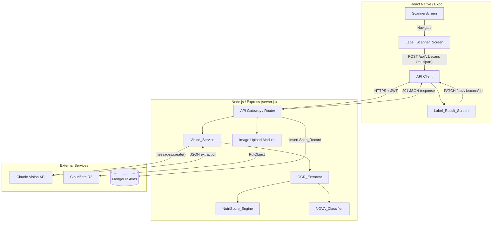
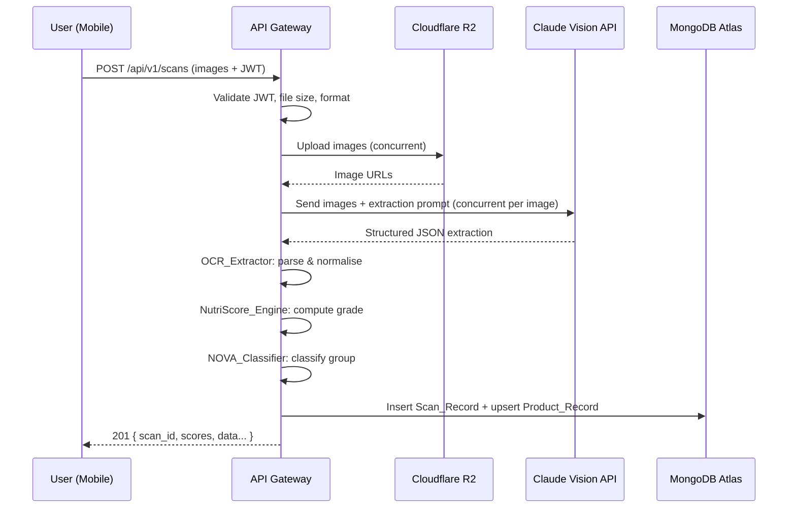

# Design Document: Food Label Scanner

## Overview

The Food Label Scanner extends ChoosePure's existing barcode scanning capability with a vision-AI-powered pipeline that extracts nutritional data from photographs of food product labels. Users capture or select images of nutrition panels and ingredient lists; the backend processes these through Claude Vision API for OCR, normalises the extracted data into per-100g units, computes a Nutri-Score (A–E) grade using the 2021 FSA algorithm, classifies NOVA Group (1–4) from ingredient analysis, and persists all data with full version history.

The system integrates into the existing Node.js/Express monolith (`server.js`) and React Native/Expo mobile app, reusing the JWT auth flow, API client with Bearer token interceptor, and MongoDB Atlas infrastructure already in place.

### Key Design Decisions

1. **Image Storage: Cloudflare R2** — Selected over Firebase Storage (pricing) and S3 (R2 offers free egress, S3-compatible API, and simple integration via `@aws-sdk/client-s3`). Images are accessed via public URLs with signed upload.
2. **Scoring Engines as Pure Functions** — NutriScore_Engine and NOVA_Classifier are implemented as pure, stateless modules with no I/O dependencies, enabling unit testing and property-based testing without mocks.
3. **Single-Server Monolith Extension** — New routes added to existing `server.js` under `/api/v1/` prefix. No microservice split needed at current scale.
4. **Claude Vision API for OCR** — Leverages Anthropic's multimodal capability with structured prompts. Single vendor avoids stitching multiple OCR services.

---

## Architecture

### High-Level System Diagram



### Request Flow (Scan Pipeline)



---

## Components and Interfaces

### 1. Image Upload Module (`services/imageUpload.js`)

```typescript
interface ImageUploadResult {
  url: string;        // Public R2 URL
  key: string;        // Object key in bucket
  size: number;       // Bytes
  contentType: string;
}

async function uploadImages(files: Express.Multer.File[]): Promise<ImageUploadResult[]>
// Uploads concurrently to R2, returns URLs. Throws on failure.
```

**Dependencies:** `@aws-sdk/client-s3`, Cloudflare R2 credentials via env vars (`R2_ACCOUNT_ID`, `R2_ACCESS_KEY`, `R2_SECRET_KEY`, `R2_BUCKET_NAME`, `R2_PUBLIC_URL`)

### 2. Vision_Service (`services/visionService.js`)

```typescript
interface ExtractionResult {
  product_name: string | null;
  brand: string | null;
  serving_size: { value: number; unit: 'g' | 'ml' | 'piece' } | null;
  servings_per_container: number | null;
  nutrition_per_100g: NutritionPer100g | null;
  nutrition_per_serving: NutritionPerServing | null;
  ingredients_raw: string | null;
  extraction_confidence: number; // 0.0–1.0
  field_confidences: Record<string, number>;
}

async function extractFromImages(imageUrls: string[]): Promise<ExtractionResult>
// Sends images concurrently to Claude Vision, merges results.
```

**Prompt Strategy:** Structured system prompt requests JSON output with explicit field names, handles FSSAI format by including Hindi/English bilingual extraction instructions.

### 3. OCR_Extractor (`services/ocrExtractor.js`)

```typescript
interface NutritionPer100g {
  energy_kcal: number | null;
  energy_kj: number | null;
  total_fat_g: number | null;
  saturated_fat_g: number | null;
  trans_fat_g: number | null;       // FSSAI
  carbohydrates_g: number | null;
  sugars_g: number | null;
  added_sugars_g: number | null;    // FSSAI
  fibre_g: number | null;
  protein_g: number | null;
  sodium_mg: number | null;
  cholesterol_mg: number | null;    // FSSAI
  fruits_veg_nuts_pct: number | null;
}

interface ServingInfo {
  value: number;
  unit: 'g' | 'ml' | 'piece';
  servings_per_container: number | null;
}

function parseAndNormalise(extraction: ExtractionResult): {
  nutrition_per_100g: NutritionPer100g;
  serving_info: ServingInfo | null;
  ingredients_parsed: string[];
  missing_fields: string[];
}
```

### 4. NutriScore_Engine (`services/nutriscoreEngine.js`)

```typescript
interface NutriScoreInput {
  energy_kcal: number;
  saturated_fat_g: number;
  sugars_g: number;
  sodium_mg: number;
  fibre_g: number | null;
  protein_g: number | null;
  fruits_veg_nuts_pct: number | null;
  category?: 'solid' | 'beverages' | 'cheese' | 'fats_and_oils';
}

interface NutriScoreResult {
  grade: 'A' | 'B' | 'C' | 'D' | 'E';
  net_score: number;           // -15 to 40
  negative_points: number;     // 0 to 40
  positive_points: number;     // 0 to 15
  breakdown: {
    energy_pts: number;
    sat_fat_pts: number;
    sugars_pts: number;
    sodium_pts: number;
    fibre_pts: number;
    protein_pts: number;
    fvn_pts: number;
  };
}

function computeNutriScore(input: NutriScoreInput): NutriScoreResult
// Pure function. Throws ValidationError for invalid inputs.
```

### 5. NOVA_Classifier (`services/novaClassifier.js`)

```typescript
interface NOVAResult {
  group: 1 | 2 | 3 | 4;
  reason: string;
  matched_markers: string[];  // Which markers triggered classification
}

function classifyNOVA(ingredients: string[]): NOVAResult
// Pure function. Tokenises, matches against marker dictionaries.
```

### 6. API Routes (`routes/labelScanner.js`)

| Method | Endpoint | Description |
|--------|----------|-------------|
| POST | `/api/v1/scans` | Upload images, run pipeline, return scores |
| GET | `/api/v1/scans/:id` | Get full scan record |
| PATCH | `/api/v1/scans/:id` | Submit corrections, trigger re-scoring |
| GET | `/api/v1/products` | Search products (q, nutri_score, nova_group, page, limit) |
| GET | `/api/v1/products/:id` | Get product with latest scan data |

---

## Data Models

### Scan_Record (MongoDB: `scans` collection)

```json
{
  "_id": "ObjectId",
  "scan_id": "uuid-v4",
  "product_id": "uuid-v4",
  "user_id": "string (from JWT)",
  "version": 1,
  "image_refs": ["https://r2.choosepure.in/scans/uuid/img1.jpg"],
  "raw_ocr_text": "string (full Vision API response text)",
  "product_name": "string | null",
  "brand": "string | null",
  "barcode": "string | null",
  "serving_info": {
    "value": 30,
    "unit": "g",
    "servings_per_container": 10
  },
  "nutrition_per_100g": {
    "energy_kcal": 450,
    "energy_kj": 1882,
    "total_fat_g": 12.5,
    "saturated_fat_g": 3.2,
    "trans_fat_g": 0,
    "carbohydrates_g": 65.0,
    "sugars_g": 22.0,
    "added_sugars_g": 18.0,
    "fibre_g": 2.1,
    "protein_g": 8.0,
    "sodium_mg": 480,
    "cholesterol_mg": 0,
    "fruits_veg_nuts_pct": null
  },
  "ingredients_raw": "Wheat flour, sugar, palm oil...",
  "ingredients_parsed": ["wheat flour", "sugar", "palm oil", "..."],
  "nutri_score": {
    "grade": "D",
    "net_score": 14,
    "negative_points": 19,
    "positive_points": 5,
    "breakdown": { ... }
  },
  "nova_group": {
    "group": 4,
    "reason": "Contains emulsifier (E471)",
    "matched_markers": ["E471", "artificial flavour"]
  },
  "extraction_confidence": 0.87,
  "field_confidences": {
    "product_name": 0.95,
    "energy_kcal": 0.90,
    "sugars_g": 0.72
  },
  "missing_fields": ["fruits_veg_nuts_pct"],
  "warnings": ["Low confidence for sugars_g (0.72)"],
  "category": "solid",
  "correction_log": [],
  "created_at": "2024-01-15T10:30:00Z",
  "updated_at": "2024-01-15T10:30:00Z"
}
```

### Product_Record (MongoDB: `products` collection)

```json
{
  "_id": "ObjectId",
  "product_id": "uuid-v4",
  "name": "Parle-G Gold",
  "brand": "Parle",
  "barcode": "8901234567890",
  "category": "solid",
  "latest_scan_id": "uuid-v4",
  "scan_count": 3,
  "created_at": "2024-01-10T08:00:00Z",
  "updated_at": "2024-01-15T10:30:00Z"
}
```

### MongoDB Indexes

```javascript
// scans collection
db.scans.createIndex({ scan_id: 1 }, { unique: true });
db.scans.createIndex({ product_id: 1, version: -1 });
db.scans.createIndex({ user_id: 1, created_at: -1 });
db.scans.createIndex({ created_at: -1 });

// products collection (label scanner)
db.products.createIndex({ product_id: 1 }, { unique: true });
db.products.createIndex({ name: 'text', brand: 'text', barcode: 'text' });
db.products.createIndex({ 'nutri_score.grade': 1 });
db.products.createIndex({ 'nova_group.group': 1 });
db.products.createIndex({ barcode: 1 }, { sparse: true });
```

---

## Low-Level Design: Algorithms

### Nutri-Score 2021 FSA Algorithm

#### Negative Points (N-Points: 0–40)

Each component scored 0–10 based on thresholds. Total = sum of all four.

**Solid Food Thresholds:**

| Points | Energy (kcal) | Sat Fat (g) | Sugars (g) | Sodium (mg) |
|--------|---------------|-------------|------------|-------------|
| 0 | ≤335 | ≤1 | ≤4.5 | ≤90 |
| 1 | >335 | >1 | >4.5 | >90 |
| 2 | >670 | >2 | >9 | >180 |
| 3 | >1005 | >3 | >13.5 | >270 |
| 4 | >1340 | >4 | >18 | >360 |
| 5 | >1675 | >5 | >22.5 | >450 |
| 6 | >2010 | >6 | >27 | >540 |
| 7 | >2345 | >7 | >31 | >630 |
| 8 | >2680 | >8 | >36 | >720 |
| 9 | >3015 | >9 | >40 | >810 |
| 10 | >3350 | >10 | >45 | >900 |

**Beverage-Specific Thresholds (Energy and Sugars only):**

| Points | Energy (kcal) | Sugars (g) |
|--------|---------------|------------|
| 0 | ≤0 | ≤0 |
| 1 | >0 | >0 |
| 2 | >30 | >1.5 |
| 3 | >60 | >3 |
| 4 | >90 | >4.5 |
| 5 | >120 | >6 |
| 6 | >150 | >7.5 |
| 7 | >180 | >9 |
| 8 | >210 | >10.5 |
| 9 | >240 | >12 |
| 10 | >270 | >13.5 |

#### Positive Points (P-Points: 0–15)

| Points | Fibre (g) | Protein (g) | Fruits/Veg/Nuts (%) |
|--------|-----------|-------------|---------------------|
| 0 | ≤0.9 | ≤1.6 | ≤40 |
| 1 | >0.9 | >1.6 | >40 |
| 2 | >1.9 | >3.2 | >60 |
| 3 | >2.8 | >4.8 | — |
| 4 | >3.7 | >6.4 | — |
| 5 | >4.7 | >8.0 | >80 |

#### Net Score and Special Rules

```
net_score = negative_points - positive_points
```

**Protein rule:** If negative_points ≥ 11 AND fruits/veg/nuts < 80%, protein points are NOT subtracted (set to 0 in positive_points).

**Cheese/Fats exception:** Protein points are always counted regardless of negative score.

#### Grade Assignment (Solid)

| Grade | Net Score |
|-------|-----------|
| A | ≤ -1 |
| B | 0 to 2 |
| C | 3 to 10 |
| D | 11 to 18 |
| E | ≥ 19 |

#### Grade Assignment (Beverages)

| Grade | Net Score |
|-------|-----------|
| A | ≤ 1 |
| B | 2 to 5 |
| C | 6 to 9 |
| D | 10 to 13 |
| E | ≥ 14 |

#### Pseudocode

```javascript
function computeNutriScore(input) {
  validate(input); // throws if negative values or sat_fat > total_fat
  
  const category = input.category || 'solid';
  const thresholds = category === 'beverages' 
    ? BEVERAGE_THRESHOLDS 
    : SOLID_THRESHOLDS;

  // Compute negative points
  const energy_pts = lookupPoints(input.energy_kcal, thresholds.energy);
  const sat_fat_pts = lookupPoints(input.saturated_fat_g, thresholds.sat_fat);
  const sugars_pts = lookupPoints(input.sugars_g, thresholds.sugars);
  const sodium_pts = lookupPoints(input.sodium_mg, thresholds.sodium);
  const negative_points = energy_pts + sat_fat_pts + sugars_pts + sodium_pts;

  // Compute positive points
  const fibre_pts = lookupPoints(input.fibre_g ?? 0, POSITIVE_THRESHOLDS.fibre);
  const fvn_pts = lookupPoints(input.fruits_veg_nuts_pct ?? 0, POSITIVE_THRESHOLDS.fvn);
  let protein_pts = lookupPoints(input.protein_g ?? 0, POSITIVE_THRESHOLDS.protein);

  // Protein rule: exclude protein if N ≥ 11 and FVN < 80%
  // Exception: cheese and fats always count protein
  const isCheese = category === 'cheese' || category === 'fats_and_oils';
  if (!isCheese && negative_points >= 11 && (input.fruits_veg_nuts_pct ?? 0) < 80) {
    protein_pts = 0;
  }

  const positive_points = fibre_pts + protein_pts + fvn_pts;
  const net_score = negative_points - positive_points;

  // Assign grade
  const grade = assignGrade(net_score, category);

  return { grade, net_score, negative_points, positive_points, breakdown: { ... } };
}

function lookupPoints(value, thresholdArray) {
  // thresholdArray is [t0, t1, ..., t10] in ascending order
  // returns highest index i where value > thresholdArray[i]
  let points = 0;
  for (let i = 0; i < thresholdArray.length; i++) {
    if (value > thresholdArray[i]) points = i + 1;
    else break;
  }
  return Math.min(points, thresholdArray.length);
}
```

### NOVA Classification Algorithm

#### Marker Dictionaries

```javascript
const GROUP_4_MARKERS = [
  // Additives (E-numbers associated with ultra-processing)
  /^e\d{3,4}[a-z]?$/i,
  // Flavour indicators
  /\b(flavou?r|flavou?ring|artificial flavou?r)\b/i,
  // Colour indicators
  /\b(colou?r|colou?ring|artificial colou?r)\b/i,
  // Emulsifiers
  /\b(emulsifier|lecithin|mono[- ]?and[- ]?diglycerides)\b/i,
  // Stabilisers and thickeners
  /\b(stabiliser|thickener|xanthan|carrageenan|guar gum)\b/i,
  // Sweeteners
  /\b(aspartame|sucralose|acesulfame|saccharin|stevia extract)\b/i,
  // Hydrogenated oils
  /\b(hydrogenated|partially hydrogenated)\b/i,
  // High-fructose corn syrup
  /\b(high[- ]?fructose|HFCS|corn syrup)\b/i,
  // Protein isolates
  /\b(protein isolate|hydrolysed protein|hydrolyzed protein)\b/i,
  // MSG and flavour enhancers
  /\b(monosodium glutamate|MSG|flavou?r enhancer)\b/i,
  // Maltodextrin, invert sugar
  /\b(maltodextrin|invert sugar|dextrose)\b/i,
];

const GROUP_2_MARKERS = [
  /^(salt|sugar|honey|oil|butter|flour|vinegar|spices?)$/i,
  /\b(olive oil|coconut oil|sunflower oil|vegetable oil|ghee)\b/i,
  /\b(cane sugar|brown sugar|jaggery|palm sugar)\b/i,
];

const GROUP_1_PROCESSES = [
  'drying', 'crushing', 'grinding', 'roasting', 'boiling',
  'pasteurisation', 'refrigeration', 'freezing', 'fermentation',
  'filtering', 'fractioning'
];
```

#### Synonym Dictionary

```javascript
const SYNONYMS = {
  'msg': 'monosodium glutamate',
  'hfcs': 'high-fructose corn syrup',
  'partially hydrogenated oil': 'hydrogenated oil',
  'vanillin': 'artificial flavour',
  'INS': 'E',  // Indian numbering → E-number prefix
  // ... extensible
};
```

#### Pseudocode

```javascript
function classifyNOVA(ingredients) {
  if (!ingredients || ingredients.length === 0) {
    return { group: null, reason: 'No ingredients available', matched_markers: [] };
  }

  const normalised = ingredients.map(i => normaliseSynonyms(i.toLowerCase().trim()));
  const matched_markers = [];

  // Step 1: Check for Group 4 markers (highest priority)
  for (const ingredient of normalised) {
    for (const marker of GROUP_4_MARKERS) {
      if (marker.test(ingredient)) {
        matched_markers.push(ingredient);
        break;
      }
    }
  }
  if (matched_markers.length > 0) {
    return { group: 4, reason: `Ultra-processed: contains ${matched_markers[0]}`, matched_markers };
  }

  // Step 2: Check for Group 3 (processed foods)
  // Need ≥2 ingredients, combining Group 1 foods with Group 2 substances
  const group2Matches = normalised.filter(i => GROUP_2_MARKERS.some(m => m.test(i)));
  const group1Count = normalised.length - group2Matches.length;
  
  if (normalised.length >= 2 && group2Matches.length >= 1 && group1Count >= 1) {
    return { group: 3, reason: 'Processed: combines whole foods with culinary ingredients', matched_markers: group2Matches };
  }

  // Step 3: Check for Group 2 (single culinary ingredient)
  if (normalised.length === 1 && GROUP_2_MARKERS.some(m => m.test(normalised[0]))) {
    return { group: 2, reason: 'Processed culinary ingredient', matched_markers: normalised };
  }

  // Step 4: Default to Group 1 (unprocessed/minimally processed)
  return { group: 1, reason: 'Unprocessed or minimally processed', matched_markers: [] };
}

function normaliseSynonyms(ingredient) {
  for (const [synonym, canonical] of Object.entries(SYNONYMS)) {
    if (ingredient.includes(synonym)) {
      ingredient = ingredient.replace(synonym, canonical);
    }
  }
  // Convert INS numbers to E-numbers for matching
  ingredient = ingredient.replace(/\bins\s*(\d{3,4})\b/i, 'e$1');
  return ingredient;
}
```

### Vision Extraction Prompt

```javascript
const EXTRACTION_PROMPT = `You are a food label OCR system. Analyse the provided food product label image(s) and extract the following information as a JSON object.

Extract:
1. product_name: The product name as written on the front of the pack
2. brand: The brand/manufacturer name
3. serving_size: { value: number, unit: "g"|"ml"|"piece" }
4. servings_per_container: number or null
5. nutrition_per_100g: Extract per-100g values. If only per-serving is available, I will compute per-100g separately.
   - energy_kcal, energy_kj, total_fat_g, saturated_fat_g, trans_fat_g, 
   - carbohydrates_g, sugars_g, added_sugars_g, fibre_g, protein_g, 
   - sodium_mg, cholesterol_mg
6. nutrition_per_serving: Same fields as above but per-serving values
7. ingredients_raw: The complete ingredient list text exactly as printed
8. confidence: Your confidence score (0.0-1.0) in the overall extraction accuracy

Rules:
- If a field is not visible or legible, set it to null
- For Indian FSSAI labels: prefer the English text, extract trans fat, cholesterol, added sugars
- If the label has both per-serving and per-100g columns, extract BOTH
- Sodium: if listed in mg keep as-is; if in g multiply by 1000
- Return valid JSON only, no markdown fencing`;
```

### Per-Serving to Per-100g Conversion

```javascript
function convertToPerHundredGrams(perServingValues, servingSize) {
  if (!servingSize || servingSize.value <= 0) return null;
  
  const factor = 100 / servingSize.value;
  const result = {};
  
  for (const [key, value] of Object.entries(perServingValues)) {
    result[key] = value !== null ? Math.round(value * factor * 100) / 100 : null;
  }
  
  return result;
}
```

---


## Correctness Properties

*A property is a characteristic or behavior that should hold true across all valid executions of a system — essentially, a formal statement about what the system should do. Properties serve as the bridge between human-readable specifications and machine-verifiable correctness guarantees.*

### Property 1: Nutrition Data Serialisation Round-Trip

*For any* valid Nutrition_Per_100g object with numeric fields, serialising it to a JSON string and deserialising back SHALL produce a numerically equivalent object (all numeric fields equal within floating-point tolerance of 0.01).

**Validates: Requirements 4.6, 16.2**

### Property 2: Per-Serving to Per-100g Conversion Correctness

*For any* valid per-serving nutritional value V (≥ 0) and serving size S (> 0), the computed per-100g value SHALL equal V × 100 / S (within floating-point tolerance of 0.01), and converting back using the same serving size SHALL recover the original per-serving value.

**Validates: Requirements 4.1, 4.4**

### Property 3: Multi-Image Extraction Merge Prefers Highest Confidence

*For any* set of two or more extraction results containing conflicting values for the same field, the merged result SHALL contain the value from the extraction with the highest confidence score for that specific field.

**Validates: Requirements 3.3**

### Property 4: NutriScore Scoring Invariants

*For any* valid NutriScoreInput (non-negative energy, saturated fat, sugars, sodium), the NutriScore_Engine SHALL produce: negative_points as an integer in [0, 40], positive_points as an integer in [0, 15], and net_score = negative_points − positive_points as an integer in [-15, 40].

**Validates: Requirements 5.2, 5.3, 5.5, 5.10**

### Property 5: Grade Assignment Correctness

*For any* valid NutriScoreInput and product category (solid, beverages, cheese, fats_and_oils), the assigned grade SHALL be exactly determined by the net_score and the category-specific threshold table: for solids A ≤ -1 < B ≤ 2 < C ≤ 10 < D ≤ 18 < E; for beverages A ≤ 1 < B ≤ 5 < C ≤ 9 < D ≤ 13 < E.

**Validates: Requirements 5.6, 5.7**

### Property 6: NutriScore Input Validation Rejects Invalid Data

*For any* Nutrition_Per_100g object containing at least one negative numeric nutritional value, OR where saturated_fat_g > total_fat_g, the NutriScore_Engine SHALL reject the input with an error indicating the specific invalid field(s).

**Validates: Requirements 16.3, 16.4**

### Property 7: NOVA Highest-Group Precedence

*For any* non-empty ingredient list where at least one ingredient matches a Group 4 marker, the NOVA_Classifier SHALL assign Group 4 regardless of whether other ingredients match Group 1, 2, or 3 markers. More generally, the classifier SHALL always assign the highest applicable group number.

**Validates: Requirements 6.2, 6.6**

### Property 8: NOVA Classification Invariant

*For any* non-empty Ingredients_Parsed array, the NOVA_Classifier SHALL produce a classification that is exactly one of the integer values 1, 2, 3, or 4.

**Validates: Requirements 6.10**

### Property 9: NOVA Case-Insensitive Synonym Matching

*For any* ingredient string and its uppercase/lowercase/mixed-case variants, and for any known synonym pair (e.g., "MSG" ↔ "monosodium glutamate"), the NOVA_Classifier SHALL produce the same classification result regardless of casing or synonym usage.

**Validates: Requirements 6.9**

### Property 10: Search Filter Correctness

*For any* product search request with a `nutri_score` or `nova_group` filter parameter, all returned products SHALL have a matching grade or group value — no product in the result set shall violate the filter constraint.

**Validates: Requirements 9.2**

### Property 11: Pagination Invariant

*For any* valid page/limit combination on `/api/v1/products`, the number of returned results SHALL be ≤ limit (capped at 100), and the results SHALL represent the correct positional slice of the total ordered result set.

**Validates: Requirements 9.5**

### Property 12: Scan Version Immutability and Pointer Consistency

*For any* sequence of N scans or corrections on the same product, all N Scan_Version documents SHALL remain retrievable (never overwritten or deleted), AND the Product_Record's `latest_scan_id` SHALL always point to the most recently created Scan_Version.

**Validates: Requirements 7.4, 7.5**

---

## Error Handling

### Error Response Format

All error responses follow a consistent structure:

```json
{
  "error": {
    "code": "VALIDATION_ERROR",
    "message": "Human-readable error description",
    "details": { ... },
    "request_id": "uuid-v4"
  }
}
```

### Error Codes and HTTP Status Mapping

| HTTP Status | Error Code | Trigger |
|-------------|-----------|---------|
| 400 | `VALIDATION_ERROR` | No images, unsupported format, invalid fields |
| 400 | `INVALID_NUTRITION_DATA` | Negative values, sat_fat > total_fat |
| 401 | `UNAUTHORIZED` | Missing/expired/invalid JWT |
| 404 | `NOT_FOUND` | Scan or product ID doesn't exist |
| 413 | `PAYLOAD_TOO_LARGE` | Single image > 10 MB |
| 500 | `STORAGE_ERROR` | Image upload to R2 failed |
| 503 | `SERVICE_UNAVAILABLE` | Claude Vision API unreachable |

### Error Handling Strategy by Layer

1. **API Gateway (route handlers):** Catches all errors, wraps in standard format, attaches request_id, logs to console. Uses Express error middleware.
2. **Vision_Service:** Retries once on 5xx from Claude API (with 3s timeout). Propagates permanent failures as 503.
3. **Image Upload Module:** No retry (client can retry the full request). Returns immediately on failure.
4. **NutriScore_Engine / NOVA_Classifier:** Throw `ValidationError` for invalid inputs. Never throw for valid inputs (pure functions).
5. **OCR_Extractor:** Never throws. Sets unparseable fields to `null` and records them in `missing_fields`.

### Timeout Handling

| Component | Timeout | Behaviour on Timeout |
|-----------|---------|---------------------|
| Client → API | 15s | Mobile shows "Upload failed" with retry |
| API → Claude Vision | 6s per image | Return 503 "Vision service temporarily unavailable" |
| API → R2 Upload | 10s per image | Return 500 "Image storage failed" |
| API → MongoDB | 5s | Return 500 with generic error |

### Input Sanitisation

```javascript
function sanitiseInput(obj) {
  if (typeof obj === 'string') {
    // Remove MongoDB operators
    return obj.replace(/\$[a-zA-Z]+/g, '');
  }
  if (typeof obj === 'object' && obj !== null) {
    const sanitised = {};
    for (const [key, value] of Object.entries(obj)) {
      // Reject keys starting with $ or containing dots
      if (key.startsWith('$') || key.includes('.')) continue;
      sanitised[key] = sanitiseInput(value);
    }
    return sanitised;
  }
  return obj;
}
```

---

## Testing Strategy

### Testing Framework

- **Backend:** Jest (test runner) + fast-check (property-based testing library)
- **Mobile:** Jest + React Native Testing Library (already configured)
- **Property tests:** Minimum 100 iterations per property

### Test Categories

#### 1. Property-Based Tests (Pure Scoring Engines)

These validate the 12 correctness properties defined above using `fast-check`. Each test generates random valid inputs and asserts universal properties.

**Target modules:**
- `services/nutriscoreEngine.js` — Properties 4, 5, 6
- `services/novaClassifier.js` — Properties 7, 8, 9
- `services/ocrExtractor.js` — Properties 1, 2, 3

**Configuration:**
- Library: `fast-check` (npm package)
- Iterations: 100 minimum per property
- Each test tagged with: `Feature: food-label-scanner, Property {N}: {title}`

**Example test structure:**
```javascript
const fc = require('fast-check');
const { computeNutriScore } = require('../services/nutriscoreEngine');

// Feature: food-label-scanner, Property 4: NutriScore Scoring Invariants
test('Property 4: NutriScore scoring invariants hold for all valid inputs', () => {
  fc.assert(
    fc.property(
      fc.record({
        energy_kcal: fc.float({ min: 0, max: 3500 }),
        saturated_fat_g: fc.float({ min: 0, max: 100 }),
        sugars_g: fc.float({ min: 0, max: 100 }),
        sodium_mg: fc.float({ min: 0, max: 1500 }),
        fibre_g: fc.oneof(fc.constant(null), fc.float({ min: 0, max: 50 })),
        protein_g: fc.oneof(fc.constant(null), fc.float({ min: 0, max: 100 })),
        fruits_veg_nuts_pct: fc.oneof(fc.constant(null), fc.float({ min: 0, max: 100 })),
        category: fc.oneof(
          fc.constant('solid'), fc.constant('beverages'),
          fc.constant('cheese'), fc.constant('fats_and_oils')
        ),
      }),
      (input) => {
        const result = computeNutriScore(input);
        expect(result.negative_points).toBeGreaterThanOrEqual(0);
        expect(result.negative_points).toBeLessThanOrEqual(40);
        expect(result.positive_points).toBeGreaterThanOrEqual(0);
        expect(result.positive_points).toBeLessThanOrEqual(15);
        expect(result.net_score).toBe(result.negative_points - result.positive_points);
        expect(Number.isInteger(result.net_score)).toBe(true);
        expect(result.net_score).toBeGreaterThanOrEqual(-15);
        expect(result.net_score).toBeLessThanOrEqual(40);
      }
    ),
    { numRuns: 100 }
  );
});
```

#### 2. Unit Tests (Example-Based)

- **NutriScore_Engine:** Known food examples (e.g., apple = A, cola = E, cheddar cheese = D)
- **NOVA_Classifier:** Known products (e.g., rice = Group 1, sugar = Group 2, canned fish = Group 3, instant noodles = Group 4)
- **OCR_Extractor:** Fixture extraction results → verify parsing
- **Input validation:** Boundary tests (10MB exactly, 3 images exactly)
- **Error responses:** Each HTTP status code scenario

#### 3. Integration Tests

- **Full pipeline test:** Upload image → receive scores (with mocked Claude API)
- **PATCH corrections:** Submit correction → verify re-scoring and version creation
- **Search and pagination:** Seed database → verify query results
- **Auth middleware:** Verify 401 for missing/invalid JWT

#### 4. Mobile Component Tests

- **LabelScannerScreen:** Permission states, image selection, upload trigger
- **LabelResultScreen:** Score display, warning indicators, correction flow
- **ScannerScreen integration:** "Scan Label" button presence and navigation

### Test File Structure

```
tests/
├── unit/
│   ├── nutriscoreEngine.test.js
│   ├── nutriscoreEngine.property.test.js
│   ├── novaClassifier.test.js
│   ├── novaClassifier.property.test.js
│   ├── ocrExtractor.test.js
│   └── ocrExtractor.property.test.js
├── integration/
│   ├── scanPipeline.test.js
│   ├── corrections.test.js
│   ├── search.test.js
│   └── auth.test.js
└── mobile/
    ├── LabelScannerScreen.test.js
    └── LabelResultScreen.test.js
```

### Dependencies to Add

**Backend (`package.json`):**
```json
{
  "@anthropic-ai/sdk": "^0.25.0",
  "@aws-sdk/client-s3": "^3.600.0",
  "multer": "^1.4.5-lts.1",
  "uuid": "^10.0.0"
}
```

**Dev dependencies:**
```json
{
  "jest": "^29.7.0",
  "fast-check": "^3.19.0"
}
```

**Mobile (`package.json`):**
```json
{
  "expo-image-picker": "~16.0.0"
}
```
