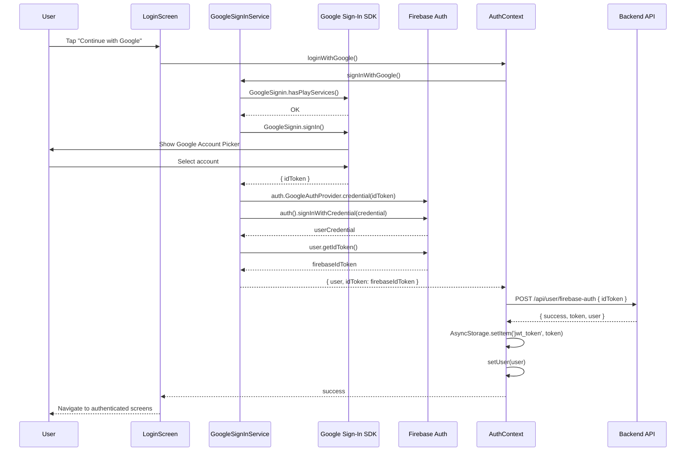

# Design Document: Google Sign-In

## Overview

This feature integrates Google Sign-In into the ChoosePure React Native (Expo SDK 52) mobile app using the `@react-native-google-signin/google-signin` library. When a user taps "Continue with Google" on the LoginScreen, the app presents the native Google account picker, obtains a Google ID token, creates a Firebase credential, signs into Firebase Auth, and then exchanges the resulting Firebase ID token with the backend API (`POST /api/user/firebase-auth`) to receive a JWT — completing the same authentication flow already used for email/password and phone sign-in.

The implementation leverages the existing `exchangeFirebaseToken()` helper in AuthContext and the backend endpoint that already handles Firebase ID tokens from any provider. No backend changes are required.

## Architecture

```mermaid
graph TD
    A[LoginScreen] -->|Tap 'Continue with Google'| B[GoogleSignInService]
    B -->|Google SDK| C[Google Account Picker]
    C -->|Google ID Token| B
    B -->|Firebase Credential| D[@react-native-firebase/auth]
    D -->|Firebase ID Token| E[AuthContext.loginWithGoogle]
    E -->|POST /api/user/firebase-auth| F[Backend API]
    F -->|JWT + User| E
    E -->|setUser + store JWT| G[App Authenticated State]
```

## Sequence Diagram



## Components and Interfaces

### Component 1: GoogleSignInService

**Purpose**: Encapsulates all Google Sign-In SDK interactions and Firebase credential exchange. Provides a single async function that returns a Firebase ID token ready for backend exchange.

**Interface**:
```javascript
// src/services/firebase/googleSignIn.js

/**
 * Configure Google Sign-In with the web client ID from Firebase.
 * Must be called once at app startup (before any sign-in attempt).
 */
export function configureGoogleSignIn(): void

/**
 * Perform the full Google Sign-In flow:
 * 1. Check Play Services availability
 * 2. Present Google account picker
 * 3. Create Firebase credential from Google ID token
 * 4. Sign into Firebase with credential
 * 5. Return Firebase user and ID token
 *
 * @returns {{ user: FirebaseUser, idToken: string }}
 * @throws {GoogleSignInError} on cancellation or failure
 */
export async function signInWithGoogle(): Promise<{ user: FirebaseUser, idToken: string }>
```

**Responsibilities**:
- Configure Google Sign-In SDK with the correct web client ID
- Handle Play Services availability check (Android)
- Present native Google account picker
- Convert Google ID token to Firebase credential
- Sign into Firebase Auth with the credential
- Return the Firebase ID token for backend exchange

### Component 2: AuthContext (Extended)

**Purpose**: Adds a `loginWithGoogle()` method that orchestrates the Google Sign-In flow and backend token exchange, following the same pattern as `login()` and `confirmPhoneOTP()`.

**Interface**:
```javascript
// Added to AuthContext.Provider value
{
  loginWithGoogle: () => Promise<{ success: boolean, message?: string }>
}
```

**Responsibilities**:
- Call `signInWithGoogle()` from GoogleSignInService
- Exchange Firebase ID token with backend via `exchangeFirebaseToken()`
- Update user state and store JWT on success
- Log analytics events (`logLogin('google')`)
- Set Crashlytics user ID
- Handle and propagate errors

### Component 3: LoginScreen (Updated)

**Purpose**: Wire the existing "Continue with Google" button to the `loginWithGoogle()` method from AuthContext.

**Responsibilities**:
- Call `loginWithGoogle()` on button press
- Show loading state during sign-in
- Display error messages on failure
- Handle user cancellation gracefully (no error shown)

## Data Models

### Google Sign-In Response

```javascript
// Returned by GoogleSignin.signIn()
{
  type: 'success',
  data: {
    idToken: string,       // Google ID token
    user: {
      id: string,
      name: string | null,
      email: string,
      photo: string | null,
    }
  }
}
```

### Firebase Credential Flow

```javascript
// Google ID token → Firebase credential → Firebase user
const googleCredential = auth.GoogleAuthProvider.credential(googleIdToken);
const userCredential = await auth().signInWithCredential(googleCredential);
const firebaseIdToken = await userCredential.user.getIdToken();
```

### Backend Exchange (Existing)

```javascript
// POST /api/user/firebase-auth
// Request:  { idToken: string }
// Response: { success: boolean, token: string, user: object }
```

## Key Functions with Formal Specifications

### Function 1: configureGoogleSignIn()

```javascript
import { GoogleSignin } from '@react-native-google-signin/google-signin';

function configureGoogleSignIn() {
  GoogleSignin.configure({
    webClientId: '46652240387-5nq16fa0c2ujg0gtjbv396t1c0kifo5v.apps.googleusercontent.com',
  });
}
```

**Preconditions:**
- `@react-native-google-signin/google-signin` package is installed
- App has been built with native modules (expo-dev-client, not Expo Go)
- `google-services.json` (Android) and `GoogleService-Info.plist` (iOS) are configured

**Postconditions:**
- Google Sign-In SDK is configured and ready to present account picker
- Subsequent calls to `GoogleSignin.signIn()` will use the correct client ID

### Function 2: signInWithGoogle()

```javascript
async function signInWithGoogle() {
  ensureFirebase();

  await GoogleSignin.hasPlayServices({ showPlayServicesUpdateDialog: true });
  const response = await GoogleSignin.signIn();

  if (response.type === 'cancelled') {
    throw { code: 'SIGN_IN_CANCELLED', message: 'User cancelled Google Sign-In' };
  }

  const { idToken } = response.data;
  if (!idToken) {
    throw { code: 'NO_ID_TOKEN', message: 'Failed to obtain Google ID token' };
  }

  const googleCredential = auth.GoogleAuthProvider.credential(idToken);
  const userCredential = await auth().signInWithCredential(googleCredential);
  const firebaseIdToken = await userCredential.user.getIdToken();

  return { user: userCredential.user, idToken: firebaseIdToken };
}
```

**Preconditions:**
- `configureGoogleSignIn()` has been called
- Firebase is initialized (`isFirebaseInitialized() === true`)
- Device has Google Play Services (Android) or is iOS

**Postconditions:**
- On success: Returns `{ user, idToken }` where `idToken` is a valid Firebase ID token
- On cancellation: Throws error with `code === 'SIGN_IN_CANCELLED'`
- On failure: Throws error with descriptive code and message
- Firebase Auth state is updated with the Google-authenticated user

### Function 3: loginWithGoogle() (AuthContext)

```javascript
async function loginWithGoogle() {
  const { idToken } = await signInWithGoogle();
  const data = await exchangeFirebaseToken(idToken);

  if (data.success) {
    setUser(data.user);
    logLogin('google');
    setUserId(data.user._id);
    setCrashlyticsUserId(data.user._id);
  }

  return data;
}
```

**Preconditions:**
- AuthContext is mounted and Google Sign-In is configured
- Backend API is reachable
- User has completed Google account selection

**Postconditions:**
- On success: `user` state is set, JWT is stored in AsyncStorage, analytics logged
- On failure: Error propagated to caller, no state changes

## Algorithmic Pseudocode

### Google Sign-In Flow

```pascal
ALGORITHM googleSignInFlow()
INPUT: User tap on "Continue with Google" button
OUTPUT: Authenticated user state with JWT

BEGIN
  // Step 1: Validate environment
  ASSERT Firebase is initialized
  ASSERT Google Sign-In is configured

  // Step 2: Check platform prerequisites
  IF platform = Android THEN
    checkPlayServicesAvailability()
  END IF

  // Step 3: Present Google account picker
  response ← GoogleSignin.signIn()

  IF response.type = 'cancelled' THEN
    RETURN silently (no error shown to user)
  END IF

  // Step 4: Extract Google ID token
  googleIdToken ← response.data.idToken
  ASSERT googleIdToken IS NOT NULL

  // Step 5: Create Firebase credential
  credential ← GoogleAuthProvider.credential(googleIdToken)

  // Step 6: Sign into Firebase
  userCredential ← auth().signInWithCredential(credential)
  firebaseIdToken ← userCredential.user.getIdToken()

  // Step 7: Exchange with backend
  backendResponse ← POST /api/user/firebase-auth { idToken: firebaseIdToken }

  IF backendResponse.success THEN
    storeJWT(backendResponse.token)
    setUser(backendResponse.user)
    logAnalytics('login', 'google')
  END IF

  RETURN backendResponse
END
```

**Loop Invariants:** N/A (no loops in this flow)

## Example Usage

```javascript
// In LoginScreen.js - handling the Google button press
import { useAuth } from '../context/AuthContext';

function LoginScreen() {
  const { loginWithGoogle } = useAuth();
  const [googleLoading, setGoogleLoading] = useState(false);
  const [error, setError] = useState('');

  async function handleGoogleSignIn() {
    setError('');
    setGoogleLoading(true);
    try {
      const result = await loginWithGoogle();
      if (!result.success) {
        setError(result.message || 'Google sign-in failed');
      }
    } catch (e) {
      if (e.code === 'SIGN_IN_CANCELLED') {
        // User cancelled — do nothing
        return;
      }
      setError(e.message || 'Something went wrong with Google Sign-In');
    } finally {
      setGoogleLoading(false);
    }
  }

  return (
    <Button
      variant="outline"
      fullWidth
      onPress={handleGoogleSignIn}
      disabled={googleLoading}
    >
      {googleLoading ? <ActivityIndicator /> : 'Continue with Google'}
    </Button>
  );
}
```

```javascript
// App.js or app initialization - configure once at startup
import { configureGoogleSignIn } from './src/services/firebase/googleSignIn';

// Call during app initialization
configureGoogleSignIn();
```

## Correctness Properties

1. **Token Chain Integrity**: For every successful Google Sign-In, the chain `Google ID Token → Firebase Credential → Firebase ID Token → Backend JWT` must complete without gaps.

2. **Cancellation Safety**: If the user dismisses the Google account picker, no error is displayed and no state changes occur.

3. **State Consistency**: After successful `loginWithGoogle()`, `user !== null`, `AsyncStorage.getItem('jwt_token') !== null`, and Firebase Auth `currentUser !== null` must all hold simultaneously.

4. **Idempotent Configuration**: Calling `configureGoogleSignIn()` multiple times must not cause errors or change behavior.

5. **Error Isolation**: A failure in analytics logging (`logLogin`, `setUserId`) or Crashlytics (`setCrashlyticsUserId`) must never prevent the user from being authenticated.

6. **Existing Flow Compatibility**: The Google Sign-In flow must use the same `exchangeFirebaseToken()` function and backend endpoint as email/password and phone sign-in, ensuring consistent user creation/lookup behavior.

## Error Handling

### Error Scenario 1: User Cancellation

**Condition**: User dismisses the Google account picker without selecting an account
**Response**: `signInWithGoogle()` throws with `code: 'SIGN_IN_CANCELLED'`
**Recovery**: LoginScreen catches this specific code and returns silently (no error message shown)

### Error Scenario 2: No Google Play Services (Android)

**Condition**: Device does not have Google Play Services installed or they are outdated
**Response**: `hasPlayServices()` shows an update dialog or throws
**Recovery**: Display user-friendly message suggesting they update Google Play Services

### Error Scenario 3: No ID Token Returned

**Condition**: Google Sign-In succeeds but `idToken` is null (misconfigured web client ID)
**Response**: Throw error with `code: 'NO_ID_TOKEN'`
**Recovery**: Display generic error; developer must verify `webClientId` configuration

### Error Scenario 4: Firebase Credential Failure

**Condition**: Firebase rejects the Google credential (expired token, disabled provider)
**Response**: Firebase throws auth error
**Recovery**: Map to user-friendly message via `mapFirebaseAuthError()`

### Error Scenario 5: Backend Exchange Failure

**Condition**: Backend API returns error or is unreachable
**Response**: `exchangeFirebaseToken()` throws or returns `{ success: false }`
**Recovery**: Display backend error message; user can retry

### Error Scenario 6: Network Failure

**Condition**: Device is offline during any step of the flow
**Response**: Network error thrown by Google SDK, Firebase, or Axios
**Recovery**: Display "Check your connection and try again" message

## Testing Strategy

### Unit Testing Approach

- Mock `@react-native-google-signin/google-signin` module
- Mock `@react-native-firebase/auth` module
- Test `signInWithGoogle()` returns correct structure on success
- Test cancellation handling (throws with correct code)
- Test missing ID token handling
- Test `loginWithGoogle()` in AuthContext updates state correctly
- Test error propagation from each layer

### Property-Based Testing Approach

**Property Test Library**: fast-check (already in devDependencies)

- **Property**: For any valid Google ID token string, `signInWithGoogle` always returns an object with shape `{ user: object, idToken: string }` or throws a well-formed error with a `code` property.
- **Property**: The error code is always one of a known set: `'SIGN_IN_CANCELLED'`, `'NO_ID_TOKEN'`, or a Firebase auth error code.

### Integration Testing Approach

- Manual testing on physical Android and iOS devices
- Verify the full flow: Google picker → Firebase → Backend → JWT stored
- Test with fresh Google accounts (new user creation) and existing accounts (login)
- Test cancellation at the Google picker step
- Test with airplane mode enabled at various stages

## Security Considerations

- The `webClientId` is the OAuth 2.0 web client ID from Firebase Console — it is safe to embed in client code (it is not a secret).
- Google ID tokens are short-lived and only valid for the configured client ID.
- Firebase ID tokens are exchanged server-side; the backend validates them before issuing JWTs.
- No sensitive tokens are persisted beyond the JWT (which is already stored via the existing flow).
- The `google-services.json` API key is restricted to the app's package name and SHA-1 fingerprint.

## Dependencies

| Package | Version | Purpose |
|---------|---------|---------|
| `@react-native-google-signin/google-signin` | ^13.0.0 | Native Google Sign-In SDK wrapper |
| `@react-native-firebase/auth` | ^24.0.0 | Firebase Auth (already installed) |
| `@react-native-firebase/app` | ^24.0.0 | Firebase core (already installed) |
| `expo-dev-client` | ~5.0.20 | Custom dev builds with native modules (already installed) |

### Native Configuration Required

**Android**:
- `google-services.json` already configured with OAuth client (type 3 = web client)
- SHA-1 fingerprint must be registered in Firebase Console for the signing key

**iOS**:
- `GoogleService-Info.plist` already present
- Add `@react-native-google-signin/google-signin` Expo config plugin to `app.json`
- Add reversed client ID to URL schemes (handled by the plugin)

**Expo Plugin** (add to `app.json` plugins array):
```json
"@react-native-google-signin/google-signin"
```
