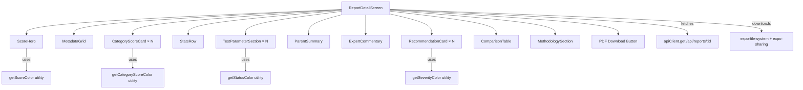

# Design Document: Report Detail UI

## Overview

This design describes the complete rewrite of the `ReportDetailScreen` in the ChoosePure mobile app. The current implementation renders test parameters as raw JSON and lacks visual hierarchy. The new design decomposes the screen into focused sub-components, each responsible for a single section of the report, following the existing project patterns (Card component, theme tokens, StyleSheet-based styling).

The screen will be a `ScrollView` container that fetches report data via the existing `apiClient` and delegates rendering to child components. Each sub-component receives props and is stateless where possible, making them testable in isolation.

## Architecture



**Data Flow:**
1. `ReportDetailScreen` fetches report data on mount via `apiClient`
2. Report state is stored in a single `useState` hook
3. Props are passed down to each sub-component — no prop drilling beyond one level
4. Expand/collapse state for `TestParameterSection` is managed locally within each section instance
5. PDF download uses `expo-file-system` for download and `expo-sharing` for the share sheet

## Components and Interfaces

### ReportDetailScreen (Container)

**File:** `src/screens/ReportDetailScreen.js`

**Props:** `{ route, navigation }` (from React Navigation)

**State:**
- `report: object | null` — full report data from API
- `loading: boolean` — fetch in progress
- `error: string | null` — error state key
- `downloading: boolean` — PDF download in progress

**Responsibilities:**
- Fetch report data on mount
- Handle loading, error, and subscription-required states
- Render sub-components in order with conditional visibility
- Handle PDF download and share

---

### ScoreHero

**File:** `src/components/report/ScoreHero.js`

**Props:**
```typescript
{
  productName: string,
  brandName: string,
  purityScore: number,
  scoreVerdict: string,
  scoreFormula?: string
}
```

**Renders:** Product name (bold heading), brand name (secondary), animated score circle with color based on score range, verdict text, optional formula text.

---

### MetadataGrid

**File:** `src/components/report/MetadataGrid.js`

**Props:**
```typescript
{
  labName?: string,
  labReportNumber?: string,
  reportDate?: string,
  batchCode?: string,
  sampleCondition?: string,
  totalParametersTested?: number,
  origin?: string,
  shelfLife?: string
}
```

**Renders:** A 2-column grid of key-value pairs. Null/empty fields are omitted.

---

### CategoryScoreCard

**File:** `src/components/report/CategoryScoreCard.js`

**Props:**
```typescript
{
  categoryName: string,
  score: number,
  description: string
}
```

**Renders:** Colored score badge (rounded square) + category name + description. Color determined by `getCategoryScoreColor(score)`.

---

### StatsRow

**File:** `src/components/report/StatsRow.js`

**Props:**
```typescript
{
  totalParameters: number,
  passCount: number,
  contextNotes: number,
  safetyConcerns: number
}
```

**Renders:** Horizontal row of metric chips. Each chip shows a large number + label. `safetyConcerns > 0` uses error color; `contextNotes > 0` uses warning color.

---

### TestParameterSection

**File:** `src/components/report/TestParameterSection.js`

**Props:**
```typescript
{
  categoryName: string,
  parameters: Array<{
    parameterName: string,
    result: string | number,
    unit: string,
    fssaiLimit: string,
    euLimit: string,
    usFdaLimit: string,
    status: 'Pass' | 'Fail' | 'Context'
  }>
}
```

**State (local):**
- `expanded: boolean` — defaults to `false`
- `expandedParam: number | null` — index of parameter showing detail

**Renders:** Tappable header with category name + chevron. When expanded, renders parameter rows with status badges. Tapping a row reveals limit details. Uses `LayoutAnimation` for smooth expand/collapse.

---

### ParentSummary

**File:** `src/components/report/ParentSummary.js`

**Props:**
```typescript
{
  summary: string
}
```

**Renders:** A card with `expo-linear-gradient` background (primary green gradient), white text, "What Parents Should Know" heading.

---

### RecommendationCard

**File:** `src/components/report/RecommendationCard.js`

**Props:**
```typescript
{
  severity: 'critical' | 'recommended' | 'positive',
  title: string,
  description: string
}
```

**Renders:** Severity tag pill (color-coded) + bold title + description text.

---

### ComparisonTable

**File:** `src/components/report/ComparisonTable.js`

**Props:**
```typescript
{
  comparisons: Array<{ productName: string, score: number, rating: string }>,
  currentProductName: string
}
```

**Renders:** Table with header row, one row per comparison. Current product row is highlighted with a distinct background.

---

### Utility Functions

**File:** `src/utils/scoreColors.js`

```javascript
// Purity score color mapping (Requirement 1.4-1.7)
export function getScoreColor(score) { ... }

// Category score color mapping (Requirement 3.3-3.5)
export function getCategoryScoreColor(score) { ... }

// Test parameter status color mapping (Requirement 5.7-5.9)
export function getStatusColor(status) { ... }

// Recommendation severity color mapping (Requirement 8.3-8.5)
export function getSeverityColor(severity) { ... }
```

## Data Models

### Report Object (from API)

```typescript
interface Report {
  productName: string;
  brandName: string;
  purityScore: number;
  scoreVerdict: string;
  scoreFormula?: string;
  
  categoryScores: Array<{
    categoryName: string;
    score: number;
    description: string;
  }>;
  
  testParameters: {
    [category: string]: Array<{
      parameterName: string;
      result: string | number;
      unit: string;
      fssaiLimit: string;
      euLimit: string;
      usFdaLimit: string;
      status: 'Pass' | 'Fail' | 'Context';
    }>;
  };
  
  stats: {
    totalParameters: number;
    passCount: number;
    contextNotes: number;
    safetyConcerns: number;
  };
  
  parentSummary?: string;
  expertCommentary?: string;
  methodology?: string;
  
  recommendations?: Array<{
    severity: 'critical' | 'recommended' | 'positive';
    title: string;
    description: string;
  }>;
  
  comparisons?: Array<{
    productName: string;
    score: number;
    rating: string;
  }>;
  
  labName?: string;
  labReportNumber?: string;
  reportDate?: string;
  batchCode?: string;
  sampleCondition?: string;
  totalParametersTested?: number;
  origin?: string;
  shelfLife?: string;
  
  pdfUrl?: string;
}
```

### Color Mapping Rules

| Function | Input Range | Output Color |
|----------|-------------|--------------|
| `getScoreColor` | ≥ 90 | `theme.colors.primary` (#226342) |
| `getScoreColor` | 70–89 | `theme.colors.scoreGood` (#2D6B4F) |
| `getScoreColor` | 40–69 | `theme.colors.warning` (#F4C430) |
| `getScoreColor` | < 40 | `theme.colors.error` (#D14E36) |
| `getCategoryScoreColor` | ≥ 90 | `theme.colors.primary` (#226342) |
| `getCategoryScoreColor` | 70–89 | `#1976D2` (blue) |
| `getCategoryScoreColor` | < 70 | `theme.colors.warning` (#F4C430) |
| `getStatusColor` | "Pass" | `theme.colors.success` (#1E8449) |
| `getStatusColor` | "Fail" | `theme.colors.error` (#D14E36) |
| `getStatusColor` | "Context" | `theme.colors.warning` (#F4C430) |
| `getSeverityColor` | "critical" | `theme.colors.error` (#D14E36) |
| `getSeverityColor` | "recommended" | `theme.colors.warning` (#F4C430) |
| `getSeverityColor` | "positive" | `theme.colors.success` (#1E8449) |

## Correctness Properties

*A property is a characteristic or behavior that should hold true across all valid executions of a system — essentially, a formal statement about what the system should do. Properties serve as the bridge between human-readable specifications and machine-verifiable correctness guarantees.*

### Property 1: Purity score color mapping is consistent with defined ranges

*For any* integer score between 0 and 100, `getScoreColor(score)` SHALL return the theme primary green when score ≥ 90, scoreGood when 70 ≤ score ≤ 89, warning when 40 ≤ score ≤ 69, and error when score < 40.

**Validates: Requirements 1.4, 1.5, 1.6, 1.7**

### Property 2: Category score color mapping is consistent with defined ranges

*For any* integer score between 0 and 100, `getCategoryScoreColor(score)` SHALL return the theme primary green when score ≥ 90, blue (#1976D2) when 70 ≤ score ≤ 89, and warning when score < 70.

**Validates: Requirements 3.3, 3.4, 3.5**

### Property 3: Metadata grid renders exactly the non-null fields

*For any* metadata object with a random subset of fields set to null/empty, the MetadataGrid component SHALL render exactly those fields that are non-null and non-empty, and SHALL omit all null/empty fields.

**Validates: Requirements 2.2, 2.3**

### Property 4: List-based sections render one item per input element

*For any* non-empty array (categoryScores, testParameters keys, recommendations, comparisons), the corresponding section SHALL render exactly as many items as the input array/object contains.

**Validates: Requirements 3.1, 5.1, 8.1, 9.1**

### Property 5: Status badge color mapping is consistent with status values

*For any* status value in the set {"Pass", "Fail", "Context"}, `getStatusColor(status)` SHALL return success (green) for "Pass", error (red) for "Fail", and warning (amber) for "Context".

**Validates: Requirements 5.7, 5.8, 5.9**

### Property 6: Severity tag color mapping is consistent with severity values

*For any* severity value in the set {"critical", "recommended", "positive"}, `getSeverityColor(severity)` SHALL return error (red) for "critical", warning (amber) for "recommended", and success (green) for "positive".

**Validates: Requirements 8.3, 8.4, 8.5**

### Property 7: Category section toggle inverts expanded state

*For any* TestParameterSection in either expanded or collapsed state, tapping the header SHALL produce the opposite state (expanded → collapsed, collapsed → expanded).

**Validates: Requirements 5.3**

### Property 8: Expanded category section displays all parameter fields

*For any* array of test parameters within an expanded TestParameterSection, every parameter's parameterName, result, unit, and status SHALL be rendered in the output.

**Validates: Requirements 5.5**

## Error Handling

| Scenario | Behavior |
|----------|----------|
| API returns 403 | Show subscription-required screen with subscribe CTA |
| API returns 401 | Show login-required screen |
| API returns other error | Show error message + retry button |
| PDF download fails | Show Alert with "Download Failed" message |
| Report data is null after fetch | Render nothing (return null) |
| Optional sections (parentSummary, expertCommentary, methodology, recommendations, comparisons) are missing | Omit the section entirely — no empty cards |
| Metadata fields are null | Omit from grid |
| pdfUrl is missing | Hide download button |

**Retry Strategy:** The retry button calls `fetchReport()` which resets loading state and re-fetches. No exponential backoff for manual retry.

## Testing Strategy

### Property-Based Tests (fast-check)

The project already has `fast-check` in devDependencies. Property tests will validate the pure utility functions and component rendering invariants.

**Library:** `fast-check` (already installed)
**Minimum iterations:** 100 per property
**Tag format:** `Feature: report-detail-ui, Property {number}: {property_text}`

Property tests target:
- `getScoreColor` — Property 1
- `getCategoryScoreColor` — Property 2
- `MetadataGrid` rendering — Property 3
- List rendering counts — Property 4
- `getStatusColor` — Property 5
- `getSeverityColor` — Property 6
- Toggle state logic — Property 7
- Parameter field rendering — Property 8

### Unit Tests (Jest + React Native Testing Library)

Unit tests cover specific examples and integration points:
- Loading state renders spinner
- Error states (403, 401, generic) render correct messages
- PDF download triggers file system and sharing APIs (mocked)
- Conditional sections appear/disappear based on data presence
- Current product highlighting in comparison table
- Parameter detail expansion shows limit values

### Test File Structure

```
src/
├── utils/__tests__/scoreColors.test.js       # Properties 1, 2, 5, 6
├── components/report/__tests__/
│   ├── MetadataGrid.test.js                  # Property 3
│   ├── TestParameterSection.test.js          # Properties 7, 8
│   ├── CategoryScoreCard.test.js             # Property 4 (partial)
│   ├── RecommendationCard.test.js            # Property 4 (partial)
│   └── ComparisonTable.test.js               # Property 4 (partial)
└── screens/__tests__/ReportDetailScreen.test.js  # Unit tests for states
```
