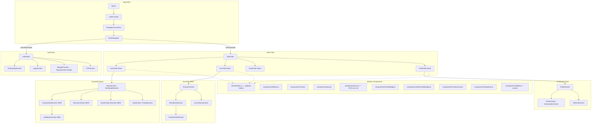
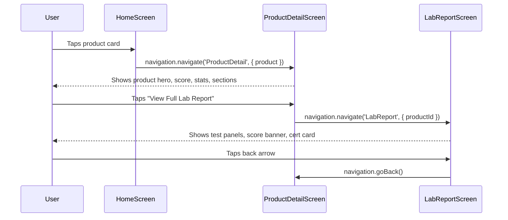
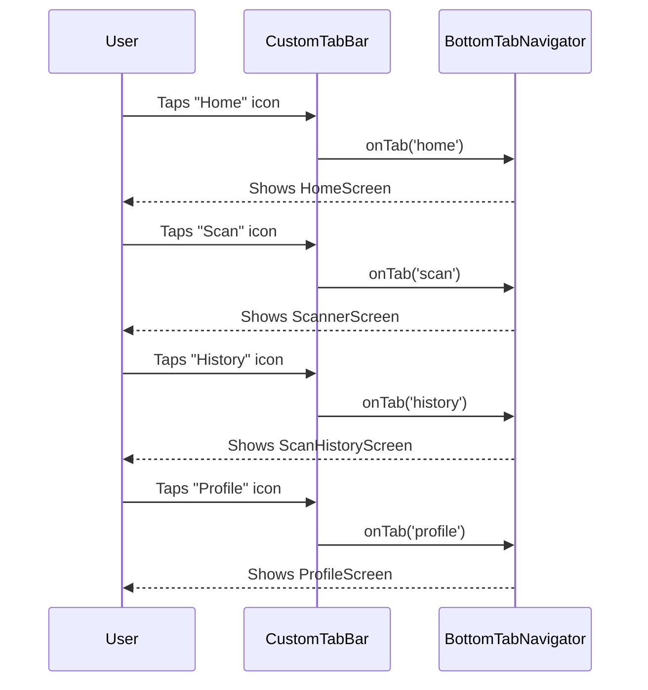

# Design Document: UI Redesign

## Overview

This feature converts all 14 screens from the React + Tailwind CSS handoff package (`react-handoff/`) into React Native `StyleSheet.create` code, updating the existing ChoosePure mobile app to match the new visual designs. The redesign introduces a refreshed color palette (green-800 `#226342` as primary, cream `#F5F7F4` as background), new shared components (ProductCard, ScoreBadge, NutriGradeBadge, Dropdown, custom Icon set), and 4 entirely new screens (DiscoverScreen, ProductDetailScreen, LabReportScreen, NutriGradeListScreen).

The app stays on Expo SDK 52, React Native 0.76, and the Inter font family exclusively (no Fraunces). All styling uses `StyleSheet.create` — no Tailwind, NativeWind, or CSS. The existing navigation structure (@react-navigation stack + bottom tabs) is restructured to match the new tab bar layout (Home, Scan, History, Profile) with stack screens for detail flows.

The handoff's `font-display` (Fraunces) references are mapped to `Inter_700Bold` throughout, keeping the app single-font-family while preserving the visual weight hierarchy.

## Architecture



## Sequence Diagrams

### Screen Navigation Flow — Home to Product Detail to Lab Report



### Tab Navigation Restructure



## Components and Interfaces

### Component 1: Updated Theme (`src/theme/index.js`)

**Purpose**: Central design token store mapping handoff Tailwind tokens to React Native values.

**Interface**:
```javascript
export const theme = {
  colors: {
    // Brand greens
    primary: '#226342',        // was #1F6B4E → green-800
    primaryLight: '#2D7A52',   // green-700
    primaryLighter: '#3D8862', // green-500
    primarySoft: '#5DA47B',    // green-400
    green100: '#D4E3D8',
    green50: '#EDF3EE',
    green25: '#F4F8F5',

    // Surfaces
    background: '#F5F7F4',     // cream
    cardBackground: '#FFFFFF',

    // Text
    text: '#1A201A',           // ink
    textSecondary: '#6B7268',  // ink-muted
    textDim: '#9B9F97',        // ink-dim

    // Borders
    border: '#ECEAE4',         // line
    borderSoft: '#F4F2EC',     // line-soft

    // Semantic
    error: '#D14E36',          // nutri-e (updated from #D62828)
    success: '#1E8449',        // nutri-a
    warning: '#F4C430',        // nutri-c

    // Nutri-Score
    nutriA: '#1E8449',
    nutriB: '#7CB342',
    nutriC: '#F4C430',
    nutriD: '#E89B3C',
    nutriE: '#D14E36',

    // Safety scores
    scoreGood: '#2D6B4F',
    scoreGoodBg: '#D9E8DD',
    scoreMid: '#8B6F3D',
    scoreMidBg: '#F0E5D5',
    scoreBad: '#A8482E',
    scoreBadBg: '#F4DDD4',

    // Legacy compat
    locked: '#BDBDBD',
    accent: '#8A6E4B',
  },
  fonts: {
    regular: 'Inter_400Regular',
    medium: 'Inter_500Medium',
    semiBold: 'Inter_600SemiBold',
    bold: 'Inter_700Bold',
    // display maps to bold (Fraunces → Inter_700Bold)
    display: 'Inter_700Bold',
  },
  fontSize: {
    '2xs': 10,
    xs: 11,
    sm: 13,
    base: 14,
    md: 15,
    lg: 17,
    xl: 19,
    '2xl': 22,
    '3xl': 26,
    '4xl': 32,
  },
  lineHeight: {
    '2xs': 14,
    xs: 16,
    sm: 19.5,
    base: 21.7,
    md: 22.5,
    lg: 23.8,
    xl: 24.7,
    '2xl': 27.5,
    '3xl': 31.2,
    '4xl': 35.2,
  },
  spacing: { xs: 4, sm: 8, md: 16, lg: 24, xl: 32 },
  borderRadius: { sm: 8, md: 10, lg: 14, xl: 18, '2xl': 24 },
  shadow: {
    card: {
      shadowColor: '#000',
      shadowOffset: { width: 0, height: 1 },
      shadowOpacity: 0.04,
      shadowRadius: 3,
      elevation: 1,
    },
    elev: {
      shadowColor: '#226342',
      shadowOffset: { width: 0, height: 4 },
      shadowOpacity: 0.18,
      shadowRadius: 12,
      elevation: 4,
    },
    pop: {
      shadowColor: '#000',
      shadowOffset: { width: 0, height: 8 },
      shadowOpacity: 0.12,
      shadowRadius: 24,
      elevation: 8,
    },
  },
};
```

**Responsibilities**:
- Single source of truth for all visual tokens
- Backward-compatible with existing screen references (colors.primary, fonts.regular, etc.)
- New tokens added alongside old ones for incremental migration

### Component 2: Icon (`src/components/Icon.js`)

**Purpose**: SVG icon set using `react-native-svg`, porting the 30+ stroke icons from the handoff's `Icon.jsx`.

**Interface**:
```javascript
import React from 'react';
import Svg, { Path, Circle, Rect } from 'react-native-svg';

// Props interface
// name: string — icon identifier (e.g., 'home', 'scan', 'user')
// size: number — width & height in dp (default 20)
// color: string — stroke/fill color (default theme.colors.text)
// strokeWidth: number — SVG stroke width (default 1.7)

export default function Icon({ name, size = 20, color, strokeWidth = 1.7 }) {
  // Switch on name, render Svg with Path/Circle/Rect
  // All icons use 24x24 viewBox, scaled to `size`
}
```

**Responsibilities**:
- Replace emoji tab icons with proper SVG icons
- Provide consistent icon API across all screens
- Support both stroke and fill icons (most are stroke, `star`, `leaf`, `flash`, `check-circle` are fill)

### Component 3: Button (`src/components/Button.js`)

**Purpose**: Reusable button with 5 variants and 3 sizes matching the handoff.

**Interface**:
```javascript
// variant: 'primary' | 'secondary' | 'ghost' | 'danger' | 'outline'
// size: 'sm' | 'md' | 'lg'
// fullWidth: boolean
// disabled: boolean
// onPress: () => void
// children: ReactNode (text or icon + text)

export default function Button({ variant, size, fullWidth, disabled, onPress, children }) {
  // Returns TouchableOpacity with styled View + Text
}
```

**Style mapping**:
| Variant | Background | Text Color | Border |
|---------|-----------|------------|--------|
| primary | green-800 `#226342` | white | none |
| secondary | green-50 `#EDF3EE` | green-800 | none |
| ghost | transparent | green-800 | none |
| danger | nutri-e `#D14E36` | white | none |
| outline | transparent | green-800 | green-800 1px |

| Size | paddingH | paddingV | fontSize | borderRadius |
|------|----------|----------|----------|-------------|
| sm | 12 | 8 | 13 | 10 |
| md | 16 | 12 | 14 | 14 |
| lg | 20 | 16 | 14 | 14 |

### Component 4: Card (`src/components/Card.js`)

**Purpose**: White surface with standard shadow and border, matching `.cp-card`.

**Interface**:
```javascript
// children: ReactNode
// style: ViewStyle (optional override)
// onPress: () => void (optional — makes it touchable)

export default function Card({ children, style, onPress }) {
  const Wrapper = onPress ? TouchableOpacity : View;
  return (
    <Wrapper style={[styles.card, style]} onPress={onPress} activeOpacity={0.8}>
      {children}
    </Wrapper>
  );
}

// styles.card = {
//   backgroundColor: '#FFFFFF',
//   borderRadius: 14,          // lg
//   borderWidth: 1,
//   borderColor: '#ECEAE4',    // border
//   ...theme.shadow.card,
// }
```

### Component 5: Input (`src/components/Input.js`)

**Purpose**: Form input with optional left/right icons and label, matching the handoff's `Input.jsx`.

**Interface**:
```javascript
// label: string
// leftIcon: string (icon name)
// rightIcon: string (icon name)
// onRightIconPress: () => void
// error: string (shows error state)
// ...TextInputProps

export default function Input({ label, leftIcon, rightIcon, onRightIconPress, error, ...rest }) {
  // Renders label (uppercase, tracking, 10px) + TextInput with icon overlays
}
```

### Component 6: ScoreBadge (`src/components/ScoreBadge.js`)

**Purpose**: Circular safety-score badge (0-100) with color tiers.

**Interface**:
```javascript
// score: number (0-100)
// size: number (default 44)

export default function ScoreBadge({ score, size = 44 }) {
  // Tier logic:
  // >= 90: bg #D9E8DD, fg #2D6B4F
  // >= 80: bg #DCEAF4, fg #2C5F87
  // >= 70: bg #F0E5D5, fg #8B6F3D
  // < 70:  bg #F4DDD4, fg #A8482E
}
```

### Component 7: NutriGradeBadge (`src/components/NutriGradeBadge.js`)

**Purpose**: Square A-E Nutri-Score badge with grade-specific colors.

**Interface**:
```javascript
// grade: 'A' | 'B' | 'C' | 'D' | 'E'
// size: number (default 40)

export default function NutriGradeBadge({ grade, size = 40 }) {
  // Color mapping from NUTRI_GRADES constant
}
```

### Component 8: ProductCard (`src/components/ProductCard.js`)

**Purpose**: Horizontal product list row with image placeholder, name, brand, meta, and optional score/grade badge.

**Interface**:
```javascript
// name: string
// brand: string
// meta: string (e.g., "2 hours ago" or "Dairy")
// score: number (renders ScoreBadge)
// grade: string (renders NutriGradeBadge)
// imageColors: [string, string] (gradient start/end for placeholder)
// onPress: () => void

export default function ProductCard({ name, brand, meta, score, grade, imageColors, onPress }) {
  // Card wrapper with 56x56 rounded image, text column, badge on right
}
```

### Component 9: Dropdown (`src/components/Dropdown.js`)

**Purpose**: Expandable option picker for grade filtering on HomeScreen.

**Interface**:
```javascript
// label: string
// value: string
// options: Array<{ value, label, meta }>
// onChange: (value) => void
// renderLeft: (activeOption) => ReactNode
// renderOption: (option) => ReactNode

export default function Dropdown({ label, value, options, onChange, renderLeft, renderOption }) {
  // Uses Modal or Animated view for dropdown panel
}
```

## Data Models

### Design Token Types

```javascript
// Color palette — maps Tailwind config to RN values
const ColorTokens = {
  primary: '#226342',
  primaryLight: '#2D7A52',
  background: '#F5F7F4',
  cardBackground: '#FFFFFF',
  text: '#1A201A',
  textSecondary: '#6B7268',
  textDim: '#9B9F97',
  border: '#ECEAE4',
  borderSoft: '#F4F2EC',
  nutriA: '#1E8449',
  nutriB: '#7CB342',
  nutriC: '#F4C430',
  nutriD: '#E89B3C',
  nutriE: '#D14E36',
};

// Font size scale — Tailwind text-* → RN fontSize numbers
const FontSizeScale = {
  '2xs': 10,  // text-2xs
  'xs': 11,   // text-xs
  'sm': 13,   // text-sm
  'base': 14, // text-base
  'md': 15,   // text-md
  'lg': 17,   // text-lg
  'xl': 19,   // text-xl
  '2xl': 22,  // text-2xl
  '3xl': 26,  // text-3xl
  '4xl': 32,  // text-4xl
};

// Nutri-Grade data model
const NutriGrade = {
  grade: 'A',       // 'A' | 'B' | 'C' | 'D' | 'E'
  count: 342,       // number of products
  bg: '#1E8449',    // badge background
  text: '#fff',     // badge text color
  label: 'Excellent' // human-readable label
};

// Product card data model
const ProductCardData = {
  name: 'Organic Whole Milk',
  brand: 'Happy Valley Farms',
  meta: '2 hours ago',
  score: 87,           // optional: 0-100 safety score
  grade: 'A',          // optional: A-E nutri grade
  imageColors: ['#F4F0E8', '#B8A584'], // gradient placeholder
};
```

**Validation Rules**:
- `score` must be 0-100 integer when present
- `grade` must be one of 'A', 'B', 'C', 'D', 'E' when present
- `score` and `grade` are mutually exclusive on ProductCard (show one badge)
- All color values must be valid hex strings
- Font family values must match loaded Expo font names exactly


## Algorithmic Pseudocode

### Tailwind Class → React Native Style Conversion Algorithm

```javascript
// ALGORITHM: convertTailwindToRN(className)
// INPUT: Tailwind CSS class string from handoff JSX
// OUTPUT: React Native StyleSheet properties object

function convertTailwindToRN(className) {
  // Precondition: className is a valid Tailwind class from the handoff config
  // Postcondition: returns equivalent RN style object

  const rules = {
    // Spacing: px-5 → paddingHorizontal: 20 (5 * 4)
    // py-3 → paddingVertical: 12
    // gap-2.5 → gap: 10
    // mb-4 → marginBottom: 16

    // Typography: text-lg → fontSize: 17
    // font-semibold → fontFamily: 'Inter_600SemiBold'
    // font-display → fontFamily: 'Inter_700Bold' (Fraunces → Inter bold)
    // tracking-widest → letterSpacing: 4
    // tracking-wider → letterSpacing: 1

    // Colors: text-green-800 → color: '#226342'
    // text-ink → color: '#1A201A'
    // text-ink-muted → color: '#6B7268'
    // bg-cream → backgroundColor: '#F5F7F4'
    // bg-white → backgroundColor: '#FFFFFF'
    // border-line → borderColor: '#ECEAE4'

    // Layout: flex → flexDirection: 'row' (in context)
    // flex-col → flexDirection: 'column'
    // items-center → alignItems: 'center'
    // justify-between → justifyContent: 'space-between'
    // flex-1 → flex: 1

    // Borders: rounded-lg → borderRadius: 14
    // rounded-md → borderRadius: 10
    // rounded-full → borderRadius: 9999
    // border → borderWidth: 1

    // Sizing: w-14 → width: 56
    // h-14 → height: 56
    // w-full → width: '100%'
  };

  return mapClassToStyle(className, rules);
}
```

### Screen Conversion Algorithm

```javascript
// ALGORITHM: convertScreen(handoffJSX)
// INPUT: React + Tailwind JSX screen component from react-handoff/
// OUTPUT: React Native screen component with StyleSheet

function convertScreen(handoffJSX) {
  // Precondition: handoffJSX is a valid React component using Tailwind classes
  // Postcondition: output is a valid React Native component using StyleSheet.create

  // Step 1: Replace HTML elements with RN equivalents
  // <div> → <View>
  // <p>, <span>, <h1-h6> → <Text>
  // <button> → <TouchableOpacity>
  // <input> → <TextInput>
  //  → <Image>
  // <header> → <View>
  // <nav> → <View>

  // Step 2: Extract className strings → StyleSheet properties
  // className="px-5 pt-1 pb-3 flex items-center justify-between"
  // → style={styles.header}
  // header: { paddingHorizontal: 20, paddingTop: 4, paddingBottom: 12,
  //           flexDirection: 'row', alignItems: 'center', justifyContent: 'space-between' }

  // Step 3: Replace web events with RN events
  // onClick → onPress
  // onChange → onChangeText
  // onSubmit → onSubmitEditing

  // Step 4: Replace navigate() prop with navigation.navigate()
  // navigate('home') → navigation.navigate('Home')

  // Step 5: Replace inline CSS gradients with LinearGradient or solid colors
  // style={{ background: 'linear-gradient(...)' }}
  // → <LinearGradient colors={[...]} /> or solid backgroundColor fallback

  // Step 6: Preserve existing business logic (API calls, auth, state)
  // Keep useAuth(), apiClient, analytics, etc. unchanged

  // Step 7: Apply theme tokens from updated theme/index.js
  // Replace hardcoded colors with theme.colors.*
  // Replace font strings with theme.fonts.*

  return rnComponent;
}
```

### Icon Migration Algorithm

```javascript
// ALGORITHM: migrateIcons()
// INPUT: Icon.jsx SVG definitions (30+ icons, 24x24 viewBox)
// OUTPUT: Icon.js using react-native-svg

function migrateIcons() {
  // Precondition: react-native-svg is installed
  // Postcondition: all icons render identically to web SVGs

  // Step 1: Install react-native-svg
  // npx expo install react-native-svg

  // Step 2: For each icon in Icon.jsx switch statement:
  //   - Replace <svg> with <Svg>
  //   - Replace <path> with <Path>
  //   - Replace <circle> with <Circle>
  //   - Replace <rect> with <Rect>
  //   - Replace className sizing with width/height props
  //   - Replace currentColor with color prop
  //   - Keep viewBox, strokeWidth, strokeLinecap, strokeLinejoin

  // Step 3: Export as single component with name-based switch
  // Icon({ name: 'home', size: 24, color: '#226342' })

  // Icon count: home, scan, scan-corners, flask, tag, user, clock,
  //   search, arrow-left, arrow-right, chevron-right, chevron-down,
  //   check, check-circle, close, eye, mail, phone, flash, image,
  //   info, shield-check, leaf, gift, star, plus, bell, lock, help,
  //   logout, share, sliders, warn-tri (33 icons total)
}
```

## Key Functions with Formal Specifications

### Function 1: `scoreTier(score)`

```javascript
function scoreTier(score) {
  if (score >= 90) return { bg: '#D9E8DD', fg: '#2D6B4F' };
  if (score >= 80) return { bg: '#DCEAF4', fg: '#2C5F87' };
  if (score >= 70) return { bg: '#F0E5D5', fg: '#8B6F3D' };
  return              { bg: '#F4DDD4', fg: '#A8482E' };
}
```

**Preconditions:**
- `score` is a number, 0 ≤ score ≤ 100

**Postconditions:**
- Returns object with `bg` (background hex) and `fg` (foreground hex)
- Tier boundaries: [90-100] green, [80-89] blue, [70-79] amber, [0-69] red
- Colors match handoff ScoreBadge.jsx exactly

### Function 2: `getNutriGradeColor(grade)`

```javascript
function getNutriGradeColor(grade) {
  const map = {
    A: { bg: '#1E8449', text: '#FFFFFF' },
    B: { bg: '#7CB342', text: '#FFFFFF' },
    C: { bg: '#F4C430', text: '#1A201A' },
    D: { bg: '#E89B3C', text: '#FFFFFF' },
    E: { bg: '#D14E36', text: '#FFFFFF' },
  };
  return map[grade] || map.C;
}
```

**Preconditions:**
- `grade` is a string, expected 'A' | 'B' | 'C' | 'D' | 'E'

**Postconditions:**
- Returns `{ bg, text }` color pair
- Grade C uses dark text (#1A201A), all others use white
- Falls back to Grade C colors for unknown grades

### Function 3: `mapScreenRoute(handoffRoute)`

```javascript
function mapScreenRoute(handoffRoute) {
  const routeMap = {
    'home':           'DashboardHome',
    'login':          'Login',
    'signup':         'Register',
    'onboarding':     'Onboarding',
    'otp':            'OTP',
    'scanner':        'ScannerHome',
    'product-detail': 'ProductDetail',
    'lab-report':     'LabReport',
    'discover':       'Discover',
    'nutri-grade-list':'NutriGradeList',
    'plans':          'Subscription',
    'referral':       'Referral',
    'vote':           'Polling',
    'profile':        'ProfileHome',
    'history':        'ScanHistory',
  };
  return routeMap[handoffRoute] || handoffRoute;
}
```

**Preconditions:**
- `handoffRoute` is a string from the handoff's `navigate()` calls

**Postconditions:**
- Returns the corresponding React Navigation route name
- Unknown routes pass through unchanged

## Example Usage

### Using the updated theme

```javascript
import { theme } from '../theme';

const styles = StyleSheet.create({
  container: {
    flex: 1,
    backgroundColor: theme.colors.background, // #F5F7F4
  },
  title: {
    fontFamily: theme.fonts.bold,     // Inter_700Bold
    fontSize: theme.fontSize['2xl'],  // 22
    color: theme.colors.text,         // #1A201A
  },
  card: {
    backgroundColor: theme.colors.cardBackground,
    borderRadius: theme.borderRadius.lg,  // 14
    borderWidth: 1,
    borderColor: theme.colors.border,     // #ECEAE4
    ...theme.shadow.card,
  },
  primaryButton: {
    backgroundColor: theme.colors.primary, // #226342
    paddingVertical: 16,
    borderRadius: theme.borderRadius.lg,
    alignItems: 'center',
  },
});
```

### Using shared components

```javascript
import Icon from '../components/Icon';
import Button from '../components/Button';
import Card from '../components/Card';
import ProductCard from '../components/ProductCard';
import ScoreBadge from '../components/ScoreBadge';

// Icon usage
<Icon name="home" size={24} color={theme.colors.primary} />
<Icon name="scan" size={24} color={theme.colors.textSecondary} />

// Button variants
<Button variant="primary" size="lg" fullWidth onPress={handleSubmit}>
  Sign In
</Button>
<Button variant="outline" onPress={handleGoogle}>
  Continue with Google
</Button>

// Card wrapper
<Card style={{ padding: 20 }}>
  <Text>Content inside card</Text>
</Card>

// Product card in a list
<ProductCard
  name="Organic Whole Milk"
  brand="Happy Valley Farms"
  meta="2 hours ago"
  score={87}
  imageColors={['#F4F0E8', '#B8A584']}
  onPress={() => navigation.navigate('ProductDetail', { product })}
/>
```

## Screen-by-Screen Conversion Plan

### Mapping Table

| # | Handoff Screen | Existing Screen | Action | Route Name |
|---|---------------|----------------|--------|------------|
| 1 | OnboardingScreen.jsx | OnboardingScreen.js | Restyle | Onboarding |
| 2 | LoginScreen.jsx | LoginScreen.js | Restyle | Login |
| 3 | SignupScreen.jsx | RegisterScreen.js | Restyle | Register |
| 4 | OTPScreen.jsx | OTPScreen.js | Restyle | OTP |
| 5 | HomeScreen.jsx | DashboardScreen.js | Restyle (major) | DashboardHome |
| 6 | ScannerScreen.jsx | ScannerScreen.js | Restyle | ScannerHome |
| 7 | ProductDetailScreen.jsx | — | Create new | ProductDetail |
| 8 | LabReportScreen.jsx | — | Create new | LabReport |
| 9 | DiscoverScreen.jsx | — | Create new | Discover |
| 10 | NutriGradeListScreen.jsx | — | Create new | NutriGradeList |
| 11 | PlansScreen.jsx | SubscriptionScreen.js | Restyle | Subscription |
| 12 | ReferralScreen.jsx | ReferralScreen.js | Restyle | Referral |
| 13 | VoteScreen.jsx | PollingScreen.js | Restyle | Polling |
| 14 | ProfileScreen.jsx | ProfileScreen.js | Restyle | ProfileHome |

### Key Conversion Notes Per Screen

**1. OnboardingScreen**: Replace logo circle with image. Add slide content from handoff (3 slides with different copy). Animated dot indicators (active: w-24 green-700, inactive: w-8 green-100). Green-50 background instead of default.

**2. LoginScreen**: Add email/mobile tab switcher. Add social login buttons (Google, Apple) with outline variant. Card-wrapped form fields with icon inputs. "Forgot password?" link inside card.

**3. RegisterScreen → SignupScreen**: Card-wrapped form with icon inputs (user, mail, phone, lock+eye). Terms/Privacy text. Logo card at top.

**4. OTPScreen**: 6 individual digit inputs (not single TextInput). Mail icon in green circle. Card-wrapped instruction text. Resend timer.

**5. HomeScreen (DashboardScreen)**: Most complex conversion. Search bar card with scan-corners icon. "Latest Testing Reports" section with ProductCard list. "Check Nutri-score" section with Dropdown grade filter and ProductCard list. Avatar button linking to profile. Greeting text.

**6. ScannerScreen**: Dark theme viewfinder with green corner brackets. Flash/gallery buttons. Recent scans thumbnails. Manual barcode entry link. Animated scan line.

**7. ProductDetailScreen (NEW)**: Gradient hero with product image placeholder. Score badge (64px) with label. 3-column quick stats (Nutri/NOVA/Eco). Collapsible info sections (Ingredients, Allergens, Certifications). "View Full Lab Report" button.

**8. LabReportScreen (NEW)**: Product summary card. Green gradient score banner with check icon. 3 test panels (Heavy Metals, Pesticide, Microbiological) with pass/fail rows. Certified lab partner card.

**9. DiscoverScreen (NEW)**: Search bar. Horizontal category pills (scrollable). Product list with scores. Filter icon in header.

**10. NutriGradeListScreen (NEW)**: 5-column grade pill selector. Search bar with clear button. Category pills. Filtered product list with grade badges. Result count text.

**11. PlansScreen (SubscriptionScreen)**: Star icon in green circle. 3 plan cards (Monthly/Yearly/Family) with radio selection. "Best value" badge on yearly. Perks checklist with check icons. "Start Free Trial" CTA.

**12. ReferralScreen**: Green gradient earnings banner with gift icon. Referral code box with dashed border and copy button. 3-step "How it works" with numbered circles. Recent activity list.

**13. VoteScreen (PollingScreen)**: Suggestion cards with vote/voted toggle buttons. "Suggest a category" input card. Explanation card at top.

**14. ProfileScreen**: Avatar with gradient background. Name, email, subscription badge. 3-column stats (Scans/Saved/Referrals). Grouped menu sections (Account, Subscription, Support) with icons and chevrons. Sign out in red.

## Navigation Changes

### Current Tab Structure (to be replaced)
```
Dashboard | Scan | Polling | Suggestions | Referral | Profile
```

### New Tab Structure (from handoff)
```
Home | Scan | History | Profile
```

### Required Changes

1. **MainTabs.js**: Reduce from 6 tabs to 4 tabs (Home, Scan, History, Profile)
2. **Remove Suggestions tab**: Merge into Home or remove
3. **Remove standalone Referral tab**: Move to Profile stack
4. **Remove standalone Polling tab**: Move to Home stack (accessible from Home)
5. **Add custom tab bar**: Replace default bottom tab bar with custom component using SVG icons
6. **HomeTab stack**: DashboardHome → ProductDetail → LabReport, Discover, NutriGradeList, VoteScreen
7. **ScanTab stack**: ScannerHome → ResultCard → ProductDetail, ScanHistory
8. **ProfileTab stack**: ProfileHome → Subscription (Plans), Referral, Vision

### Custom Tab Bar Component

Replace the default `@react-navigation/bottom-tabs` tab bar with a custom component matching the handoff's `TabBar.jsx`:

```javascript
function CustomTabBar({ state, descriptors, navigation }) {
  const tabs = [
    { route: 'Home',    icon: 'home',  label: 'Home' },
    { route: 'Scan',    icon: 'scan',  label: 'Scan' },
    { route: 'History', icon: 'clock', label: 'History' },
    { route: 'Profile', icon: 'user',  label: 'Profile' },
  ];

  return (
    <View style={styles.tabBar}>
      {tabs.map((tab, index) => {
        const isFocused = state.index === index;
        return (
          <TouchableOpacity
            key={tab.route}
            style={styles.tabItem}
            onPress={() => navigation.navigate(tab.route)}
          >
            <Icon
              name={tab.icon}
              size={24}
              color={isFocused ? '#226342' : '#6B7268'}
              strokeWidth={isFocused ? 2 : 1.7}
            />
            <Text style={[styles.tabLabel, isFocused && styles.tabLabelActive]}>
              {tab.label}
            </Text>
          </TouchableOpacity>
        );
      })}
    </View>
  );
}
```

## Icon Strategy

### Approach: react-native-svg

The handoff uses 33 custom SVG icons defined inline in `Icon.jsx`. The migration strategy:

1. **Install**: `npx expo install react-native-svg` (already compatible with Expo SDK 52)
2. **Create `src/components/Icon.js`**: Port all 33 icon definitions from the handoff
3. **SVG → react-native-svg mapping**:
   - `<svg>` → `<Svg>`
   - `<path>` → `<Path>`
   - `<circle>` → `<Circle>`
   - `<rect>` → `<Rect>`
   - `className` sizing → `width`/`height` props
   - `currentColor` → explicit `color` prop
   - `stroke="currentColor"` → `stroke={color}`
   - `fill="currentColor"` → `fill={color}` (for filled icons)
   - `fill="none"` → `fill="none"` (for stroke icons)

4. **Icon list** (33 icons):
   `home`, `scan`, `scan-corners`, `flask`, `tag`, `user`, `clock`, `search`, `arrow-left`, `arrow-right`, `chevron-right`, `chevron-down`, `check`, `check-circle`, `close`, `eye`, `mail`, `phone`, `flash`, `image`, `info`, `shield-check`, `leaf`, `gift`, `star`, `plus`, `bell`, `lock`, `help`, `logout`, `share`, `sliders`, `warn-tri`

5. **Replace emoji icons**: Current MainTabs uses emoji (🏠📷🗳️💡🎁👤) — replace with SVG Icon component

## Color Palette Migration

### Old → New Color Mapping

| Token | Old Value | New Value | Notes |
|-------|----------|-----------|-------|
| primary | `#1F6B4E` | `#226342` | Slightly different green |
| background | `#FAFAF7` | `#F5F7F4` | Warmer cream |
| text | `#1A1A1A` | `#1A201A` | Slightly green-tinted |
| textSecondary | `#6B6B6B` | `#6B7268` | Green-tinted gray |
| error | `#D62828` | `#D14E36` | Now matches nutri-E |
| success | `#2E7D32` | `#1E8449` | Now matches nutri-A |
| warning | `#FFB703` | `#F4C430` | Now matches nutri-C |
| border | `#E0E0E0` | `#ECEAE4` | Warmer border |
| cardBackground | `#FFFFFF` | `#FFFFFF` | Unchanged |

### New Tokens Added

| Token | Value | Purpose |
|-------|-------|---------|
| textDim | `#9B9F97` | Tertiary text (timestamps, hints) |
| borderSoft | `#F4F2EC` | Subtle dividers within cards |
| green25-green900 | Various | Full green scale for backgrounds/accents |
| nutriA-nutriE | Various | Nutri-Score badge colors |
| scoreGood/Mid/Bad | Various | Safety score tier colors |
| shadow.card/elev/pop | Various | Three shadow levels |

## Error Handling

### Error Scenario 1: Missing Icon Name

**Condition**: `Icon` component receives an unknown `name` prop
**Response**: Return `null` (render nothing), matching handoff behavior
**Recovery**: No crash; developer sees empty space and can check icon name

### Error Scenario 2: Invalid Score/Grade

**Condition**: `ScoreBadge` receives score outside 0-100 or `NutriGradeBadge` receives invalid grade
**Response**: ScoreBadge renders with lowest tier colors; NutriGradeBadge falls back to Grade C
**Recovery**: Visual indicator of unexpected data; no crash

### Error Scenario 3: LinearGradient Not Available

**Condition**: Some handoff screens use CSS gradients (hero sections, banners)
**Response**: Fall back to solid background color (primary or midpoint of gradient)
**Recovery**: Install `expo-linear-gradient` for full gradient support; solid color is acceptable fallback

### Error Scenario 4: react-native-svg Not Installed

**Condition**: Icon component imported before dependency is installed
**Response**: Build error at compile time
**Recovery**: Run `npx expo install react-native-svg` before using Icon component

## Testing Strategy

### Unit Testing Approach

- Test `scoreTier()` with boundary values (69, 70, 79, 80, 89, 90, 100)
- Test `getNutriGradeColor()` with all 5 grades + invalid input
- Test theme token values match handoff token values exactly
- Test Button renders correct styles for each variant/size combination
- Test Icon renders correct SVG paths for each icon name

### Property-Based Testing Approach

**Property Test Library**: fast-check (already in devDependencies)

- **ScoreBadge color consistency**: For any score 0-100, `scoreTier(score)` returns valid hex colors and the tier boundaries are monotonically ordered
- **NutriGradeBadge completeness**: For any grade in ['A','B','C','D','E'], badge renders with non-null colors
- **Theme token completeness**: Every color referenced in StyleSheet.create across all screens exists in theme.colors
- **Font family validity**: Every fontFamily in theme.fonts matches a loaded Expo font name

### Integration Testing Approach

- Verify navigation flow: Onboarding → Login → Home → ProductDetail → LabReport
- Verify tab bar highlights correct tab on each screen
- Verify existing functionality preserved: barcode scanning, API calls, auth flow, Razorpay payments
- Verify all 14 screens render without crashes on iOS and Android

## Performance Considerations

- **Icon component**: Use `React.memo` on Icon to prevent re-renders when props haven't changed
- **ProductCard list**: Use `FlatList` with `keyExtractor` for all product lists (not ScrollView with map)
- **Image placeholders**: Use `LinearGradient` from `expo-linear-gradient` for gradient placeholders instead of images
- **StyleSheet.create**: All styles defined outside component render (already the pattern in existing code)
- **Font loading**: No new fonts needed — Inter is already loaded in App.js

## Security Considerations

- No security changes — this is a visual-only redesign
- All API calls, auth flows, and payment integrations remain unchanged
- No new network requests or data storage
- Existing input validation (barcode, registration form) preserved

## Dependencies

### New Dependencies Required

| Package | Version | Purpose |
|---------|---------|---------|
| `react-native-svg` | Expo-compatible | SVG icon rendering |
| `expo-linear-gradient` | Expo-compatible | Gradient backgrounds (hero sections, banners) |

### Existing Dependencies (unchanged)

- `@expo-google-fonts/inter` — Font loading
- `@react-navigation/bottom-tabs` + `@react-navigation/stack` — Navigation
- `expo-camera` — Barcode scanning
- `react-native-razorpay` — Payments
- All Firebase packages — Auth, analytics, messaging
- `fast-check` — Property-based testing

### No Dependencies Needed For

- Tailwind/NativeWind — NOT used (pure StyleSheet)
- Icon libraries (Ionicons, MaterialIcons) — Custom SVG icons instead
- UI component libraries — All components are custom

## Correctness Properties

*A property is a characteristic or behavior that should hold true across all valid executions of a system — essentially, a formal statement about what the system should do. Properties serve as the bridge between human-readable specifications and machine-verifiable correctness guarantees.*

### Property 1: Theme color tokens match specification

*For any* color token key in the expected set (primary, primaryLight, primaryLighter, primarySoft, green100, green50, green25, background, cardBackground, text, textSecondary, textDim, border, borderSoft, error, success, warning, nutriA, nutriB, nutriC, nutriD, nutriE, scoreGood, scoreMid, scoreBad), `theme.colors[key]` shall equal the hex value specified in the design document.

**Validates: Requirement 1.1**

### Property 2: Theme fontSize tokens match specification

*For any* fontSize key in the expected set (`2xs`, `xs`, `sm`, `base`, `md`, `lg`, `xl`, `2xl`, `3xl`, `4xl`), `theme.fontSize[key]` shall equal the specified numeric value (10, 11, 13, 14, 15, 17, 19, 22, 26, 32 respectively).

**Validates: Requirement 1.3**

### Property 3: Theme shadow presets contain valid React Native shadow properties

*For any* shadow preset key in (`card`, `elev`, `pop`), the object shall contain `shadowColor` (string), `shadowOffset` (object with width and height), `shadowOpacity` (number 0-1), `shadowRadius` (non-negative number), and `elevation` (non-negative integer).

**Validates: Requirement 1.5**

### Property 4: Icon renders for all valid icon names

*For any* icon name in the set of 33 valid names (home, scan, scan-corners, flask, tag, user, clock, search, arrow-left, arrow-right, chevron-right, chevron-down, check, check-circle, close, eye, mail, phone, flash, image, info, shield-check, leaf, gift, star, plus, bell, lock, help, logout, share, sliders, warn-tri), the Icon component shall return a non-null rendered element.

**Validates: Requirement 2.1**

### Property 5: Icon returns null for invalid icon names

*For any* arbitrary string that is not in the set of 33 valid icon names, the Icon component shall return null without throwing an error.

**Validates: Requirement 2.4**

### Property 6: Icon size scaling produces correct dimensions

*For any* valid icon name and any positive numeric size, the rendered SVG element shall have `width` equal to `size`, `height` equal to `size`, and `viewBox` equal to `"0 0 24 24"`.

**Validates: Requirements 2.2, 2.3**

### Property 7: Button variant style correctness

*For any* variant in (`primary`, `secondary`, `ghost`, `danger`, `outline`), the Button component shall render with the specified backgroundColor, text color, and border properties for that variant.

**Validates: Requirement 3.1**

### Property 8: Button size dimension correctness

*For any* size in (`sm`, `md`, `lg`), the Button component shall render with the specified paddingHorizontal, paddingVertical, fontSize, and borderRadius for that size.

**Validates: Requirement 3.2**

### Property 9: ScoreBadge tier color boundaries

*For any* integer score in the range 0-100 and any positive size, `scoreTier(score)` shall return the green tier colors for scores >= 90, blue tier for 80-89, amber tier for 70-79, and red tier for 0-69. The badge shall render at the given size dimensions displaying the numeric score.

**Validates: Requirements 6.1, 6.2, 6.3**

### Property 10: NutriGradeBadge color correctness for valid grades

*For any* grade in (`A`, `B`, `C`, `D`, `E`), `getNutriGradeColor(grade)` shall return the specified background and text color pair, and the badge shall display the grade letter.

**Validates: Requirements 7.1, 7.2**

### Property 11: NutriGradeBadge invalid grade fallback

*For any* string that is not one of `A`, `B`, `C`, `D`, `E`, the NutriGradeBadge component shall fall back to Grade C colors (bg `#F4C430`, text `#1A201A`).

**Validates: Requirement 7.3**

### Property 12: CustomTabBar active/inactive state styling

*For any* tab index in (0, 1, 2, 3), the active tab shall render its icon with color `#226342` and strokeWidth 2, while all inactive tabs shall render with color `#6B7268` and strokeWidth 1.7.

**Validates: Requirement 10.2**

### Property 13: Font family exclusivity

*For any* key in `theme.fonts`, the value shall be a string starting with `"Inter_"`, ensuring no non-Inter font families are referenced in the theme.

**Validates: Requirement 15.3**
